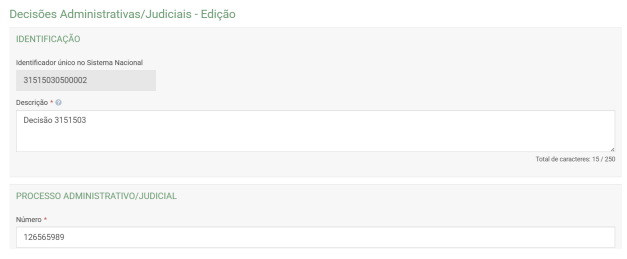
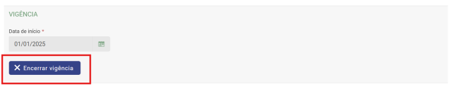
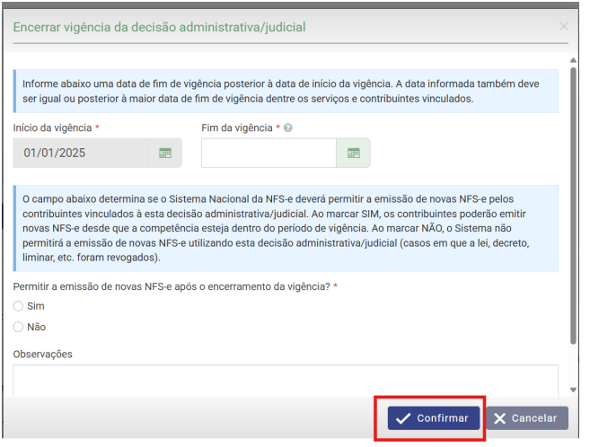
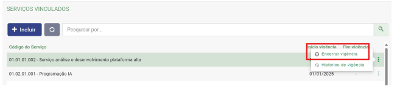
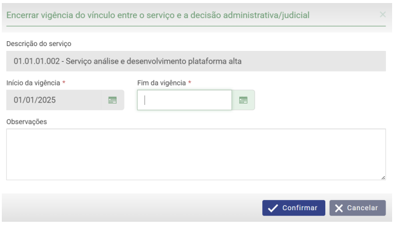
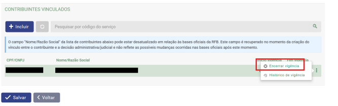
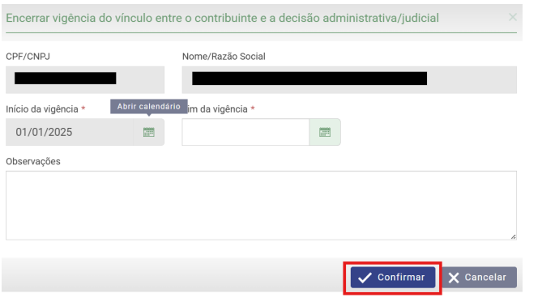

# 3.10.1 Encerramento de data de vigência

Para editar as informações, inclusive para incluir uma data fim de vigência, deve-se clicar nos ícones conforme destacado em vermelho na figura anterior. Será aberta a tela abaixo, com todas as informações cadastradas anteriormente:

*Figura 130 – Tela com as informações de decisão cadastrada.*

Nesta mesma tela, temos a opção de encerrar a vigência da decisão:

*Figura 131 – Tela para encerramento de vigência.*

Após clicar em Encerrar vigência, será aberta a tela seguinte, para preenchimento da data de fim de vigência e da permissão para o contribuinte emitir novas NFS-e após o <!-- p.117 -->encerramento da vigência, desde que a competência esteja dentro do período de vigência informado. Após o preenchimento, clicar em confirmar para salvar as informações:

*Figura 132 – Informação da data de encerramento da vigência.*

É possível também encerrar a vigência dos serviços vinculados a decisão, conforme a tela abaixo:

*Figura 133 – Tela com para iniciar o encerramento de vigência de serviço vinculado a decisão.*

Após clicar em Encerrar vigência, será aberta a tela seguinte, onde deve-se informar a data fim da vigência do serviço escolhido:

<!-- p.118 -->

*Figura 134 – Inserção da data fim de vigência de serviço vinculado a decisão.*

Em relação aos contribuintes vinculados a decisão, também é possível encerrar a sua vigência individualmente, na mesma página onde são apresentadas as informações sobre a decisão, conforme a figura abaixo:

*Figura 135 – Tela com para iniciar o encerramento de vigência de contribuinte vinculado a decisão.*

Clicando em “Encerrar vigência”, será aberta a tela a seguir, onde deverá ser informada a data fim de vigência. O campo observações é opcional:

<!-- p.119 -->

*Figura 136 – Inserção da data fim da vigência de contribuinte vinculado a decisão.*
