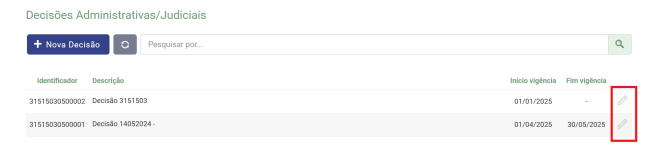
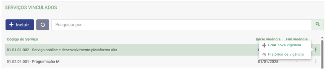
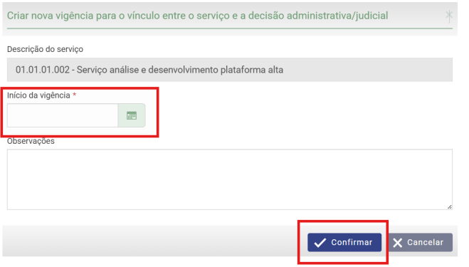
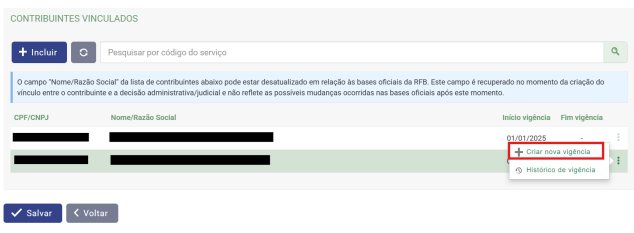
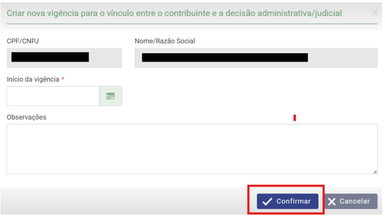

# 3.10.2 Criar nova vigência de serviço ou contribuinte

É possível ativar novamente tanto os serviços como os contribuintes vinculados a decisão. Nos parágrafos a seguir serão descritos os passos para conclusão da reativação. Primeiramente, deve-se escolher a decisão em que pretende alterar reativar a vigência do serviço ou contribuinte, clicando nos ícones destacados em vermelho, desde que a decisão não tem sido encerrada:

*Figura 137 – Escolha para criar nova vigência de serviço ou contribuinte.*

Neste exemplo, foi selecionado um serviço onde sua vigência foi encerrada, e agora iremos reativá-lo, clicando nos três pontos ao lado e em seguida criar nova vigência:

<!-- p.120 -->

*Figura 138 – Seleção de serviço para criar nova vigência.*

Na tela seguinte, deve-se informar a nova data de vigência, lembrando que a data de início da nova vigência deve ser superior à data de fim da última vigência do serviço selecionado:

*Figura 139 – Informação do início de vigência.*

Para criar nova vigência para contribuinte vinculado a decisão, a sistemática é similar ao que foi apresentada em relação aos serviços. Neste exemplo, foi selecionado um contribuinte onde sua vigência foi encerrada, e agora iremos reativá-lo, clicando nos três pontos ao lado e em seguida criar nova vigência:

<!-- p.121 -->

*Figura 140 – Seleção de contribuinte para nova vigência.*

Na tela seguinte, basta informar a nova data inicial de vigência, lembrando que a data de início da nova vigência deve ser superior à data de fim da última vigência informada:

*Figura 141 – Inserção da nova data de vigência.*
