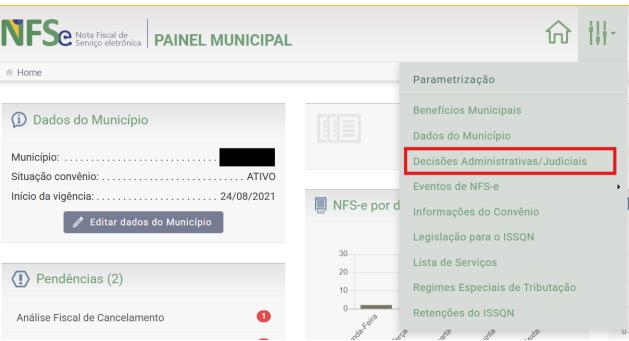
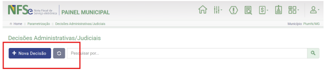
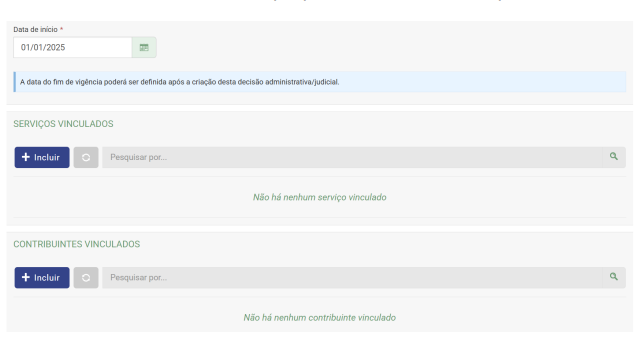
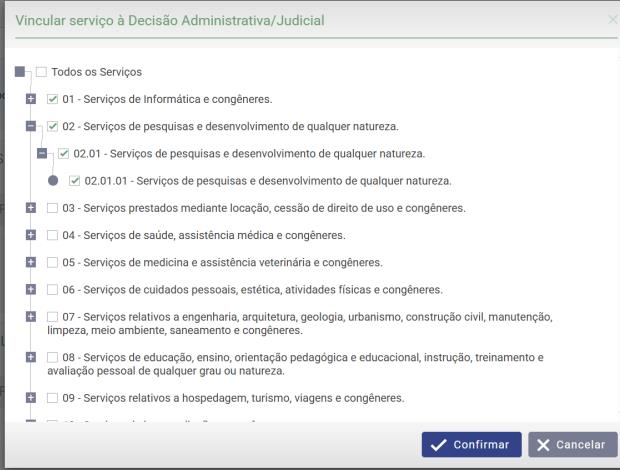
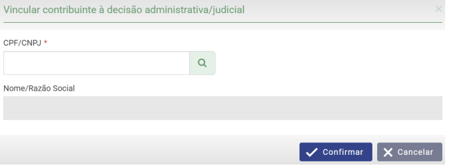
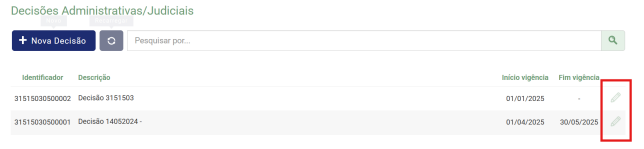

<!-- p.113 -->
# 3.10 Parametrização Decisões Administrativas / Judiciais

Foi criado um módulo com o objetivo de tratar um novo fluxo de emissão de documentos na Sefin Nacional que permita a geração de notas sem a aplicação de algumas regras de validação conforme consta no ANEXO_I-SEFIN_ADN-DPS_NFSe-SNNFSe na planilha RN_DPS_NFS-e coluna “L”. Esta funcionalidade foi pensada para tratar as decisões administrativas ou judiciais, que em muitos casos demandam a não validação de determinadas regras para atender a decisão exarada. A ATM poderá incluir decisões administrativas / judiciais através do menu “Parametrização -> Decisões Administrativas / Judiciais” e logo em seguida em “Nova Decisão”, conforme as figuras abaixo:

*Figura 124 – Emissão de NFS-e com decisão administrativa ou judicial.*

*Figura 125 – Inclusão de nova decisão.*

Na tela seguinte, deve-se incluir as seguintes informações: identificação (descrição), Processo Administrativo/Judicial (número e descrição), vigência (data de início) e escolher os <!-- p.114 -->serviços e contribuintes vinculados. Para escolher os serviços e contribuintes vinculados, deve-se informar primeiramente uma data de início de vigência:

*Figura 126 – Inserção de serviços e contribuintes vinculados.*

Para vincular os serviços a decisão cadastrada, clicar no botão Incluir onde será mostrada a seguinte tela, onde será possível marcar os serviços vinculados a decisão:

<!-- p.115 -->

*Figura 127 – Escolha de serviços vinculados.*

Para inclusão do contribuinte, basta clicar em Incluir e informar na tela seguinte informar o CPF ou CNPJ:

*Figura 128 – Inserção de contribuinte vinculado.*

É possível incluir vários contribuintes, repetindo o passo anterior. Após a inclusão das informações, deve-se clicar em Salvar. Após salvar as informações, será apresentada a lista de decisões administrativas / judiciais cadastradas:

<!-- p.116 -->

*Figura 129 – Lista com as decisões cadastradas pelo município.*
