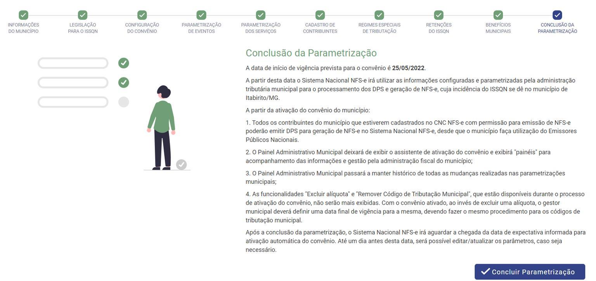
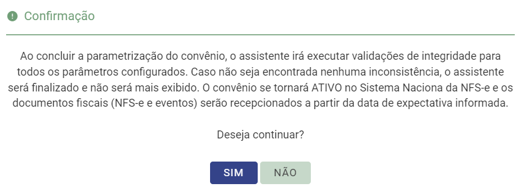
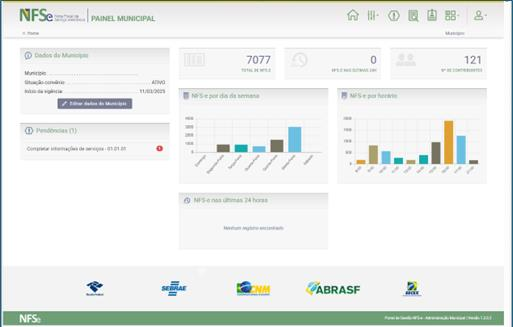

<!-- p.122 -->
# 3.11 Conclusão da Parametrização

## “Ativação” do Município no Sistema Nacional NFS-e

Concluída todas as parametrizações obrigatórias que o município deve realizar antes que possa estar plenamente ativo no Sistema Nacional NFS-e, o sistema disponibiliza o comando para que o gestor municipal possa acionar e ativar o município no sistema nacional, ou seja, a partir desta ativação, a emissão de qualquer NFS-e, emitida através dos emissores públicos nacionais, que necessite de alguma informação que seja parametrizável pelo município, poderá ser validada com esta informação parametrizada no município ativado.

*Figura 142 – Passo de conclusão da parametrização.*

Os contribuintes do município ativado no sistema nacional, se emitirem NFS-e utilizando os emissores públicos nacionais terão otimizados os preenchimentos e cálculos dos valores, além de maior controle nas informações prestadas pois o sistema está automatizado para otimizar o preenchimento da declaração de prestação de serviço e emissão da NFS-e com maior precisão, já que as informações preenchidas são validadas com as parametrizações.

A partir da ativação do convênio do município:

<!-- p.123 -->
1. Todos os contribuintes do município que estiverem cadastrados no CNC NFS-e com permissão para emissão de NFS-e poderão emitir DPS para geração de NFS-e no Sistema Nacional NFS-e, desde que o município faça utilização do Emissores Públicos Nacionais.
2. O Painel Administrativo Municipal deixará de exibir o assistente de ativação do convênio e exibirá "painéis" para acompanhamento das informações e gestão pela administração fiscal do município;
3. O Painel Administrativo Municipal passará a manter histórico de todas as mudanças realizadas nas parametrizações municipais;
4. As funcionalidades "Excluir alíquota" e "Remover Código de Tributação Municipal", que estão disponíveis durante o processo de ativação do convênio, não serão mais exibidas. Com o convênio ativado, ao invés de excluir uma alíquota, o gestor municipal deverá definir uma data final de vigência para ela, devendo fazer o mesmo procedimento para os códigos de tributação municipal.

Após a conclusão da parametrização, o Sistema Nacional NFS-e irá aguardar a chegada da data de expectativa informada para ativação automática do convênio. Até um dia antes desta data, será possível editar/atualizar os parâmetros, caso seja necessário.

A data de expectativa para o início de vigência deste convênio é inferior à data atual. Para conclusão da parametrização, esta data deve ser igual ou superior à data atual. Entre em contato com o Comitê Gestor do Sistema Nacional NFS-e para solicitar a alteração desta data de expectativa para início de vigência do convênio.

Ao selecionar o botão “Concluir Parametrização” o Sistema NFS-e exibe um aviso sobre a conclusão da parametrização e as consequências desse passo.

*Figura 143 - Aviso sobre as consequências da conclusão da parametrização e a ativação do convênio.*

<!-- p.124 -->
> **Atenção:** Enquanto a data da expectativa de ativação do convênio não chegar, será possível alterar as parametrizações. Nesse cenário, ao buscar editar as parametrizações antes da ativação, o sistema retoma o status de “pré-ativação”, ou seja, abre-se novamente o assistente de ativação com todos os parâmetros cadastrados, que podem ser alterados (e, até excluídos). Após eventual edição, deve ser repetido o passo final para efetivar a ativação.

Depois da ativação, os parâmetros continuam editáveis, porém, com controle de início e encerramento de vigência próprios.

Após a parametrização, ao entrar no painel municipal, será exibida a tela inicial com um resumo das informações do município.

*Figura 144 - Página inicial do Painel Administrativo Municipal após a ativação do convênio.*
