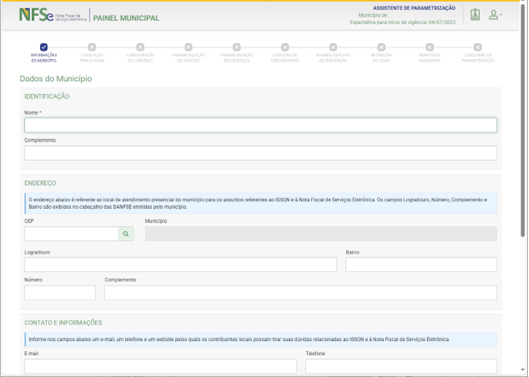
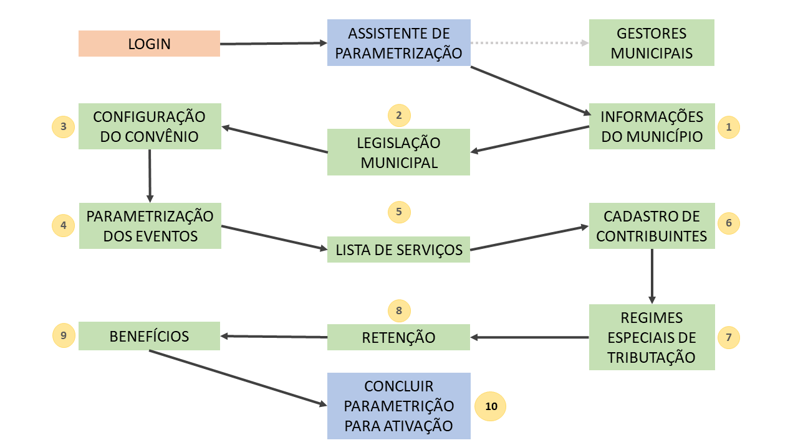
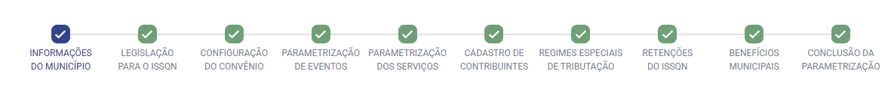
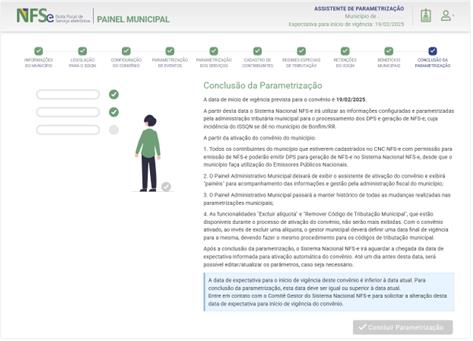

<!-- p.24 -->
# 3. Primeira Etapa – Definição das Parametrizações e Ativação do Município

O gestor do município recém conveniado e cadastrado no Sistema Nacional NFS-e deve acessar o Painel Administrativo Municipal NFS-e, realizar a parametrização do município no sistema nacional e acionar o comando de conclusão da parametrização. A ativação somente é possível se o Gestor Municipal competente para esta tarefa informar todos os parâmetros exigidos pelo painel municipal. O próprio sistema realiza o controle do que é obrigatório parametrizar e o que é opcional.

A parametrização contém informações que fazem parte da legislação tributária municipal referente ao ISSQN instituído no município, conforme dito anteriormente, que são minimamente necessárias para a ativação do convênio de um município no Sistema Nacional NFS-e. Uma vez ativo, é possível ao Sistema Nacional NFS-e realizar as validações necessárias à DPS e gerar a NFS-e adequadamente de forma padronizada e consistente com as regras das legislações federais e municipais, de forma a automatizar a utilização do sistema para os contribuintes ao mesmo tempo que atribui corretude e integridade às informações dos documentos fiscais.

O controle de preenchimento dos parâmetros municipais no sistema nacional é realizado através do assistente de parametrização que é exibida enquanto o convênio municipal não estiver ativo e auxilia a administração municipal a identificar as pendências para a conclusão da parametrização. A exibição dos elementos que devem ser configurados/parametrizados e sua respectiva situação atual permite ao gestor municipal identificar itens pendentes de parametrização. Ao clicar sobre esses elementos o sistema redireciona para a respectiva tela onde se poderá realizar as devidas parametrizações.

---

A realização dos itens de parametrização obrigatórios no Painel Administrativo Nacional NFS-e é exigida para todos os municípios conveniados ao Sistema Nacional NFS-e, independentemente do tipo ou opções de uso de módulos do sistema nacional, informados na configuração de seu convênio.

---

Na primeira entrada no Painel com o certificado digital, dar-se-á início ao Assistente de Parametrização do Sistema Nacional da NFS-e deve-se clicar em **Continuar Parametrização**.

<!-- p.25 -->

*Figura 14 – Página inicial do Painel Municipal antes da parametrização.*

O painel exibirá a primeira tela para a inclusão dos Informações do Município, também é possível ver um menu com todas as parametrizações a serem feitas.

*Figura 15 – Página inicial da parametrização.*

<!-- p.26 -->
O comando para "Concluir Parametrização" será habilitado somente quando não houver nenhuma pendência em todos os elementos, exceto os não obrigatórios, que serão explicitados mais adiante neste manual.

As situações que os itens de parametrização podem assumir, são:

1. Não há pendências;
2. Existem pendências;
3. Informações não obrigatórias;
4. Elemento bloqueado (depende do preenchimento de algum item);

Ao longo da parametrização, o painel exibirá todos os parâmetros que serão necessários para a finalização da parametrização.

Abaixo segue uma figura ilustrativa dos passos e suas respectivas ordenações no Fluxo de Parametrização Inicial do Painel Administrativo Municipal.

*Fluxo de Parametrização Inicial do Painel Administrativo Municipal.*

As situações de cada um dos itens de parametrização:

a) **Gestores Municipais** – Item de parametrização não obrigatório pois o Gestor Municipal Principal que já vem cadastrado do painel nacional possui todas as atribuições para executar todas as funcionalidades existentes no painel municipal realizando todas as parametrizações possíveis para o município. No entanto já neste momento inicial é possível cadastrar outros gestores municipais (auditores, parametrizadores e atendentes) para delegação de tarefas do município pertinentes à parametrização do município no Sistema Nacional NFS-e;

b) **Informações do Município** – Informações do município que são utilizadas quando da impressão da DANFSe (Documento Auxiliar de Nota Fiscal de Serviço Eletrônica);

c) **Legislação para o ISSQN** – Itens da legislação referente ao ISSQN que serão utilizados como informação obrigatória de todos os demais itens do painel municipal;

<!-- p.27 -->
d) **Configuração do Convênio** – Verifica se as informações obrigatórias para a configuração do convênio foram preenchidas;

e) **Parametrização de Eventos** – Parametrização relativa aos Eventos de NFS-e, Eventos do MAN e outros que necessitarem de parametrização de acordo com a legislação municipal.

f) **Cancelamento de NFS-e** – Verifica se as informações obrigatórias para o evento de cancelamento de NFS-e do município foram preenchidas;

g) **Substituição de NFS-e** – Verifica se as informações obrigatórias para a substituição de NFS-e do município foram preenchidas;

h) **Parametrização dos Serviços** – A lista de Serviços Nacional deve ser administrada nos subitens que estão definidos ou em códigos de serviços municipais de parametrização opcional, somente para casos em que o município possua códigos de serviços próprios em sua legislação municipal, pois o município pode estar aderente à lista de serviço nacional, que é a lista de serviço mínima e comum para todos os municípios. Para cada código de serviço administrado deverá ser atribuído alíquota e as informações de Dedução/Redução.

i) **Cadastro de Contribuintes** – Depende da configuração do convênio para ser obrigatório informar ao menos um contribuinte do município ou se é um item de parametrização municipal opcional;

j) **Regimes Especiais de Tributação** – Verifica se para cada serviço existente no município foram definidas as regras para cada um dos regimes especiais de tributação disponíveis na legislação do município;

k) **Retenções do ISSQN** – Verifica se os critérios para possibilidade de retenções do valor de ISSQN para recolhimento pelo tomador ou intermediário foram preenchidas. Critérios específicos do município para ocorrência da retenção do ISSQN podem não vigorar na legislação municipal e, portanto, este município segue os critérios para retenção descritos nos incisos do Art 6º, § 2o da Lei Complementar 116/2003;

l) **Benefícios Municipais** – Verifica se os critérios para possibilidade de benefícios municipais configuram pelo menos uma redução de base de cálculo, isenção ou alíquota diferenciadas para serviços baseados nas leis municipais relativos ao cálculo do ISSQN devido. Assim como as retenções do imposto, critérios específicos do município para ocorrência de benefício municipal podem não vigorar na legislação municipal. Por isso, a parametrização de benefícios municipais é opcional.

O Painel exibe um menu com todos os parâmetros disponíveis, deve-se acessar cada um deles e preencher conforme indicado neste Guia.

<!-- p.28 -->
O comando para "Concluir Parametrização" será habilitado somente quando não houver nenhuma pendência em todos os elementos, exceto os não obrigatórios, que serão explicitados mais adiante neste manual.

*Figura 16 – Página final da parametrização.*
