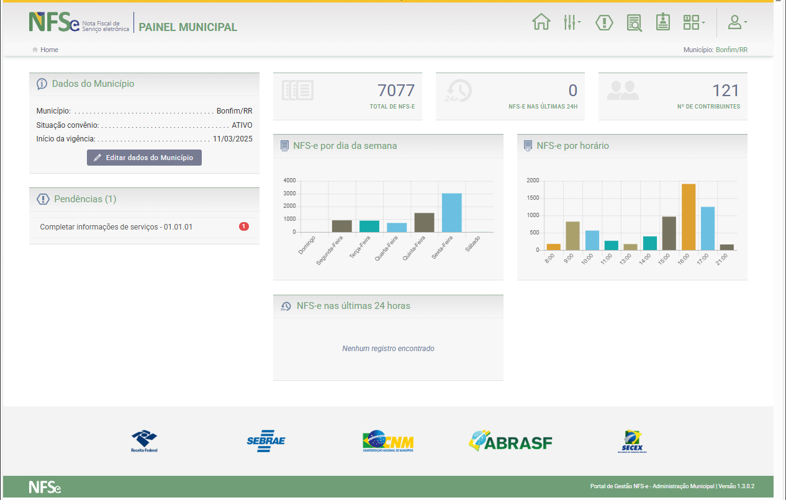

# 5.1 Página Inicial

Após ativado o convênio, o Painel Administrativo Municipal passará a exibir na página inicial, além do Menu principal, algumas informações gerenciais relevantes, como a quantidade de pendências na fila para análise, a quantidade de NFS-e emitidas por dia da semana e por horário, as NFS-e emitidas nas últimas 24 horas, entre outras informações.

Após a ativação qualquer mudança de valores dos parâmetros é considerada uma alteração “controlada” e é registrada no histórico de alterações dos parâmetros com as datas inicial e final de vigência, pois a emissão de documentos fiscais é afetada pelo período de vigência conforme a data de competência da DPS (da qual irá ser gerada a NFS-e).

*Figura 145 – Página inicial do Painel Administrativo Municipal após a ativação do convênio.*
