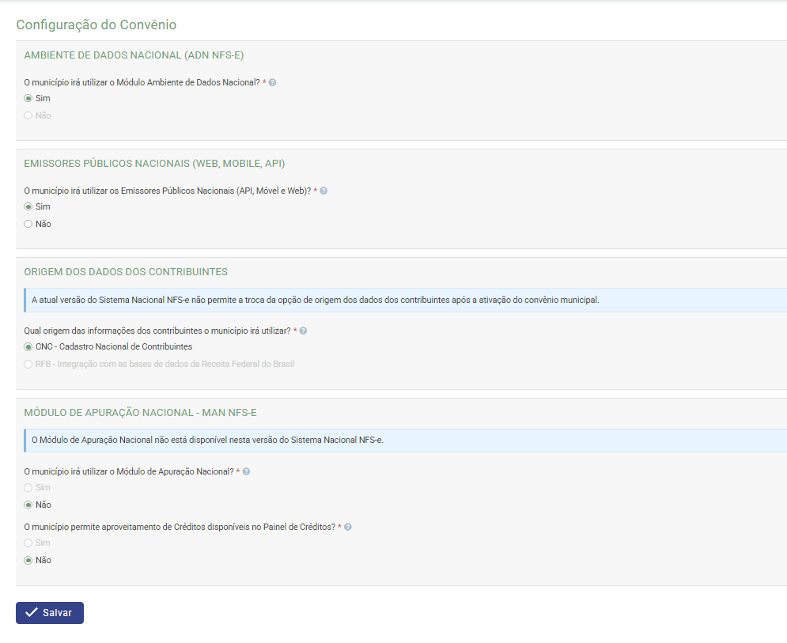

<!-- p.128 -->

# 5.2.1 Informações do Convênio

Ao acessar o menu “Parametrização” – “Dados do Município” é possível verificar a parametrização feita na etapa inicial de parametrização. Algumas informações são possíveis de serem editadas.

*Figura 147 – Seleção das “Informações do Convênio”.*

*Figura 148 – Tela de Configuração do Convênio.*
