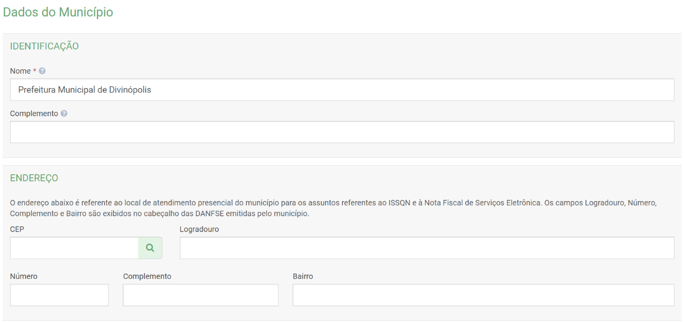
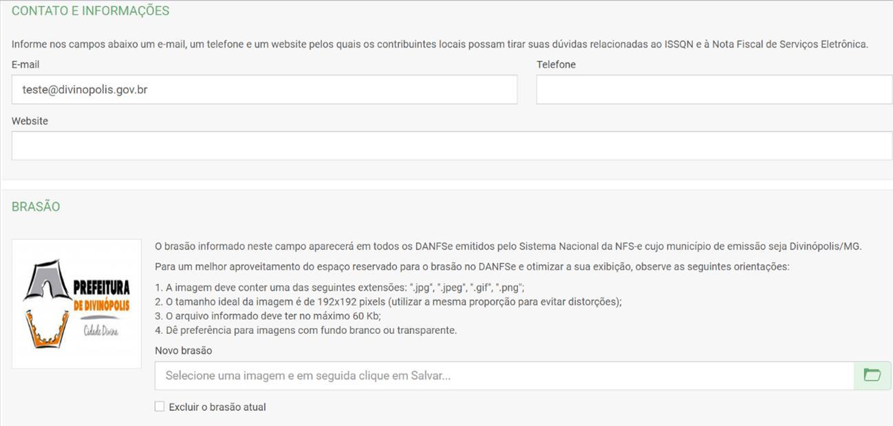
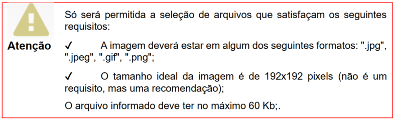

<!-- p.129 -->

# 5.2.2 Dados do Município

Ao acessar o Menu “Parametrização” ou selecionar o botão “Editar dados do Município” no painel Municipal o sistema será redirecionado para a página que contém as informações básicas relativas ao município em questão. De maneira geral, as informações editadas nesta página serão exibidas nas NFS-e emitidas na sua jurisdição.

*Figura 149 – Painel inicial com destaque para Editar os dados do Município.*

*Figura 150 – Parametrização dos dados do Município.*

<!-- p.130 -->

*Figura 151 – Dados básicos relativos ao município, a serem exibidos na NFS-e.*

- **Nome:** este campo é exibido no cabeçalho do DANFS-e, para identificação do município. O tamanho máximo que pode assumir é de 56 caracteres e normalmente é preenchido com “Prefeitura Municipal de XXX”;
- **Complemento:** neste campo, pode ser inserido para exibição no DANFS-e o nome do departamento responsável pela administração do ISSQN no município. O tamanho máximo que pode assumir é de 32 caracteres;
- **Endereço:** caso seja interesse da ATM, o endereço para atendimentos relativos ao ISSQN e à NFS-e no Município poderá ser informado e exibido no DANFS-e. Neste caso, a ATM deverá preencher os campos relativos ao endereço: CEP, logradouro, número, complemento e bairro;
- **Contato e informações:** poderão ser inseridos os dados relativos ao e-mail institucional, ao telefone e ao website que são disponibilizados aos contribuintes para entrarem em contato com a ATM para tirar dúvidas quanto ao ISSQN e à NFS-e;
- **Brasão:** caso deseje, a ATM poderá inserir o brasão da prefeitura para exibição no DANFS-e. Para isso deverá selecionar a imagem do brasão através tela exibida quando da seleção do ícone.

<!-- p.131 -->

*Figura 152 – Informações de contato e inserção do brasão da prefeitura no sistema.*

Caso a ATM deseje apenas excluir o brasão atual, deverá selecionar a caixa “Excluir o brasão atual”.

Uma vez realizadas todas as alterações, o botão “Salvar” disponibilizado ao final da página deverá ser selecionado. Será então exibida uma mensagem de confirmação das alterações e a página é atualizada.

*Figura 153 – Confirmação da atualização das informações.*
