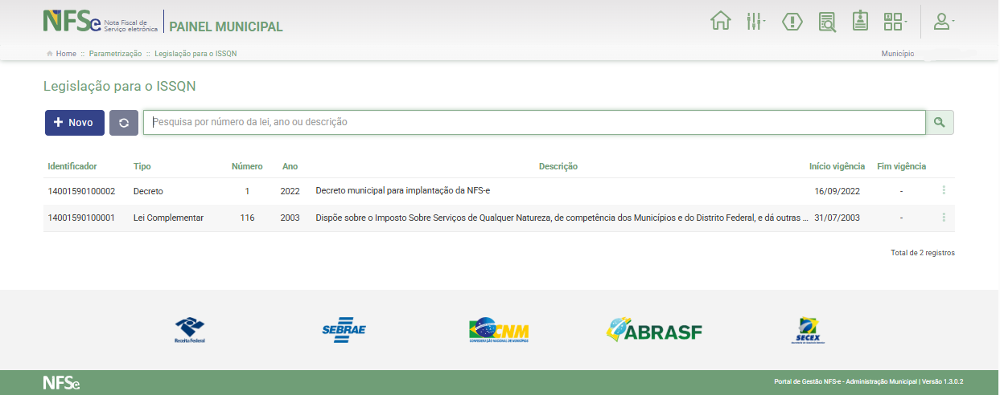
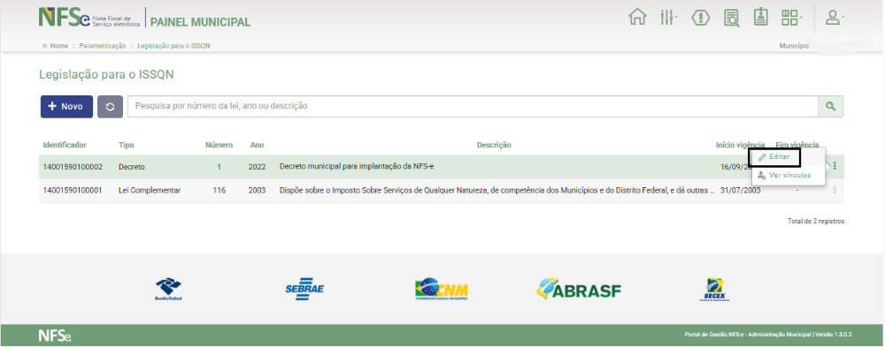
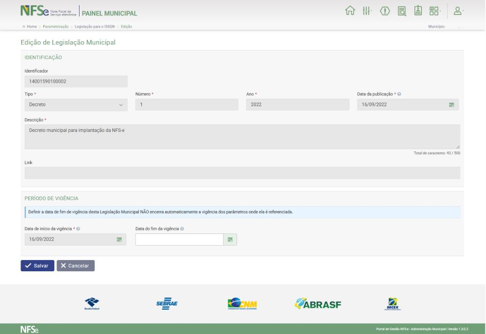
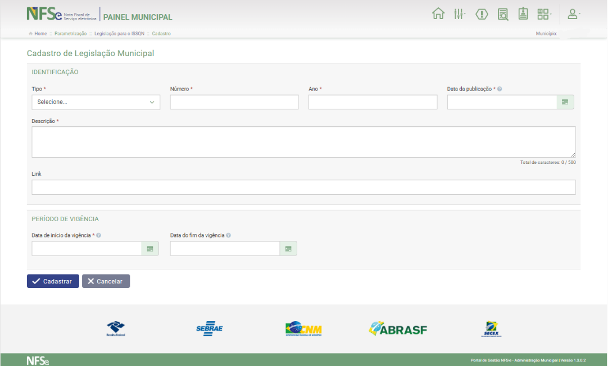

# 5.2.3 Alterações da “Legislação para o ISSQN”

Ao clicar na opção “Legislação para o ISSQN” abrirá uma janela onde será possível, consultar, editar e ver vínculos de uma legislação já cadastrada ou cadastrar uma nova.

<!-- p.132 -->

*Figura 154 – Seleção da alteração da Legislação no botão Parametrização.*

## 5.2.3.1.1 Consultar Legislação

Exibe uma tabela paginada com a relação de toda a legislação já cadastrada com opção [ícone] para incluir nova legislação, pesquisar legislação pelo número da lei, ano ou descrição conforme figura abaixo:

*Figura 155 – Tela inicial da Legislação ISSQN.*

<!-- p.133 -->

## 5.2.3.1.2 Alterar Informações da Legislação

Não é possível alterar informações sobre uma legislação já cadastrada. Para alterar a legislação, deve-se incluir uma data com o fim da vigência de uma e cadastrar uma nova.

## 5.2.3.1.3 Encerrar vigência da Legislação

Para informar a “Data do fim da vigência”, deve-se usar a janela de edição que abrirá clicando nos 3 pontos ao final da linha da referida legislação.

*Figura 156 – Opção “editar” na tela inicial da Legislação ISSQN.*

Abrirá a janela para edição, ara inclusão da data do fim de vigência. Deve-se incluir a data e clicar em [botão].

*Figura 157 – Tela edição de Legislação Municipal.*

<!-- p.134 -->

## 5.2.3.1.4 Incluir Legislação

Ao clicar no botão [ícone] será apresentada uma janela para a inserção das informações (Tipo, Número, Ano, Data da publicação, Descrição, Link e o período de vigência). Preencher todas as informações e clicar em [botão]. Mais informações ver no item 3.2. deste manual.

*Figura 158 – Opção “Novo” na tela inicial da Legislação ISSQN.*

*Figura 159 – Tela de Cadastro de Legislação Municipal.*
