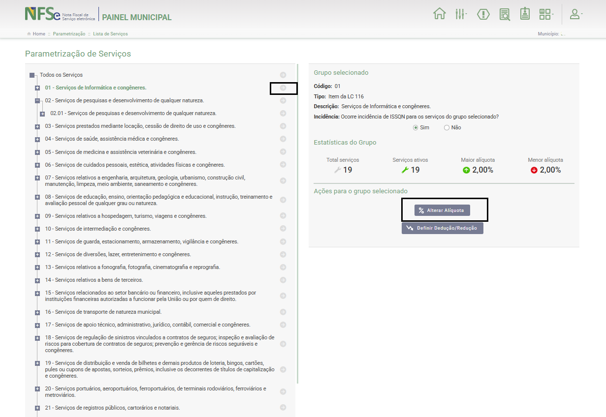
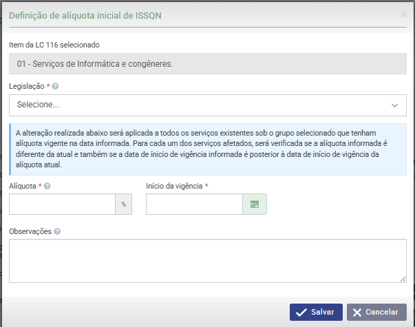
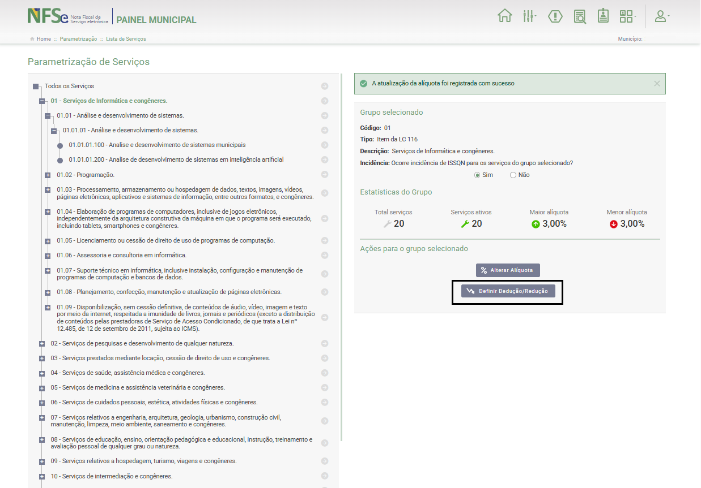
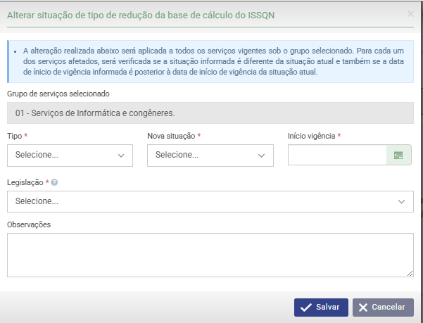

# 5.2.4 Alterações da “Lista de Serviços”

Ao clicar na opção “Lista de Serviços” abrirá a janela de parametrização de Serviços com a lista de serviços cadastrados pelo Município na primeira etapa.

<!-- p.135 -->

*Figura 160 – Seleção da alteração da Legislação no botão Parametrização.*

Como cadastrar novos serviços ou editar os serviços constantes estão contidos no item 3.5. deste Manual.

## 5.2.4.1 Alteração Alíquota

Para alterar uma alíquota, deve-se selecionar o serviço a ser editado e a janela para edição será mostrada do lado direito do painel.

O encerramento de vigência de alíquota poderá se dar pelo processo de Generalização ou Especialização.

Na Generalização a alteração da alíquota/vigência é feita através do item Pai ou subitem nacional:

A alteração irá expandir para todos os subitens, desdobros nacionais e códigos tributários municipais criados. Essa alteração só será possível se a nova data de vigência for maior que a data de vigência de todos os subitens/desdobros nacionais/códigos tributários municipais.

Deve-se considerar a convenção abaixo para melhor entendimento:

- AA – item Pai
- AA.BB – subitem
- AA.BB.CC – desdobro nacional
- AA.BB.CC.DDD – Código Tributário Municipal

<!-- p.136 -->

Na Especialização a alteração/encerramento é feita através do Código Tributário Municipal e o efeito será apenas nesse código.

Seja qual for o processo de alteração/encerramento, o gestor municipal deve excluir do serviço administrado qualquer parametrização de benefícios e/ou retenções. Para admitir um encerramento, o sistema realiza a rastreabilidade de cada serviço administrado pelo município, benefícios municipais ou retenções, para garantir que a alteração/encerramento não gere inconsistências.

*Figura 161 – Tela para edição da parametrização dos serviços.*

Clicar em [botão] e abrirá a janela para a inclusão da alíquota e início da vigência.

> Todo item Pai, subitem, desdobro nacional existente na lista de serviços, é obrigatório a existência de uma alíquota vigente. Portanto ao alterar uma alíquota a mesma estará em vigor a partir da nova data informada. A alíquota anterior terá como data de encerramento da vigência a nova data informada decrescida de um dia.
>
> A exceção se dá para os Códigos Tributários Nacionais que porventura tenham sido criados pelo Gerente Municipal e podem ter sua vigência encerrada a critério do Município. Os Códigos Tributários Municipais com vigência encerrada não poderão mais ser objeto de geração de uma nota fiscal.

<!-- p.137 -->

> Sempre a data de início de vigência do novo valor do parâmetro que se está alterando é futura, do dia seguinte à data atual em diante. Assim o sistema sempre inicia uma nova vigência de valores de parâmetros à 00h da data programada e encerra a vigência do valor do parâmetro que se está alterando às 23h59min59seg do dia anterior à data programada o início de vigência do novo valor do parâmetro.

*Figura 162 – Tela para definição de nova alíquota e data de vigência para um serviço.*

<!-- p.138 -->

## 5.2.4.2 Alteração Dedução/Redução

É possível fazer alterações nas deduções/reduções na janela mostrada a partir do botão [botão].

*Figura 163 – Tela para parametrização de serviços.*

*Figura 164 – Tela para alterar situação de tipo de redução de base de cálculo do ISSQN.*
