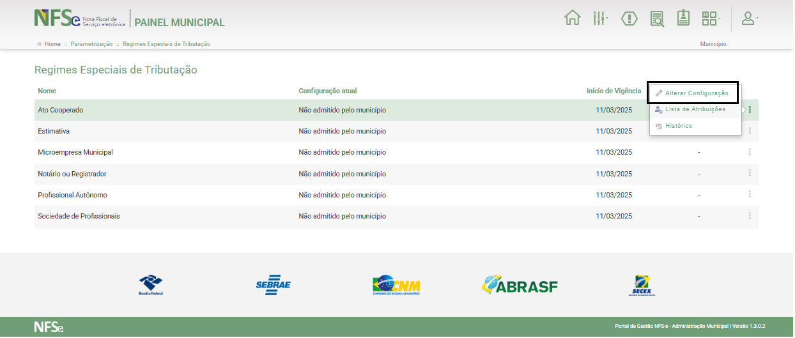
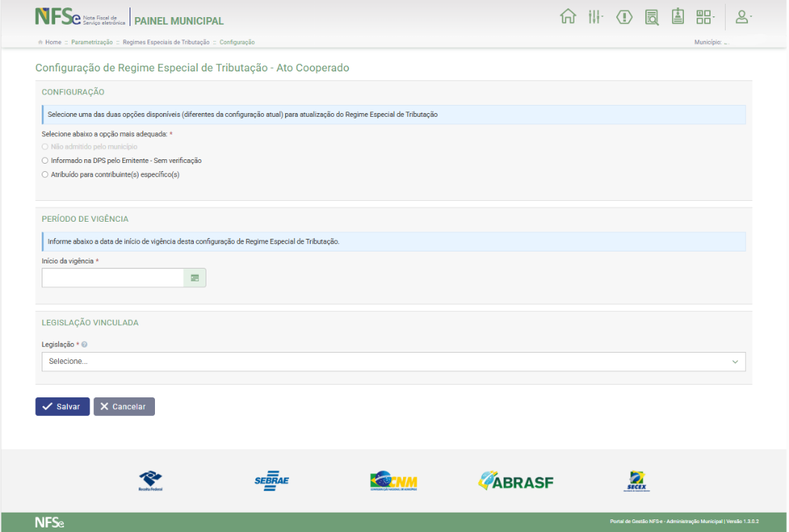

<!-- p.139 -->

# 5.2.5 Alteração Regime Especial de Tributação

*Figura 165 – Menu Regimes Especiais de Tributação.*

É possível editar a configuração dos campos envolvidos do Regime Especial de Tributação clicando em [botão] conforme figura abaixo:

*Figura 166 – Regimes Especiais de Tributação.*

Preencher os campos da janela abaixo e clicar em [botão].

<!-- p.140 -->

*Figura 167 – Configuração de Regimes Especiais de Tributação – Ato Cooperado.*
