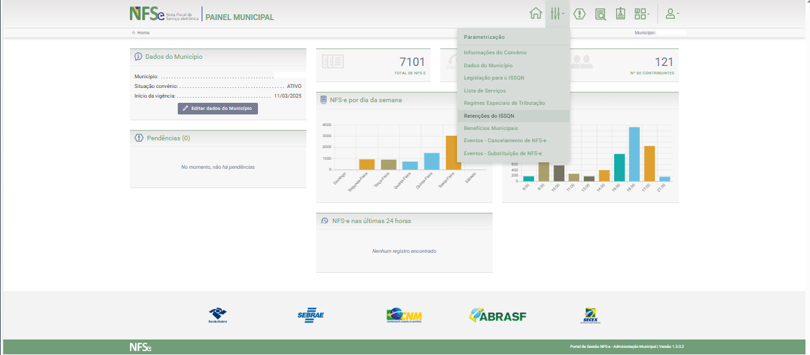
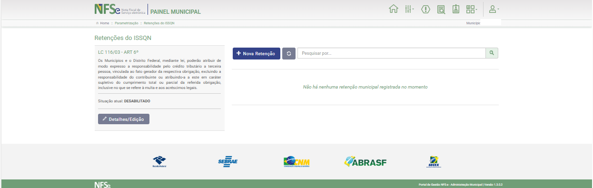

# 5.2.6 Editar Retenções do ISSQN

*Figura 168 – Menu Retenções do ISSQN.*

É possível cadastrar retenções de ISSQN ou editar outras feitas anteriormente:

<!-- p.141 -->

*Figura 169 – Configuração de Retenções do ISSQN.*

*Figura 170 – Configuração de Retenções do ISSQN.*
