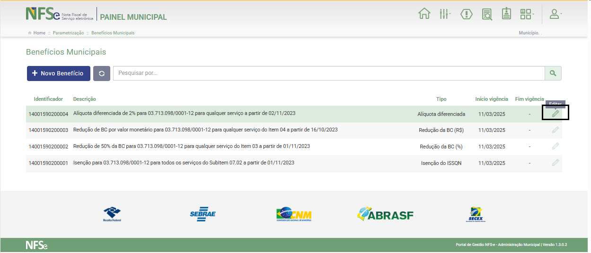
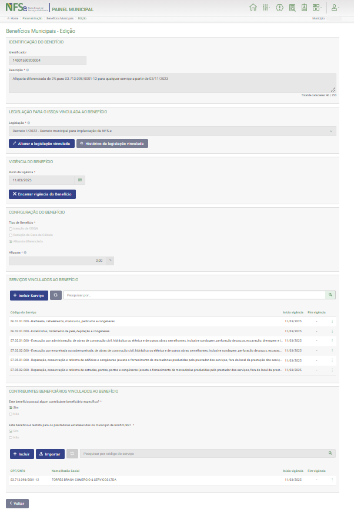

# 5.2.7 Edição de Benefícios Municipais

*Figura 171 – Menu Benefícios Municipais.*

Nesta funcionalidade é possível alterar a legislação, encerrar a vigência do benefício a partir de uma data, incluir serviço e incluir contribuintes a serem beneficiados em algum benefício fiscal, deve-se clicar, no menu principal, em Benefícios Fiscais, conforme figura abaixo.

Então, clicar no final da linha do benefício que ser quer editar.

<!-- p.142 -->

*Figura 172 – Tela com os Benefícios Municipais cadastrados.*

É possível alterar a legislação, encerrar a vigência do benefício a partir de uma data, incluir serviço e incluir contribuintes a serem beneficiados.

<!-- p.143 -->

*Figura 173 – Benefícios Municipais – edição.*
