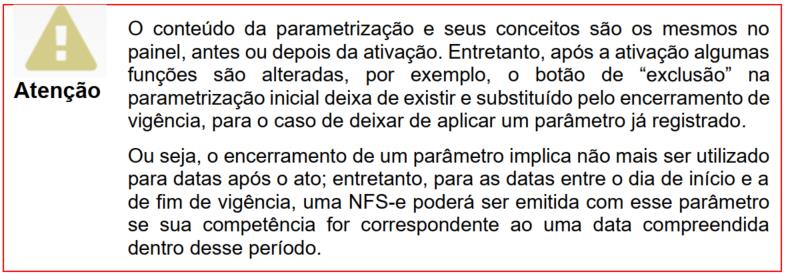

# 5.2 Parametrização

A partir desse momento todas as configurações disponibilizadas quando da ativação do convênio poderão ser revistas, acessando o menu no canto superior direito da página.

Cada item do menu é detalhado neste manual.

<!-- p.127 -->

Muitos parâmetros cadastrados na etapa 1 podem ser editados, no entanto, para alguns deles isto não será possível.

Acessando o botão [ícone] a parametrização municipal poderá ser alterada, respeitando as regras para a implantação das mudanças realizadas.

Todas as configurações da parametrização foram abordadas no item 3 deste manual.

*Figura 146 – Seleção da Parametrização municipal no menu.*
