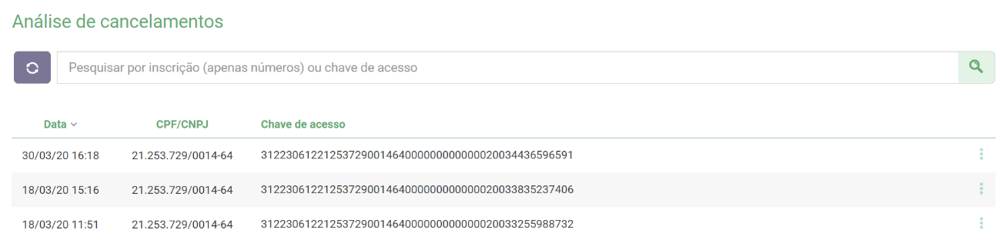
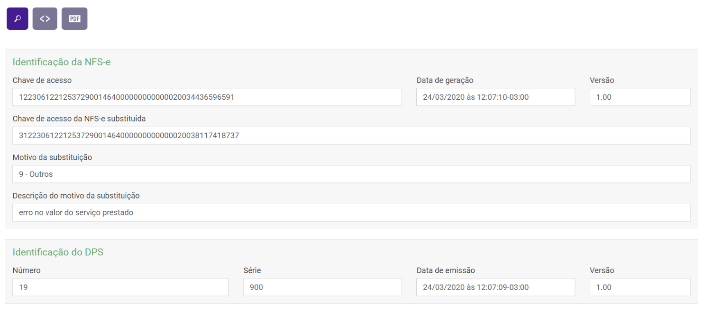
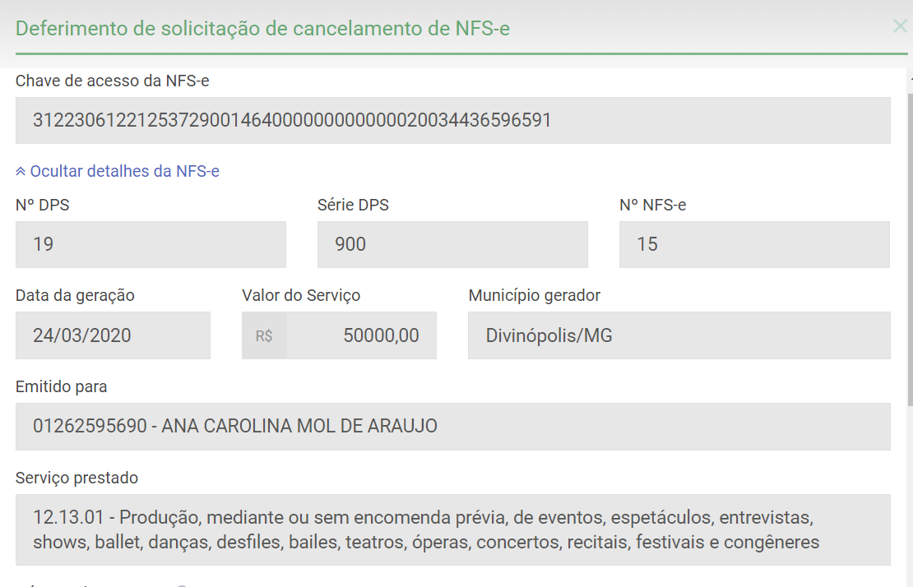
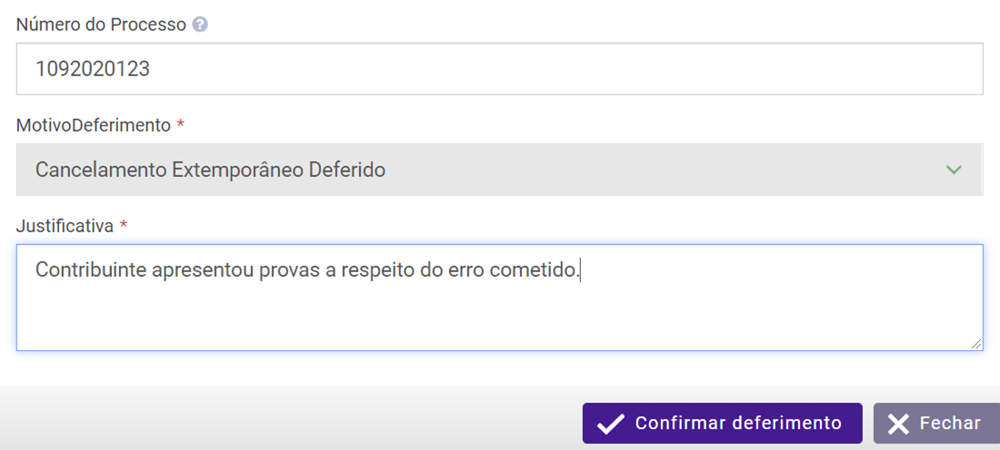
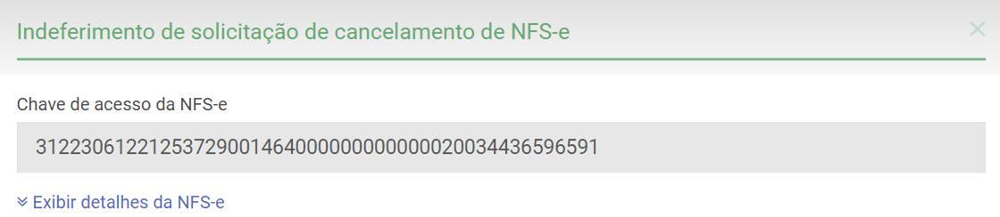
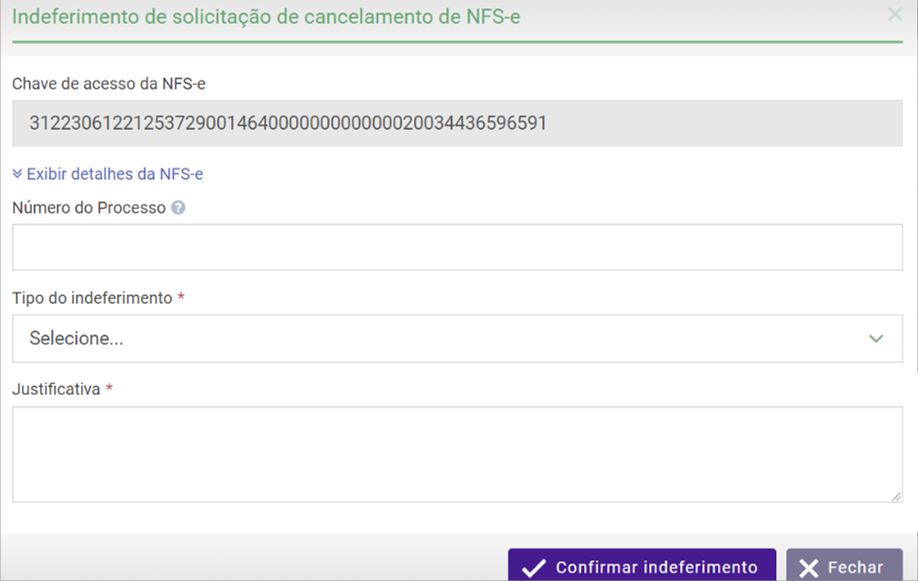

# 5.3 Verificar Pendências

Em situações não admitidas pela ATM para o cancelamento automático da NFS-e Nacional (de acordo com o item 15 deste manual), os contribuintes podem solicitar a análise fiscal.

Esta funcionalidade exibe para o gestor municipal uma lista de Eventos de Solicitação de Cancelamento de NFS-e por Análise Fiscal emitidos por seus contribuintes que precisam ser analisados para que o fisco possa deferir ou indeferir o cancelamento de NFS-e solicitado.

Por exemplo, não há possibilidade de o fisco realizar os dois eventos para a mesma solicitação de cancelamento de uma NFS-e.

A ação de deferir ou indeferir as solicitações gera, respectivamente, os eventos de Cancelamento de NFS-e Deferido por Análise Fiscal e o Cancelamento de NFS-e Indeferido por Análise Fiscal. Estas ações de deferimento ou indeferimento geram os respectivos arquivos XML, conforme leiaute definido no anexo II e, que serão processados, armazenados e vinculas à NFS-e correspondente.

Esta solicitação fica disponível para a ATM através do Painel Administrativo Municipal, no ícone [ícone].

*Figura 174 – Lista de pendências de análise fiscal.*

Aparecerão na tela todas as solicitações de cancelamento pendentes de análise pela ATM.

Para analisar uma solicitação, a ATM deverá acessar o ícone [ícone] na mesma linha da solicitação.

<!-- p.145 -->

Serão então exibidas três opções:

*Figura 175 – Opções para análise da pendência pela ATM.*

- **Visualizar NFS-e:** nesta opção, a ATM terá acesso a todas as informações da NFS-e a ser analisada, bem como o motivo alegado pelo contribuinte para a solicitação do cancelamento do documento fiscal;

*Figura 176 – Tela de visualização de algumas informações da NFS-e a ser analisada.*

Nesta opção do menu, a ATM poderá apenas visualizar, realizar o download do xml e do DANFS-e, mas não poderá deferir/indeferir a solicitação. Para isso, deve retornar à página de pendências e selecionar o item do menu que desejar: “Deferir solicitação” ou “Indeferir solicitação”.

- **Deferir solicitação:** ao selecionar essa opção, uma nova tela será exibida e algumas informações básicas da NFS-e poderão ser exibidas através da opção “Exibir detalhes da NFS-e”, para que sejam reduzidas as possibilidades de erro por parte da ATM.

<!-- p.146 -->

*Figura 177 – As informações básicas são exibidas na tela para conferência.*

Para que haja o deferimento da solicitação, a ATM poderá inserir em campo próprio (caso exista) o número do processo administrativo municipal vinculado à solicitação de cancelamento da NFS-e.

Os demais campos são de preenchimento obrigatório pela ATM e deverão demonstrar os motivos pelos quais a ATM decidiu por acatar o pedido do contribuinte.

*Figura 178 – Informações a serem inseridas sobre o deferimento do cancelamento.*

Uma vez inseridas todas as informações, a ATM deverá confirmar o deferimento da solicitação.

<!-- p.147 -->

Será então exibida uma mensagem de confirmação do deferimento.

- **Indeferir solicitação:** ao selecionar essa opção, assim como ocorre para o deferimento, uma nova tela será exibida e algumas informações básicas da NFS-e poderão ser exibidas através da opção “Exibir detalhes da NFS-e”, para que sejam reduzidas as possibilidades de erro por parte da ATM.

*Figura 179 – Possibilidade de exibição de informações básicas da NFSe para conferência antes do indeferimento da solicitação.*

*Figura 180 – Campos a serem preenchidos para o indeferimento da solicitação de cancelamento.*

Para o indeferimento da solicitação, a ATM poderá inserir em campo próprio (caso exista) o número do processo administrativo municipal vinculado à solicitação de cancelamento da NFS-e.

No campo “Tipo do indeferimento” a ATM deverá selecionar entre “Cancelamento extemporâneo indeferido” e “Cancelamento extemporâneo indeferido sem análise de mérito”.

<!-- p.148 -->

Em seguida, a justificativa para o indeferimento deverá ser incluída em campo próprio, para que o contribuinte saiba as razões que levaram ao não cancelamento do documento fiscal.

Será então exibida uma mensagem de confirmação do indeferimento.
