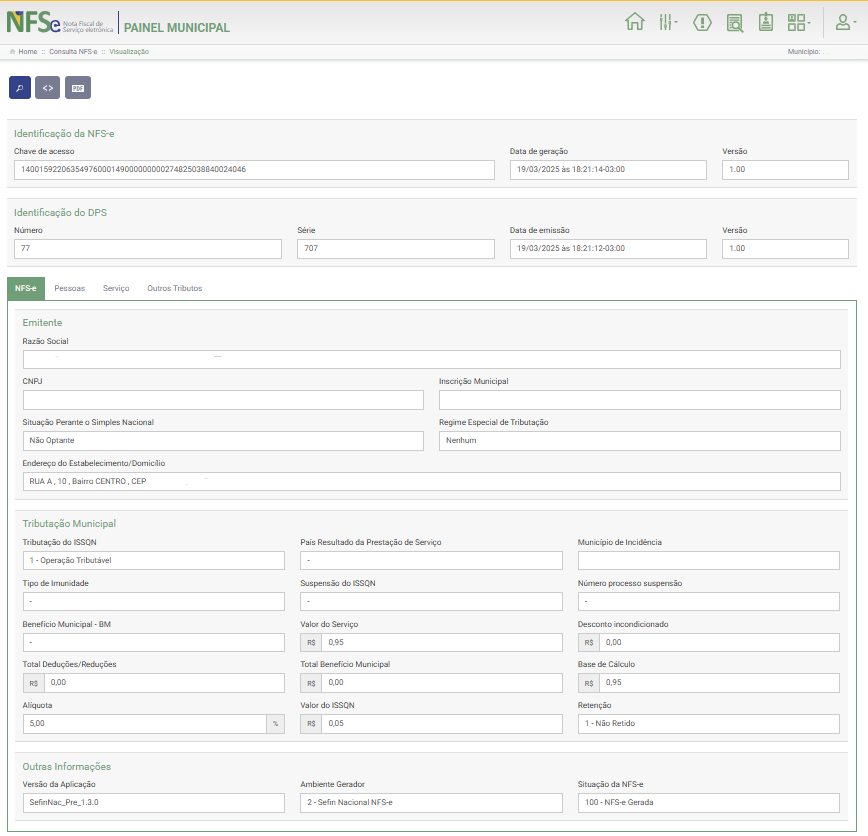
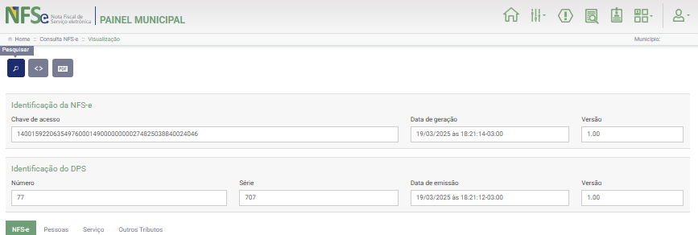
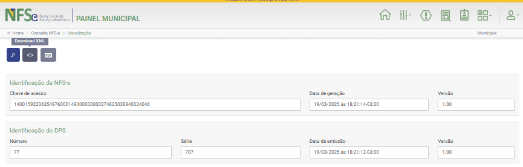
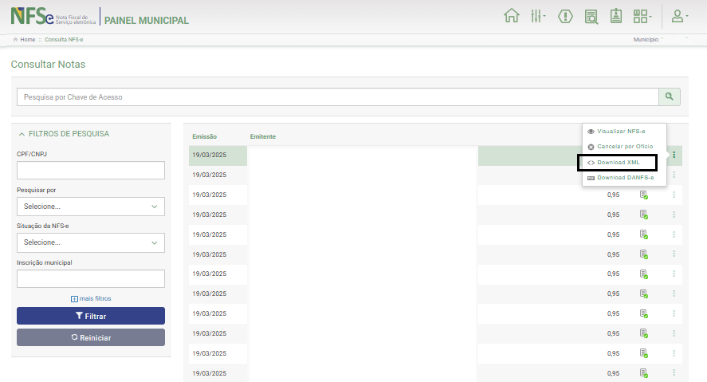
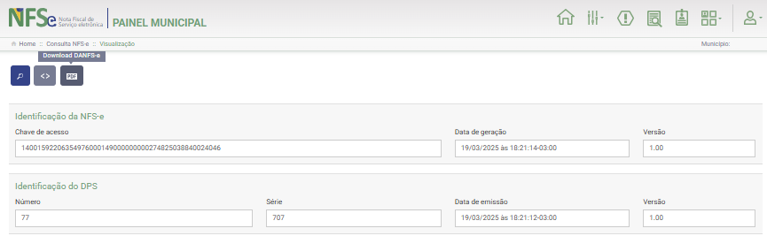
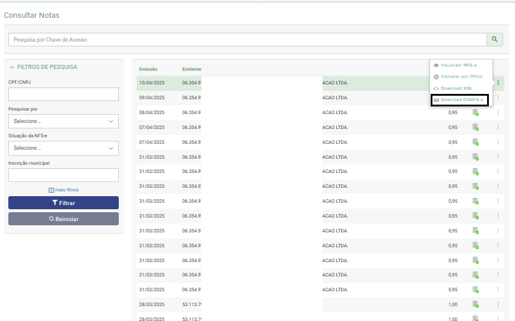

# 5.4.1 Visualizar NFS-e e Eventos Vinculados

<!-- p.151 -->

*Figura 186 – Tela com dados sobre uma NFS-e.*

Na tela de Visualização da NFS-e existem 3 opções [ícones] (Pesquisar, Download xml da NFS-e e Download PDF da DANFS-e).

**a) Pesquisar:**

Ao clicar no ícone [ícone] “pesquisar”, o sistema retorna à página anterior para realizar uma nova pesquisa.

*Figura 187 – Opção pesquisar.*

<!-- p.152 -->

**b) Download XML:**

Ao clicar no ícone [ícone] “Download XML”, o sistema fará o download da NFS-e no computador do usuário.

*Figura 188 – Opção Download XML.*

Ou:

Pode ser acessado diretamente na tela “Consultar Notas”.

*Figura 189 – Consultar Notas com opção Download XML.*

**c) Download DANFS-e:**

<!-- p.153 -->

d) Ao clicar no ícone [ícone] “Download DANFS-e”, o sistema fará o download da DANFS-e no computador do usuário.

*Figura 190 – Opção Download DANFS-e.*

Ou:

Pode ser acessado diretamente na tela “Consultar Notas”.

*Figura 191 – Consultar Notas com opção Download DANFS-e.*
