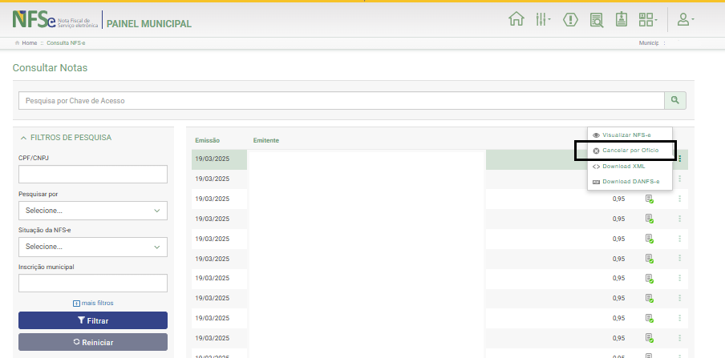
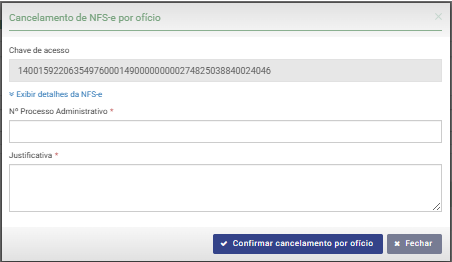

# 5.4.2 Cancelamento por Ofício

A Administração Tributária Municipal poderá cancelar por ofício qualquer NFS-e que tenha sido emitida pelo contribuinte daquele município, ou seja, em que o município seja o município emissor daquela nota. Esta ação será possível através da funcionalidade disponibilizada nas NFS-e que resultarem (que o município seja o município emissor) da consulta de NFS-e do Painel Administrativo Municipal.

<!-- p.154 -->

No painel Consultar Notas, ao clicar nos [ícones] ao final da linha de cada NFS-e da lista, há a opção “Cancelar de Ofício”.

*Figura 192 – Consultar Notas com opção Cancelar por Ofício.*

Ao clicar em “Cancelar por Ofício”, aparecerá a Janela de confirmação do cancelamento. Deverá informar o Número do Processo Administrativo e a Justificativa e então clicar em [botão].

*Figura 193 – Confirmação do Cancelamento por Ofício.*
