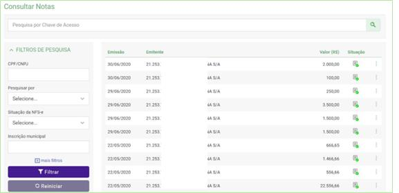
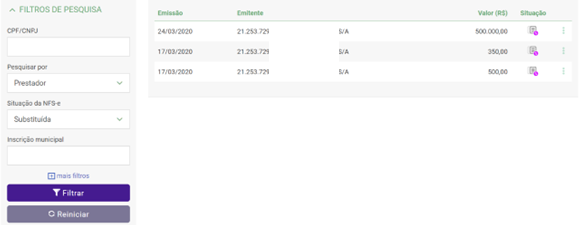
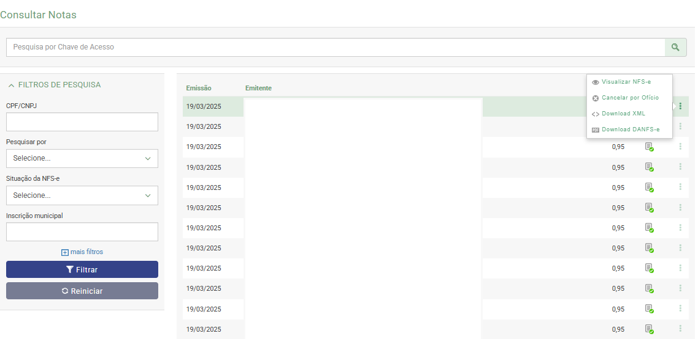
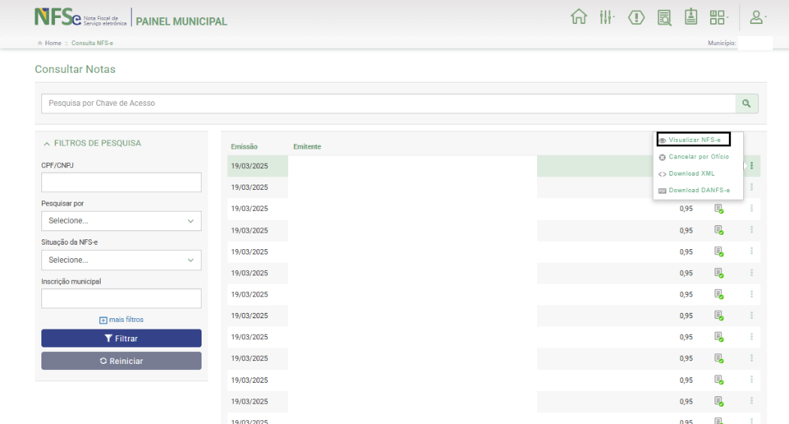

# 5.4 Consulta NFS-e

A ATM poderá consultar as notas emitidas na sua jurisdição, para isso deve acessar o ícone [ícone] do menu principal.

Poderão ser consultadas as NFS-e emitidas pelos contribuintes cadastrados no município em questão e aqueles em que o município consta como município de incidência do ISSQN.

De maneira geral, a consulta às NFS-e pode acontecer de duas formas: especificamente, através da chave da NFS-e ou por filtros de pesquisa mais gerais.

*Figura 181 – Página de consulta das NFS-e emitidas na jurisdição municipal.*

Para pesquisar uma NFS-e específica, a sua chave de acesso poderá ser inserida no campo específico no início da página e em seguida o botão [botão] deverá ser selecionado. A página com as informações da NFS-e será exibida, dando a possibilidade de fazer o download do xml ou do DANFS-e ou realizar uma nova pesquisa através dos ícones [ícones] disponíveis no canto superior esquerdo da página.

<!-- p.149 -->

Caso deseje, a ATM poderá pesquisar as NFS-e emitidas utilizando outros critérios, tendo a possibilidade de realizar uma análise mais gerencial dos documentos fiscais emitidos na sua jurisdição. Para isso deverá utilizar os filtros disponíveis no canto esquerdo da página de consulta e em seguida selecionar o botão “Filtrar”. As NFS-e que atenderem aos critérios selecionados, serão exibidas na página.

Os parâmetros de filtros da consulta são os demonstrados na tela abaixo. Pode-se usar cada um dos filtros individualmente ou associados.

*Figura 182 – Exemplo de filtros aplicados para a exibição de NFS-e emitidas por prestadores de serviço e que foram substituídas.*

No exemplo abaixo, a ATM deseja saber a lista de NFS-e emitidas por prestadores de serviço que foram substituídas. No canto direito de cada linha de pesquisa exibida, são disponibilizadas as seguintes opções: visualizar a NFS-e, cancelar por ofício, realizar o download do xml ou do DANFS-e para cada uma das NFS-e emitidas.

*Figura 183 – Tela inicial de consulta das NFS-e.*

<!-- p.150 -->

*Figura 184 – Opções disponibilizadas na consulta das NFS-e.*

O botão [botão] disponível abaixo dos filtros de pesquisa limpa todos os filtros de pesquisa e redireciona o sistema para a página inicial de consulta da NFS-e.

## 5.4.1 Visualizar NFS-e e Eventos Vinculados

Permite visualizar as informações da NFS-e além da opção de download da mesma nos formatos HTML (Transformação do XML com XSLT), XML e PDF. A visualização retorna, além das informações da NFS-e, também dos eventos vinculados à NFS-e. Estes últimos, os eventos, estão disponíveis somente no formato HTML (Transformação do XML com XSLT).

*Figura 185 – Tela Consultar Notas.*
