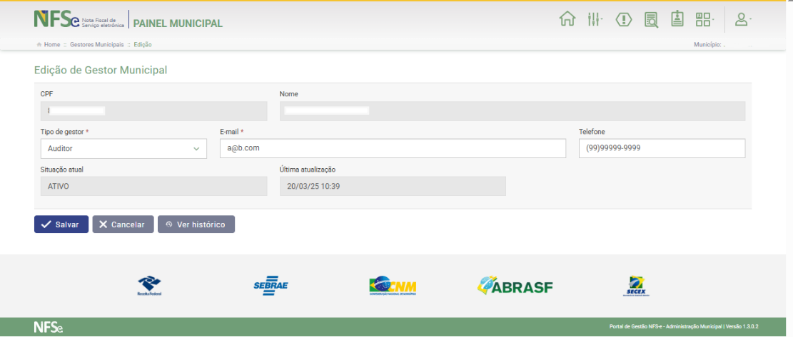

# 5.5.1 Editar

Ao selecionar a opção “Editar”, é exibida na tela todas as informações sobre o gestor municipal: CPF, Nome, Tipo (perfil cadastrado), Telefone, e-mail, situação atual e última atualização. Entretanto, apenas os campos Tipo, Telefone e e-mail poderão ser editados.

<!-- p.156 -->

*Figura 195 – Opção “Editar” de um gestor municipal.*

*Figura 196 – Edição de gestor municipal.*
