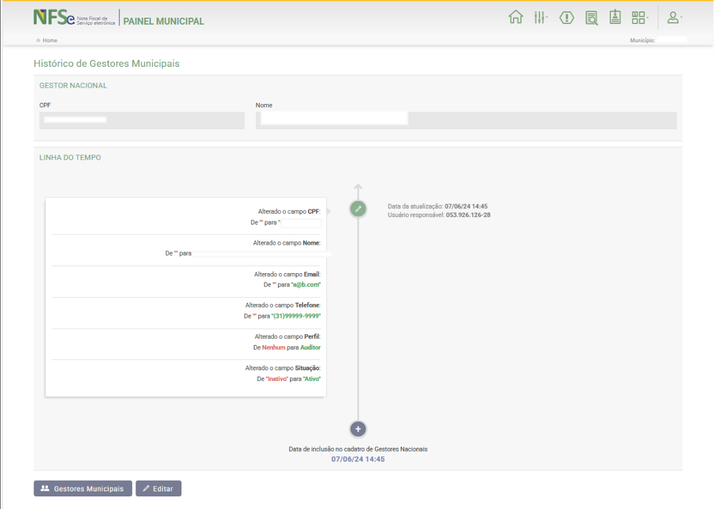

# 5.5.2 Histórico

Ao clicar em “Histórico”, o sistema exibirá a tela onde é possível ver o histórico das alterações feitas em cada um dos gestores, como as ativações e as inativações realizadas para o gestor municipal selecionado.

*Figura 197 – Opção “Histórico” de um gestor municipal.*

<!-- p.157 -->

*Figura 198 – Tela “Histórico” de um gestor municipal.*
