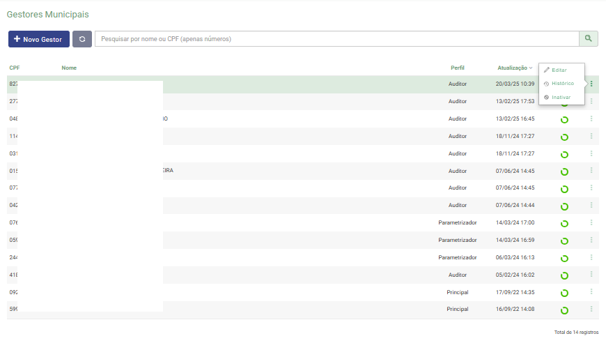

# 5.5 Gestores Municipais

<!-- p.155 -->

O gerenciamento dos perfis de acesso dos Gestores Municipais contempla as funcionalidades para cadastramento para o acesso ao Painel Administrativo Municipal. Todas as funcionalidades administrativas para os gestores municipais do município conveniado estão disponíveis no painel municipal. Ao clicar em gestores Municipais, o painel exibirá uma lista com todos os gestores cadastrados para o Município, com o Perfil de cada um, a data da atualização e a situação atual (Ativo ou Inativo).

Acessando o botão [botão] disponível no menu, a depender do perfil do usuário do sistema, os perfis dos gestores municipais poderão ser visualizados e alterados.

*Figura 194 – Tela Gestores Municipais.*

Ao clicar nos 3 pontos no final da linha com os dados do gestor, é possível editar os dados de cada, alterar a situação de ativo para inativo ou vice-versa e verificar o histórico das alterações.
