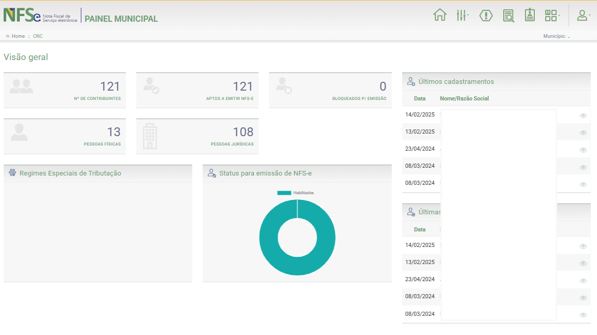
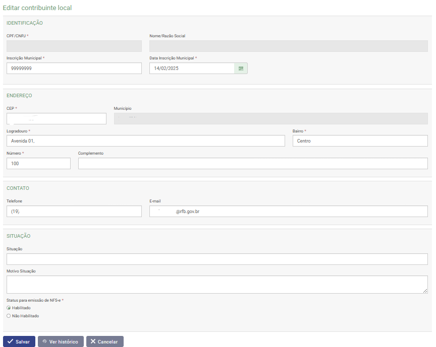

# 5.6.1 Visão Geral

No menu principal, ao clicar no ícone [ícone] e ir até “Visão Geral” o painel exibirá uma página com alguns dados e estatísticas a respeito dos contribuintes cadastrados, como: Nº de Contribuintes (Pessoas Físicas e Pessoas Jurídicas), Aptos a emitir NFS-e, Bloqueados p/ emissão, Regimes Especiais de Tributação, Status para emissão de NFS-e, Últimos cadastramentos e Últimas atualizações.

*Figura 201 – Menu Cadastro Nacional de Contribuintes com destaque para Visão Geral.*

<!-- p.160 -->

*Figura 202 – Visão Geral do Cadastro Nacional de Contribuintes.*

Para a lista dos “Últimos cadastramentos” e “Últimas atualizações” é possível “visualizar” cada uma delas clicando no ícone [ícone] que se encontra do lado direito de cada um dos nomes, então se abrirá a tela onde será possível editar algumas informações relativas àquele contribuinte local. Mais detalhes sobre as informações a serem preenchidas estão no item 3.6. deste guia.

*Figura 203 – Edição contribuinte local.*
