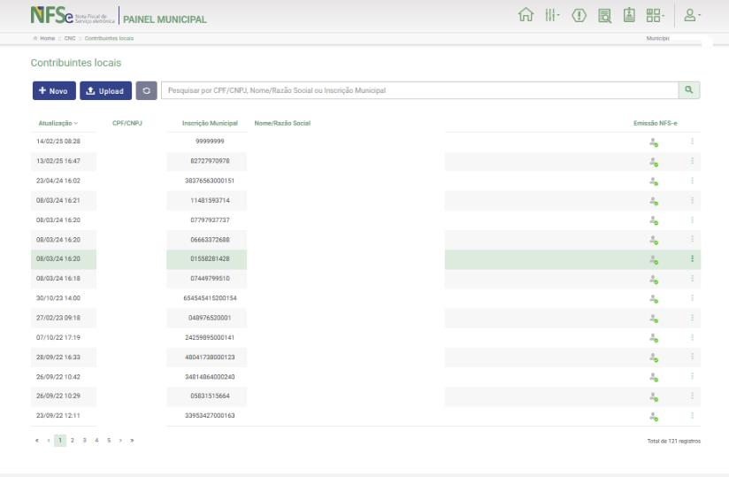
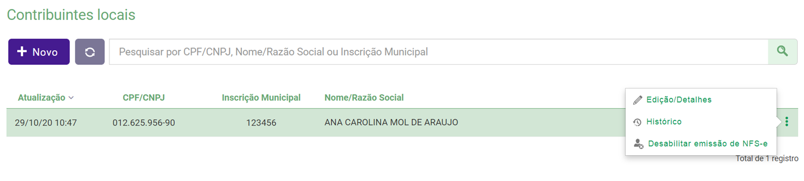
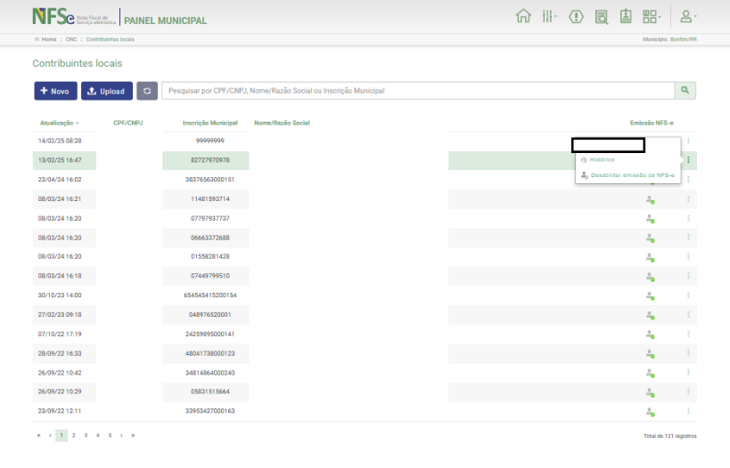
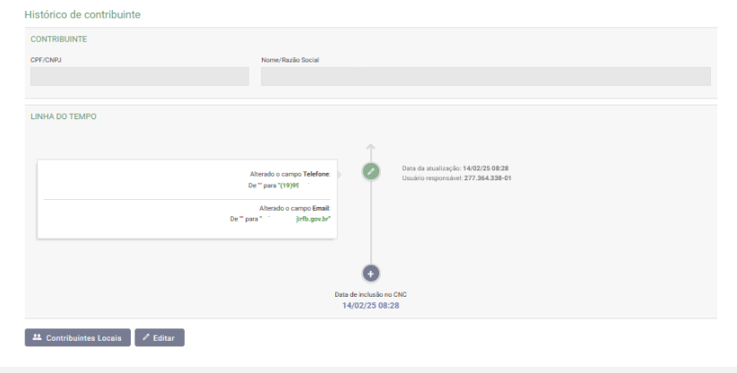

<!-- p.161 -->

# 5.6.2 Contribuintes locais

No menu principal, ao clicar no ícone [ícone] e ir até “Contribuintes locais”, este item do menu direciona para a página em que é possível verificar os contribuintes cadastrados, administrá-los e realizar a inclusão de novos.

*Figura 204 – Menu Cadastro Nacional de Contribuintes com destaque Contribuintes locais.*

Permite o gerenciamento das pessoas (físicas e jurídicas) que são contribuintes do ISSQN pelo município conveniado com o Sistema Nacional NFS-e.

A funcionalidade tem opção para Incluir Novo Contribuinte, Pesquisar, Alterar e Excluir as informações de cada um dos registros do cadastro mantendo seu histórico de atividades no sistema.

Para cada registro encontrado é possível visualizar os detalhes das informações do contribuinte cadastrado no município em questão, bem como o histórico de alterações destas informações.

<!-- p.162 -->

*Figura 205 – Página de administração dos contribuintes locais cadastrados.*

Nesta página é possível realizar as seguintes operações acessando o ícone [ícone] à direita da linha do contribuinte:

*Figura 206 – Opções de administração dos contribuintes cadastrados.*

## 5.6.2.1 Editar/Exibir Informações do Contribuinte

Para editar ou solicitar detalhes das informações sobre um contribuinte, no grid do lado direito da linha que contém as informações deverá clicar em editar/detalhes e o painel apresentará uma tela com as mesmas informações solicitadas quando do cadastramento inicial do contribuinte.

*Figura 207 – Opções de administração dos contribuintes cadastrados.*

<!-- p.163 -->

*Figura 208 – Escolha da opção “Edição/Detalhes” no menu para administração das informações de um contribuinte.*

Ao clicar na “Edição/detalhes”, se abrirá a tela onde será possível editar algumas informações relativas àquele contribuinte local, conforme mostrado no item anterior. Mais detalhes sobre as informações a serem preenchidas estão no item 3.6. deste guia.

*Figura 209 – Informações disponibilizadas para edição relativamente aos contribuintes.*

Alterar aquilo que for necessário e [botão].

## 5.6.2.2 Visualizar Histórico de Alterações de Informações do Contribuinte

Nesta funcionalidade é possível verificar o histórico de alterações cadastrais e situação para a emissão de NFS-e; será apresentado, para o contribuinte selecionado, seu CPF/CNPJ e respectivo Nome/Razão Social e uma linha do tempo com as alterações efetuadas evidenciando:

- O campo alterado;

<!-- p.164 -->

- A informação anterior e a informação alterada (De “xxx” Para “YYY”);
- Data da alteração;
- Usuário responsável pela alteração (CPF).

*Figura 210 – Escolha da opção “Histórico” no menu para administração das informações de um contribuinte.*

*Figura 211 – Página que disponibiliza o histórico da situação cadastral do contribuinte selecionado.*

## 5.6.2.3 Desabilitar emissão de NFS-e

Nesta funcionalidade é possível definir que o contribuinte ficará impedido de emitir a NFS-e Nacional. Uma mensagem de confirmação da operação é exibida na tela.

*Figura 212 – Escolha da opção “Desabilitar emissão de NFS-e” no menu para administração das informações de um contribuinte.*

<!-- p.165 -->

*Figura 213 – Mensagem de confirmação da desabilitação do contribuinte.*
