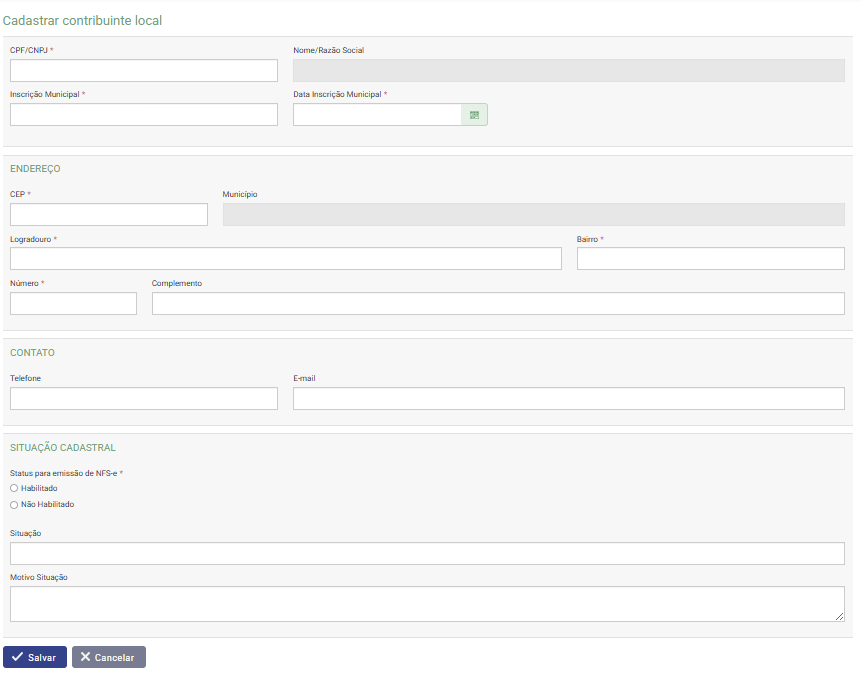

# 5.6.3 Cadastrar um Contribuinte Local

Nesta parte do menu poderá ir diretamente para a tela de inclusão de contribuinte local. Será exibida a tela para a inclusão de um contribuinte individualmente.

*Figura 214 – Menu Cadastrar contribuinte local.*

*Figura 215 – Tela cadastrar contribuinte local.*

<!-- p.166 -->

O painel exibirá uma tela para a inserção de um CPF ou CNPJ no campo indicado que realiza a busca pelo registro no cadastro CPF ou CNPJ, recuperando o nome da pessoa física ou a razão social, respectivamente. O CEP recupera na tabela TOM as informações de logradouro, município e bairro. As demais informações são preenchidas pelo cadastrador. Mais informações podem ser consultadas no item 3.6. deste manual.
