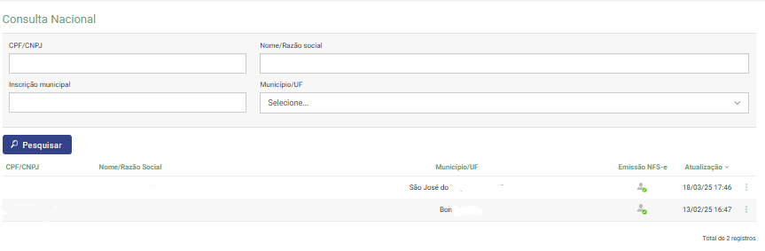
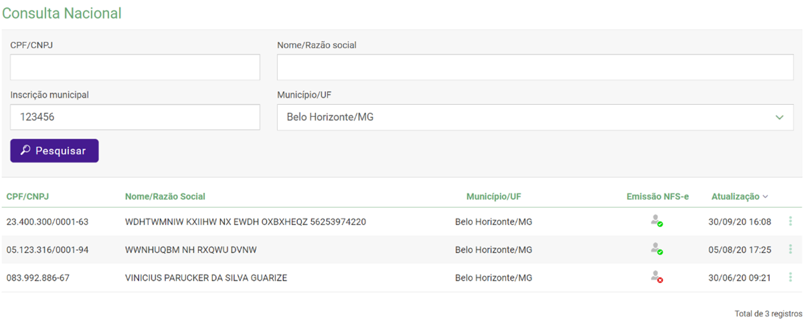

# 5.6.4 Consulta Nacional

*Figura 216 – Menu Consulta nacional.*

Neste item do menu, a ATM poderá realizar consultas para verificar em quais municípios um contribuinte está cadastrado, o seu status para emissão de NFS-e em cada município, bem como verificar o histórico de cada cadastramento e os detalhes de cada cadastro.

A busca poderá ser realizada por diversos critérios, podendo ser utilizados um ou mais deles: (CPF/CNPJ, Nome/Razão social, Inscrição municipal ou município) e o sistema exibirá uma lista com o resultado dos parâmetros preenchidos.

*Figura 217 – Critérios para realização da consulta de cadastros no CNC.*

<!-- p.167 -->

*Figura 218 – Exibição dos resultados da busca realizada, segundo os critérios escolhidos.*

Os resultados gerados exibirão todos os contribuintes que atendem aos critérios de busca inseridos.

Em cada contribuinte exibido na lista, a ATM poderá verificar os detalhes e o histórico de cada cadastro, através do ícone [ícone] em cada linha.

*Figura 219 – Opções de informações que poderão ser visualizadas pela ATM para cada resultado da busca.*
