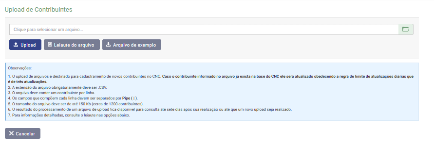

# 5.6.5 Upload de cadastro

Esta funcionalidade permite que em um único procedimento sejam incluídas as informações de um ou mais contribuintes. As regras gerais estão descritas no item 3.6. deste manual.

<!-- p.168 -->

*Figura 220 – Menu Upload de cadastro.*

É possível realizar o upload na funcionalidade [ícone] na tela Contribuintes Locais ou no menu principal contribuintes em “Upload de cadastro” no painel Contribuintes Locais.

*Figura 221 – Tela Upload de Contribuintes.*

Com relação aos Regimes Especiais de Tributação, estarão disponíveis para inclusão ao contribuinte, apenas aqueles já parametrizados no momento da adesão.
