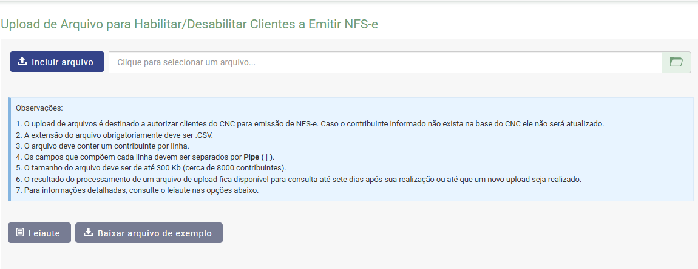
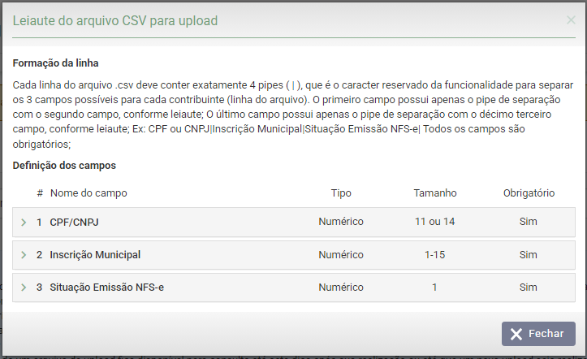
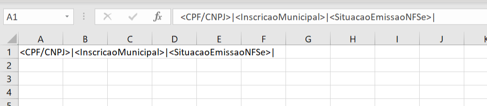
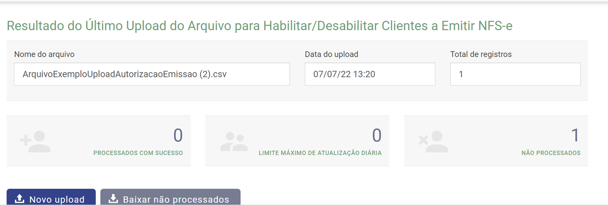

# 5.6.6 Upload Arquivo Autorização de Emissão

Esta funcionalidade permite que seja feita a habilitação ou desabilitação para emissão de NFS-e feita através do upload de um arquivo para habilitar/desabilitar contribuintes a emitirem NFS-e para aquele município.

<!-- p.169 -->

Neste caso os contribuintes alterados devem estar previamente cadastrados no sistema.

Para realizar as alterações desejadas é necessário o upload de um arquivo contendo três informações, conforme demonstra o leiaute do arquivo.

*Figura 222 – Menu Upload Arquivo Autorização de Emissão.*

Ao clicar em “Upload Arquivo Autorização de Emissão” o sistema exibirá a tela para a inclusão do arquivo. Deve-se informar a localização do arquivo, clicando no ícone [ícone] à direita da tela, o sistema abrirá uma janela para que seja informado a localização do arquivo. Selecionar o arquivo, clicar em “Abrir” e posteriormente clicar em “Incluir arquivo”.

*Figura 223 – Tela Upload de Contribuintes.*

Na janela há um quadro com “Observações” informando as definições que o arquivo deve ter:

<!-- p.170 -->

Na mesma janela, há o botão [botão]. Ao clicar neste botão, será exibida uma janela com o leiaute do arquivo CSV para upload.

*Figura 224 – Leiaute do arquivo de upload de autorização de emissão da NFS-e Nacional.*

Além das informações do leiaute do arquivo, na página de upload é disponibilizado um botão de [botão] para download do arquivo de exemplo do leiaute supracitado.

*Figura 225 – Download do arquivo de exemplo do leiaute de autorização de emissão da NFS-e.*

Por fim, para fazer o upload do arquivo, o botão [botão] e selecionar o arquivo desejado e em seguida selecionar “Incluir arquivo”.

<!-- p.171 -->

*Figura 226 – Tela de resultado do upload do arquivo.*
