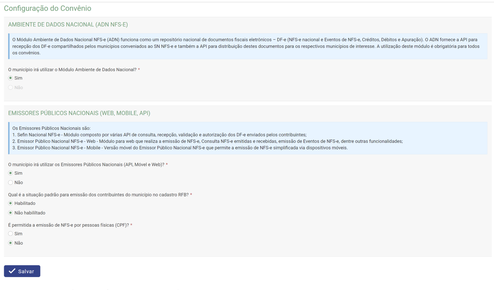

<!-- p.07 -->
# Alterações desta versão

## Item 3.3. – Configuração do Convênio – pág 36

Inclusão do texto e alteração da figura:

Na primeira versão, os municípios podiam adotar o Sistema Nacional da NFS-e de duas formas:

1. Sistema próprio do município: emite a NFS-e localmente, converte para o layout nacional e compartilha com o Ambiente de Dados Nacional (ADN).
2. Emissor Nacional: emite diretamente no sistema nacional, com os dados sendo recebidos pelo ADN.

Até então, não era permitido o uso simultâneo dos dois sistemas para uma mesma competência por um município, o que impedia uma migração gradual. Essa limitação técnica havia sido definida para evitar conflitos na emissão de documentos fiscais.

Como consequência:

- Municípios não podiam migrar aos poucos para o Emissor Nacional.
- Isso poderia gerar dificuldades operacionais, dúvidas e sobrecarga de suporte.
- Também não era possível manter o compartilhamento de NFS-e anteriores à migração.

Diante disso, surgiu a necessidade de permitir uma adoção faseada, por grupos de contribuintes, mantendo o compartilhamento das NFS-e anteriores e reduzindo os impactos da mudança.

Uma nova funcionalidade foi criada para permitir que os municípios controlem quais contribuintes devem emitir a NFS-e em cada sistema (próprio ou nacional), em momentos distintos. Isso possibilita uma migração gradual e planejada, por fases, reduzindo impactos para os contribuintes e para a administração municipal.

Como cada município pode adotar estratégias diferentes, serão apresentadas propostas específicas para cada cenário.

Poderão ser realizadas alterações na Configuração do Convênio e no cadastro de contribuinte local (ver item 3.7. Cadastro de Contribuintes).

No Painel Municipal da NFS-e, foram adicionados dois novos parâmetros ao grupo "EMISSORES PÚBLICOS NACIONAIS (WEB, MOBILE, API)", permitindo configurar e gerenciar essa transição de forma mais flexível.

<!-- p.08 -->

*Figura 24 – Versão 1.1 – Página de configuração das informações a respeito do convênio municipal com a NFS-e.*

## Item 3.6. Cadastro de Contribuintes – pág 74 e seguintes

Inclusão dos itens: 3.6.1.1 Autorização de uso dos Emissores Públicos, 3.6.1.2. Situação para emissão de NFS-e e 3.6.1.3. Situação cadastral.
