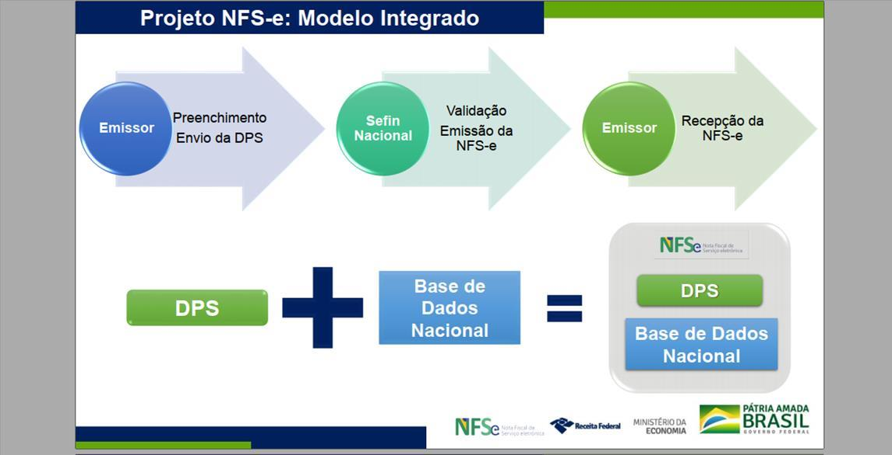

<!-- p.09 -->
# Painel Administrativo Municipal NFS-e – Web

## 1. Objetivo

O presente documento tem por objetivo principal guiar as Administrações Tributárias Municipais (ATM's) aderentes à Nota Fiscal de Serviço Eletrônica Nacional (NFS-e) quanto à utilização do Painel Municipal no Sistema Nacional.

Espera-se que com a leitura deste guia, os representantes das ATM's sejam capazes de realizar todas as configurações necessárias para permitir que o sistema nacional funcione com sua capacidade de automatização e validação de dados da forma em que foi idealizado e seus contribuintes emitam a NFS-e Nacional.

## 2. O que é a NFS-e Nacional

A NFS-e Nacional consiste na criação de um leiaute único de documento fiscal, de forma a padronizar todos os modelos de notas fiscais de serviço existentes no país. Os objetivos principais da adoção de um padrão para o adimplemento das obrigações acessórias no setor de serviços consistem não só na melhoria do ambiente de negócios no país, mas também de uma maior integração entre as administrações tributárias das esferas municipal, distrital e federal, gerando a racionalização de recursos governamentais, maior eficiência na atividade fiscal, culminando no fornecimento de melhores serviços aos cidadãos.

Esta integração entre diferentes esferas das administrações tributárias e a parametrização do Sistema Nacional – objeto deste manual, permitirão que os contribuintes não tenham que fornecer ao fisco informações que ele já disponha. Se farão necessárias apenas informações relativas ao serviço prestado.

## 3. Processo de emissão da NFS-e Nacional

A premissa principal da construção da NFS-e Nacional é que o Fisco não deve solicitar ao contribuinte informações que já possui na sua base de dados. A partir dessa premissa foi possível criar uma ferramenta que simplificasse de sobremaneira todo o processo de emissão da NFS-e Nacional por parte do contribuinte.

Este processo se baseia em três passos:

1) Preenchimento e envio da Declaração de Prestação de Serviço (DPS)

O contribuinte fornece ao Fisco informações básicas a respeito do serviço prestado na DPS e as envia à Secretaria de Finanças Nacional (Sefin Nacional - Ambiente computacional que funciona como uma Secretaria de Finanças/Fazenda Municipal, validando as Declarações de Prestação de Serviços (DPS) que são enviadas pelos contribuintes, gerando, autorizando e assinando as NFS-e correspondentes).

2) Validação e emissão da NFS-e

A Sefin Nacional recepciona as informações prestadas pelo contribuinte, realiza diversas validações com os dados que já possui na Base de Dados Nacional (BDN), complementa os dados da NFS-e e realiza a emissão da NFS-e Nacional.

<!-- p.10 -->
3) Recepção da NFS-e Nacional

Uma vez emitida a NFS-e Nacional, o emissor recepciona o documento fiscal, que engloba então os dois blocos de informações: o primeiro fornecido pelo contribuinte e o segundo pela Sefin Nacional.

*Figura 1 – Passos na emissão da NFS-e Nacional.*

## Módulo Painel Administrativo Municipal NFS-e

Este módulo do Sistema Nacional NFS-e disponibiliza funcionalidades de uso pela administração tributária municipal do município conveniado ao sistema nacional. É neste módulo do sistema que o município reflete os aspectos próprios de sua legislação tributária referentes ao ISSQN. O objetivo do módulo é uma interface para que o município insira informações, parâmetros, alíquotas e especificidades próprias de sua legislação, como benefícios fiscais.

Todos os municípios, a partir da LEI COMPLEMENTAR Nº 214, DE 16 DE JANEIRO DE 2025, são obrigados a adaptar os seus sistemas autorizadores e aplicativos de emissão simplificada de documentos fiscais eletrônicos vigentes para utilização de leiaute padronizado, que permita aos contribuintes informar os dados relativos ao IBS e à CBS, necessários à apuração desses tributos; e

II - compartilhar os documentos fiscais eletrônicos, após a recepção, validação e autorização, com o ambiente nacional de uso comum do Comitê Gestor do IBS e das administrações tributárias da União, dos Estados, do Distrito Federal e dos Municípios.

§ 1º Para fins do disposto no caput deste artigo, os Municípios e o Distrito Federal ficam obrigados, a partir de 1º de janeiro de 2026, a:

<!-- p.11 -->
I - autorizar seus contribuintes a emitir a Nota Fiscal de Serviços Eletrônica de padrão nacional (NFS-e) no ambiente nacional ou, na hipótese de possuir emissor próprio, compartilhar os documentos fiscais eletrônicos gerados, conforme leiaute padronizado, para o ambiente de dados nacional da NFS-e; e

II - compartilhar o conteúdo de outras modalidades de declaração eletrônica, conforme leiaute padronizado definido no regulamento, para o ambiente de dados nacional da NFS-e.

§ 2º O disposto no § 1º deste artigo aplica-se até 31 de dezembro de 2032.

§ 3º Os dados do ambiente centralizador nacional da NFS-e deverão ser imediatamente compartilhados em ambiente nacional nos termos do inciso II do § 1º deste artigo.

§ 4º O padrão e o leiaute a que se referem os incisos I e II do § 1º deste artigo são aqueles definidos em convênio firmado entre a administração tributária da União, do Distrito Federal e dos Municípios que tiver instituído a NFS-e, desenvolvidos e geridos pelo Comitê Gestor da Nota Fiscal de Serviços Eletrônica de padrão nacional (CGNFS-e).

§ 5º O ambiente de dados nacional da NFS-e é o repositório que assegura a integridade e a disponibilidade das informações constantes dos documentos fiscais compartilhados.

§ 6º O Comitê Gestor do IBS e a RFB poderão definir soluções alternativas à plataforma NFS-e, respeitada a adoção do leiaute do padrão nacional da NFS-e para fins de compartilhamento em ambiente nacional.

§ 7º O não atendimento ao disposto no caput deste artigo implicará a suspensão temporária das transferências voluntárias.

O Painel Administrativo Municipal NFS-e fornece funcionalidades para que o município conveniado se "parametrize" no sistema nacional.

---

Dentre os aspectos principais que o município conveniado deve parametrizar estão:

- possibilidade de criação de códigos tributários municipais (serviços da listagem municipal);
- indicação de atributos dos serviços (formas de dedução/redução, regimes especiais de tributação e alíquotas) para validação da DPS e emissão de NFS-e;
- habilitação e manutenção da situação cadastral do contribuinte no Cadastro Nacional de Contribuintes;
- gerenciamento de regras próprias referentes a Retenções do ISSQN e a Benefícios Municipais da legislação municipal; e
- consultas de documentos fiscais eletrônicos (DF-e) em que esteja envolvido.

---

A funcionalidade de parametrização de atributos municipais deve ser criteriosamente gerenciada pelos gestores municipais, pois é necessária para a correta emissão de uma NFS-e pelo contribuinte que utilize o Sistema Nacional da NFS-e (exemplos: alíquotas que podem variar entre 2% e 5% para os diversos tipos de

<!-- p.12 -->
serviços, prazos para cancelamento e substituição de NFS-e) e são necessárias para a correta validação da DPS e emissão de uma NFS-e.

Não serão criados atributos de parametrização restritos para um município ou outro especificamente. Os atributos possíveis de parametrização são aqueles comuns ao negócio do ISSQN para todos os municípios, cuja informação do atributo varia segundo a legislação interna de cada município.

---

Não existem atributos de parametrização particulares para um município especificamente.

---

O próprio módulo Painel Administrativo Municipal NFS-e gerencia o que deve ser parametrizado, para que o usuário (gestor municipal) não deixe de parametrizar informações que são necessárias para o correto funcionamento do sistema nacional de forma integrada.

As informações de parametrizações da legislação municipal do município serão utilizadas para validações em diversas regras quando da emissão da NFS-e. A depender da regra de negócio, as informações recuperadas serão do município emissor da NFS-e (município em que o emitente possui estabelecimento ou domicílio e que está habilitado a emitir NFS-e) ou podem ser recuperadas do município de incidência do ISSQN.

Fazem parte desta aplicação as funcionalidades:

1. Cadastros dos gestores municipais;
2. Cadastro de contribuintes municipais:
   - Upload de arquivo com contribuintes municipais;
   - Gestão individualizada de contribuintes municipais;
3. Parametrizações municipais:
   - Lista de Serviços
     - Código de Tributação Municipal
     - Alíquota
     - Dedução/Redução
   - Retenções;
   - Outros Benefícios;
   - Regime Especial de Tributação;
   - Eventos de NFS-e.
