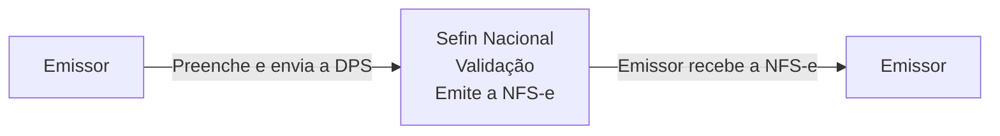

<!-- p.03 -->

# 1. Introdução

Este documento contempla a segunda versão dos novos agrupamentos e campos opcionais do layout da Nota Fiscal de Serviço eletrônica – NFS-e padrão nacional relacionados à tributação do Imposto sobre Bens e Serviços – IBS e da Contribuição sobre Bens e Serviços – CBS incidentes nas operações de serviços, em atendimento às alterações previstas na Emenda Constitucional nº 132 de, 20 de dezembro de 2023, que deu ensejo à Reforma Tributária do Consumo – RTC.

Os novos agrupamentos de campos foram inseridos a partir do layout atual da NFS-e, presente no documento “AnexoIV-LeiautesRN_ADN-SNNFSe_V1.00.02-Produção.xlsx”, aba “LEIAUTE NFS-e ADN” que consta na sessão de documentação técnica no Portal da NFS-e: https://www.gov.br/nfse/pt-br/biblioteca/documentacao-tecnica.

Importante esclarecer que o conjunto de campos apresentados neste documento é uma segunda versão, resultado de estudos técnicos realizados tomando como base o texto da Lei Complementar – LC nº 214, de 16 de janeiro de 2025, e sua divulgação objetiva dar transparência aos Municípios, às empresas prestadoras de serviço e de Tecnologia da Informação – TI e contribuintes para que possam se familiarizar com o novo padrão que deverá vigorar a partir de janeiro de 2026. Os estudos técnicos permanecem e novas versões deverão ser publicadas nos próximos meses com atualizações do layout proposto.

Para melhor compreensão dos agrupamentos que serão apresentados no próximo tópico desta Nota Técnica, a seguir é apresentada a modelagem do processo de emissão da NFS-e. O emissor (prestador de serviços) preenche a Declaração de Prestação de Serviço (DPS) que será enviada à “Sefin Nacional”, responsável pela validação das informações, cálculo dos tributos e autorização da NFS-e. Caso as informações atendam aos requisitos, será gerada a NFS-e em formato XML com o destaque dos tributos devidos e que poderá ser acessada pelo emissor e demais envolvidos na operação. É importante observar que a DPS é assinada e encapsulada no interior da nota gerada e que, dessa forma, há dois grupos de informações apresentados neste documento: um relativo à DPS com campos que serão informados pelo contribuinte e outro que, a partir dessas informações, terá campos calculados pela plataforma.

<!-- p.04 -->

*Figura: modelagem do processo de emissão da NFS-e (redesenhada em mermaid a partir da figura da p. 4).*
