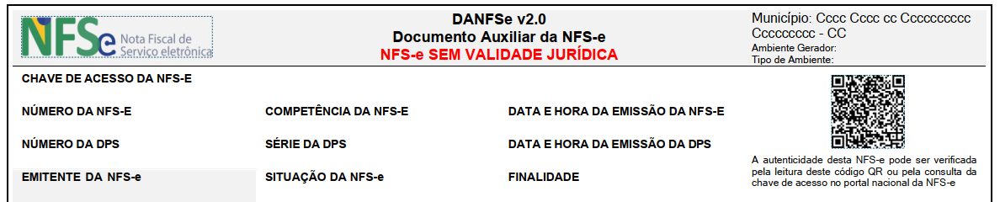
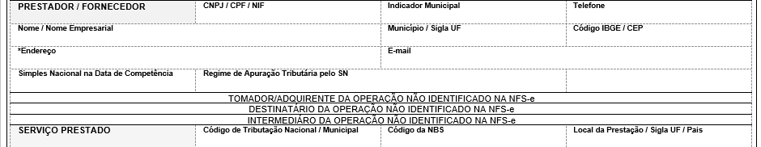
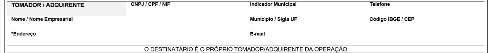
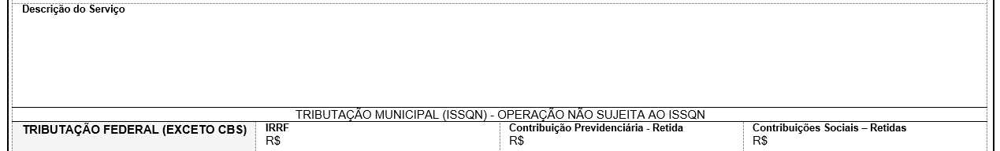

<!-- p.14 -->

# 2.4 Padrões de Caracteres (Tipos de Fontes)

Todos os caracteres deverão estar impressos nas fontes Arial para os títulos/labels e Microsoft Sans Serif para os conteúdos, em preto sólido (K100) e espaçamento normal.

## 2.4.1 Títulos (labels) dos Blocos de Campos

Deverá ter tamanho de sete (7) pontos, impresso em negrito e caixa alta (maiúsculo), observada a regra do item 2.4.

## 2.4.2 Títulos (labels) dos Campos

Deverá ter tamanho de seis (6) pontos, impresso em negrito, com a primeira letra de cada palavra maiúscula e o restante minúsculo, observada a regra do item 2.4.

Os títulos (labels) dos campos dispostos no item 2.1.2 (Dados de Identificação da NFS-e) deverão ter tamanho de sete (7) pontos, impressos em negrito, todos em caixa alta (maiúsculo), observada a regra do item 2.4.

## 2.4.3 Conteúdo do Bloco de Campos de Identificação do Documento

O conteúdo dos campos de identificação do DANFSe deverá observar:

- o cabeçalho deverá conter:
  - no canto esquerdo, a logomarca da NFS-e, disponível em: https://www.gov.br/nfse/pt-br/biblioteca/documentacao-tecnica/logos-da-nfs-e/Logo%20-%20NFS-e%20-%20Horizontal.png/view
  - ao centro, a descrição “DANFSe v2.0” e, logo abaixo, a identificação “Documento Auxiliar da NFS-e”, impressas em negrito, com tamanho de nove (9) pontos e fonte Arial.
  - no canto direito, a identificação (nome) do município do emitente, impressa em formato normal, com tamanho de 8 (oito) pontos; o ambiente gerador da NFS-e; e o tipo de ambiente do Sistema Nacional NFS-e, impressos em formato normal, com tamanho de 6 (seis) pontos; todos com fonte Microsoft Sans Serif;
- o conteúdo dos campos deverá ter tamanho de sete (7) pontos, impresso em formato normal, observada a regra do item 2.4;
- à direita dos campos de identificação, dispor código de barras bidimensional (QR Code), para consulta rápida via dispositivos móveis, indicando o endereço:

<!-- p.15 -->
“https://www.nfse.gov.br/ConsultaPublica/?tpc=1&chave=”, adicionando, após o sinal de igual (=), a Chave de Acesso da respectiva NFS-e;

- o QR Code deverá ter dimensões mínimas de 1,52 cm x 1,52 cm; e coordenadas (X/Y): X: 17,48 cm e Y: 1,67 cm;
- abaixo do QR Code, a descrição complementar: “A autenticidade desta NFS-e pode ser verificada pela leitura deste código QR ou pela consulta da chave de acesso no portal nacional da NFS-e”, disposta em 3 (três) linhas, com tamanho de seis (6) pontos, impressa em formato normal e fonte Microsoft Sans Serif.

> **Observação:** no cabeçalho, apenas no caso de NFS-e gerada para fins de teste em ambiente de produção restrita (tag `<tpAmb>` = 2 – Homologação) deve ser incluída a expressão “NFS-e SEM VALIDADE JURÍDICA”, impressa em negrito, com tamanho de nove (9) pontos, fonte Arial e em vermelho sólido (M100/Y100), abaixo do título “Documento Auxiliar da NFS-e”, conforme modelo abaixo:

*Figura: cabeçalho do DANFSe de NFS-e emitida em ambiente de homologação (“NFS-e SEM VALIDADE JURÍDICA”).*

## 2.4.4 Conteúdo dos Campos dos Demais Blocos

O conteúdo dos campos dos demais blocos do DANFSe deverá observar:

- os títulos (labels) dos campos deverão observar a regra do item 2.4.2;
- o conteúdo dos campos deverá ter tamanho de sete (7) pontos, impresso em formato normal, observada a regra do item 2.4.

<!-- p.16 -->
## 2.4.5 Tamanho dos Campos

Esta seção apresenta a sugestão de tamanho e posição de cada campo. Todas as medidas estão em centímetros.

<!-- REVISAR p.19: linhas CONTRIBUIÇÕES SOCIAIS - RETIDAS, PIS - DÉBITO APURAÇÃO PRÓPRIA e COFINS - DÉBITO APURAÇÃO PRÓPRIA aparecem destacadas em amarelo no original, sem legenda explicativa; mantidas em negrito -->

| BLOCO / CAMPO | Caminho no XML | Campo | Tamanhos Mínimos: Alt. | Larg. | Posição c/ relação à margem: Esq. | Sup. | Outros Campos / Observações | Tam. do Campo |
| --- | --- | --- | --- | --- | --- | --- | --- | --- |
| **CABEÇALHO** | | | **1,16** | **20,40** | **0,30** | **0,30** | | |
| LOGOMARCA DA NFSe | | | 0,85 | 4,00 | 0,49 | 0,44 | | |
| QUADRO DA DESCRIÇÃO "DANFSe..." | | | 1,16 | 10,19 | 5,41 | 0,30 | Centralizar o texto no quadro. | |
| QUADRO DA IDENT. MUNICÍPIO/AMBIENTE | | | 1,16 | 5,09 | 15,62 | 0,30 | | |
| MUNICÍPIO | NFSe/infNFSe/ + NFSe/infNFSe/emit/enderNac/ | xLocEmi + UF | 0,64 | 5,09 | 15,62 | 0,30 | Concatenar os dois campos. Ex.: Município / UF. Informar "Município: CCCC / CC". Obs.: Não exibir, quando o item do cód. de tributação nacional informado for 99. | 37 |
| AMBIENTE GERADOR | NFSe/infNFSe/ | ambGer | 0,24 | 5,09 | 15,62 | 0,97 | | 1 |
| TIPO DE AMBIENTE | NFSe/infNFSe/DPS/infDPS/ | tpAmb | 0,24 | 5,09 | 15,62 | 1,22 | | 1 |
| **DADOS DA NFS-e** | | | **2,84** | **20,40** | **0,30** | **1,48** | | |
| CHAVE DE ACESSO DA NFS-E | NFSe/infNFSe/ | id | 0,77 | 15,30 | 0,30 | 1,48 | Informar o id da NFS-e sem o prefixo "NFS". | 50 |
| NÚMERO DA NFS-e | NFSe/infNFSe/ | nNFSe | 0,67 | 5,09 | 0,30 | 2,27 | | 13 |
| COMPETÊNCIA DA NFS-e | NFSe/infNFSe/DPS/infDPS/ | dCompet | 0,67 | 5,09 | 5,41 | 2,27 | DD/MM/AAAA | 10 |
| DATA E HORA DA EMISSÃO DA NFS-E | NFSe/infNFSe/ | dhProc | 0,67 | 5,09 | 10,51 | 2,27 | DD/MM/AAAA hh:mm:ss | 19 |
| NÚMERO DA DPS | NFSe/infNFSe/DPS/infDPS/ | nDPS | 0,67 | 5,09 | 0,30 | 2,96 | | 15 |
| SÉRIE DA DPS | NFSe/infNFSe/DPS/infDPS/ | serie | 0,67 | 5,09 | 5,41 | 2,96 | | 5 |
| DATA E HORA DA EMISSÃO DA DPS | NFSe/infNFSe/DPS/infDPS/ | dhEmi | 0,67 | 5,09 | 10,51 | 2,96 | DD/MM/AAAA hh:mm:ss | 19 |
| EMITENTE DA NFS-E | NFSe/infNFSe/DPS/infDPS/ | tpEmit | 0,67 | 5,09 | 0,30 | 3,65 | Leiaute prevê 3 opções, que são indicadas pelos números 1 a 3. Utilizar a descrição destas opções. Ex.: Prestador. | 13 |
| SITUAÇÃO DA NFS-E | NFSe/infNFSe/ | cStat | 0,67 | 5,09 | 5,41 | 3,65 | Utilizar a descrição das opções previstas no leiaute. Preencher com reticências (...), caso a descrição supere 37 caracteres. Ex.: NFS-e de Decisão Judicial ou Administ... | 40 |
| FINALIDADE | NFSe/infNFSe/DPS/infDPS/IBSCBS/ | finNFSe | 0,67 | 5,09 | 10,51 | 3,65 | Utilizar a descrição das opções previstas no leiaute. Preencher com reticências (...), caso a descrição supere 37 caracteres. Ex.: NFS-e regular. | 40 |
| QUADRO DO QR CODE | | | 1,52 | 1,52 | 17,48 | 1,67 | | |
| QUADRO COMPLEMENTO QR CODE | | | 0,68 | 4,72 | 15,80 | 3,36 | | |
| **PRESTADOR / FORNECEDOR** | | | **0,63** | **5,09** | **0,30** | **4,34** | | |
| CNPJ / CPF / NIF | NFSe/infNFSe/DPS/infDPS/prest/ | CNPJ / CPF / NIF | 0,63 | 5,09 | 5,41 | 4,34 | nn.nnn.nnn/nnnn-nn / nnn.nnn.nnn-nn / nnn | 18 / 14 / 40 |
| INDICADOR MUNICIPAL (INSCRIÇÃO) | NFSe/infNFSe/DPS/infDPS/prest/ | IM | 0,63 | 5,09 | 10,51 | 4,34 | | 15 |
| TELEFONE | NFSe/infNFSe/DPS/infDPS/prest/ | fone | 0,63 | 5,09 | 15,62 | 4,34 | | 20 |
| NOME / NOME EMPRESARIAL | NFSe/infNFSe/DPS/infDPS/prest/ | xNome | 0,63 | 10,19 | 0,30 | 4,98 | Preencher com reticências (...), caso a descrição supere 77 caracteres. | 80 |
| MUNICÍPIO / SIGLA UF | NFSe/infNFSe/DPS/infDPS/prest/end/endNac/ ou NFSe/infNFSe/DPS/infDPS/prest/end/endExt/ | cMun ou xCidade | 0,63 | 5,09 | 10,51 | 4,98 | Leiaute prevê a informação do código do município com 7 dígitos da Tabela do IBGE. Utilizar a descrição destes códigos. Concatenar o nome do município com a respectiva UF. Ex.: Município / UF. | 37 |
| CÓDIGO IBGE / CEP | NFSe/infNFSe/DPS/infDPS/prest/end/endNac/ ou NFSe/infNFSe/DPS/infDPS/prest/end/endExt/ | cMun + CEP ou cEndPost | 0,63 | 5,09 | 15,62 | 4,98 | Concatenar os campos. Ex.: nnnnnnn / nn.nnn-nnn ou nnnnnnn / nnnnnnnnnnn (ext) | 21 |
| ENDEREÇO | NFSe/infNFSe/DPS/infDPS/prest/end/ | xLgr, nro, xCpl, xBairro | 0,63 | 10,19 | 0,30 | 5,62 | Concatenar todos os campos do endereço. Ex.: ccc, ccc, ccc, ccc. Preencher com reticências (...), caso a descrição supere 77 caracteres. Nota 1 | 80 |
| EMAIL | NFSe/infNFSe/DPS/infDPS/prest/ | email | 0,63 | 10,19 | 10,51 | 5,62 | Nota 1 | 80 |
| <!-- p.17 --> SIMPLES NACIONAL NA DATA DE COMPETÊNCIA | NFSe/infNFSe/DPS/infDPS/prest/regTrib/ | opSimpNac | 0,63 | 5,09 | 0,30 | 6,28 | Leiaute prevê 3 opções, que são indicadas pelos números 1 a 3. Utilizar a descrição destas opções. Preencher com reticências (...), caso a descrição supere 37 caracteres. Ex.: Não Optante. | 40 |
| REGIME DE APURAÇÃO TRIBUTÁRIA PELO SN | NFSe/infNFSe/DPS/infDPS/prest/regTrib/ | regApTribSN | 0,63 | 10,19 | 10,51 | 6,28 | Leiaute prevê 3 opções, que são indicadas pelos números 1 a 3. Utilizar a descrição destas opções. Preencher com reticências (...), caso a descrição supere 77 caracteres. Ex.: Regime de apuração dos tributos federais e municipal pelo Simples Nacional. | 80 |
| **TOMADOR / ADQUIRENTE** | | | **0,63** | **5,09** | **0,30** | **6,92** | **Nota 2** | |
| CNPJ / CPF / NIF | NFSe/infNFSe/DPS/infDPS/toma/ | CNPJ / CPF / NIF | 0,63 | 5,09 | 5,41 | 6,92 | nn.nnn.nnn/nnnn-nn / nnn.nnn.nnn-nn / nnn | 18 / 14 / 40 |
| INDICADOR MUNICIPAL (INSCRIÇÃO) | NFSe/infNFSe/DPS/infDPS/toma/ | IM | 0,63 | 5,09 | 10,51 | 6,92 | | 15 |
| TELEFONE | NFSe/infNFSe/DPS/infDPS/toma/ | fone | 0,63 | 5,09 | 15,62 | 6,92 | | 20 |
| NOME / NOME EMPRESARIAL | NFSe/infNFSe/DPS/infDPS/toma/ | xNome | 0,63 | 10,19 | 0,30 | 7,56 | Preencher com reticências (...), caso a descrição supere 77 caracteres. | 80 |
| MUNICÍPIO / SIGLA UF | NFSe/infNFSe/DPS/infDPS/toma/end/endNac/ ou NFSe/infNFSe/DPS/infDPS/toma/end/endExt/ | cMun ou xCidade | 0,63 | 5,09 | 10,51 | 7,56 | Leiaute prevê a informação do código do município com 7 dígitos da Tabela do IBGE. Utilizar a descrição destes códigos. Concatenar o nome do município com a respectiva UF. Ex.: Município / UF. | 37 |
| CÓDIGO IBGE / CEP | NFSe/infNFSe/DPS/infDPS/toma/end/endNac/ ou NFSe/infNFSe/DPS/infDPS/toma/end/endExt/ | cMun + CEP ou cEndPost | 0,63 | 5,09 | 15,62 | 7,56 | Concatenar os campos. Ex.: nnnnnnn / nn.nnn-nnn ou nnnnnnn / nnnnnnnnnnn (ext) | 21 |
| ENDEREÇO | NFSe/infNFSe/DPS/infDPS/toma/end/ | xLgr, nro, xCpl, xBairro | 0,63 | 10,19 | 0,30 | 8,22 | Concatenar todos os campos do endereço. Ex.: ccc, ccc, ccc, ccc. Preencher com reticências (...), caso a descrição supere 77 caracteres. Nota 1 | 80 |
| E-MAIL | NFSe/infNFSe/DPS/infDPS/toma/ | email | 0,63 | 10,19 | 10,51 | 8,22 | Nota 1 | 80 |
| **DESTINATÁRIO DA OPERAÇÃO** | | | **0,63** | **5,09** | **0,30** | **8,86** | **Nota 2 e Nota 3** | |
| CNPJ / CPF / NIF | NFSe/infNFSe/DPS/infDPS/IBSCBS/dest/ | CNPJ / CPF / NIF | 0,63 | 5,09 | 5,41 | 8,86 | nn.nnn.nnn/nnnn-nn / nnn.nnn.nnn-nn / nnn | 18 / 14 / 40 |
| TELEFONE | NFSe/infNFSe/DPS/infDPS/IBSCBS/dest/ | fone | 0,63 | 5,09 | 15,62 | 8,86 | | 20 |
| NOME / NOME EMPRESARIAL | NFSe/infNFSe/DPS/infDPS/IBSCBS/dest/ | xNome | 0,63 | 10,19 | 0,30 | 9,50 | Preencher com reticências (...), caso a descrição supere 77 caracteres. | 80 |
| MUNICÍPIO / SIGLA UF | NFSe/infNFSe/DPS/infDPS/IBSCBS/dest/end/endNac/ ou NFSe/infNFSe/DPS/infDPS/IBSCBS/dest/end/endExt/ | cMun ou xCidade | 0,63 | 5,09 | 10,51 | 9,50 | Leiaute prevê a informação do código do município com 7 dígitos da Tabela do IBGE. Utilizar a descrição destes códigos. Concatenar o nome do município com a respectiva UF. Ex.: Município / UF. | 37 |
| CÓDIGO IBGE / CEP | NFSe/infNFSe/DPS/infDPS/IBSCBS/dest/end/endNac/ ou NFSe/infNFSe/DPS/infDPS/IBSCBS/dest/end/endExt/ | cMun + CEP ou cEndPost | 0,63 | 5,09 | 15,62 | 9,50 | Concatenar os campos. Ex.: nnnnnnn / nn.nnn-nnn ou nnnnnnn / nnnnnnnnnnn (ext) | 21 |
| ENDEREÇO | NFSe/infNFSe/DPS/infDPS/IBSCBS/dest/end/ | xLgr, nro, xCpl, xBairro | 0,63 | 10,19 | 0,30 | 10,16 | Concatenar todos os campos do endereço. Ex.: ccc, ccc, ccc, ccc. Preencher com reticências (...), caso a descrição supere 77 caracteres. Nota 1 | 80 |
| E-MAIL | NFSe/infNFSe/DPS/infDPS/IBSCBS/dest/ | email | 0,63 | 10,19 | 10,51 | 10,16 | Nota 1 | 80 |
| **INTERMEDIÁRIO DA OPERAÇÃO** | | | **0,63** | **5,09** | **0,30** | **10,80** | **Nota 2** | |
| CNPJ / CPF / NIF | NFSe/infNFSe/DPS/infDPS/interm/ | CNPJ / CPF / NIF | 0,63 | 5,09 | 5,41 | 10,80 | nn.nnn.nnn/nnnn-nn / nnn.nnn.nnn-nn / nnn | 18 / 14 / 40 |
| INDICADOR MUNICIPAL (INSCRIÇÃO) | NFSe/infNFSe/DPS/infDPS/interm/ | IM | 0,63 | 5,09 | 10,51 | 10,80 | | 15 |
| TELEFONE | NFSe/infNFSe/DPS/infDPS/interm/ | fone | 0,63 | 5,09 | 15,62 | 10,80 | | 20 |
| NOME / NOME EMPRESARIAL | NFSe/infNFSe/DPS/infDPS/interm/ | xNome | 0,63 | 10,19 | 0,30 | 11,44 | Preencher com reticências (...), caso a descrição supere 77 caracteres. | 80 |
| MUNICÍPIO / SIGLA UF | NFSe/infNFSe/DPS/infDPS/interm/end/endNac/ ou NFSe/infNFSe/DPS/infDPS/interm/end/endExt/ | cMun ou xCidade | 0,63 | 5,09 | 10,51 | 11,44 | Leiaute prevê a informação do código do município com 7 dígitos da Tabela do IBGE. Utilizar a descrição destes códigos. Concatenar o nome do município com a respectiva UF. Ex.: Município / UF. | 37 |
| <!-- p.18 --> CÓDIGO IBGE / CEP | NFSe/infNFSe/DPS/infDPS/interm/end/endNac/ ou NFSe/infNFSe/DPS/infDPS/interm/end/endExt/ | cMun + CEP ou cEndPost | 0,63 | 5,09 | 15,62 | 11,44 | Concatenar os campos. Ex.: nnnnnnn / nn.nnn-nnn ou nnnnnnn / nnnnnnnnnnn (ext) | 21 |
| ENDEREÇO | NFSe/infNFSe/DPS/infDPS/interm/end/ | xLgr, nro, xCpl, xBairro | 0,63 | 10,19 | 0,30 | 12,09 | Concatenar todos os campos do endereço. Ex.: ccc, ccc, ccc, ccc. Preencher com reticências (...), caso a descrição supere 77 caracteres. Nota 1 | 80 |
| E-MAIL | NFSe/infNFSe/DPS/infDPS/interm/ | email | 0,63 | 10,19 | 10,51 | 12,09 | Nota 1 | 80 |
| **SERVIÇO PRESTADO** | | | **0,63** | **5,09** | **0,30** | **12,74** | | |
| CÓDIGO DE TRIBUTAÇÃO NACIONAL / MUNICIPAL | NFSe/infNFSe/DPS/infDPS/serv/cServ/ + NFSe/infNFSe/ | cTribNac + cTribMun | 0,63 | 5,09 | 5,41 | 12,74 | nn.nn.nn / nnn | 14 |
| CÓDIGO DA NBS | NFSe/infNFSe/DPS/infDPS/serv/cServ/ | cNBS | 0,63 | 5,09 | 10,51 | 12,74 | n.nnnn.nn.nn | 9 |
| LOCAL DA PRESTAÇÃO / SIGLA UF / PAÍS | NFSe/infNFSe/ + NFSe/infNFSe/DPS/infDPS/serv/locPrest/ | xLocPrestacao + cPaisPrestacao | 0,63 | 5,09 | 15,62 | 12,74 | Concatenar o nome do município, a respectiva UF da Tabela do IBGE e o nome do País. Ex.: Município / UF / País. Com relação ao país, utilizar o código de 2 dígitos, conforme a Tabela de Países ISO. Ex.: BR | 42 |
| DESCRIÇÃO DO CÓDIGO DE TRIBUTAÇÃO NACIONAL / MUNICIPAL | NFSe/infNFSe/DPS/infDPS/serv/cServ/ + NFSe/infNFSe/ | xTribNac + xTribMun | 0,38 | 20,40 | 0,30 | 13,39 | SE xTribMun <> “” ENTAO Descrição Municipal SENAO Descrição Nacional. Utilizar reticências (...), caso a descrição supere 167 caracteres. Obs.: Não há título (label) deste campo no DANFSe | 170 |
| DESCRIÇÃO DO SERVIÇO | NFSe/infNFSe/DPS/infDPS/serv/cServv/ | xDescServ | 0,63 | 20,40 | 0,30 | 13,79 | Utilizar reticências (...), caso a descrição supere 1297 caracteres. | 1300 |
| **TRIBUTAÇÃO MUNICIPAL (ISSQN)** | | | **0,63** | **5,09** | **0,30** | **14,43** | **Nota 4** | |
| TIPO DE TRIBUTAÇÃO DO ISSQN | NFSe/infNFSe/DPS/infDPS/valores/trib/tribMun/ | tribISSQN | 0,63 | 5,09 | 0,30 | 14,43 | Leiaute prevê 4 opções, que são indicadas pelos números 1 a 4. Utilizar a descrição destas opções. Ex.: Operação Tributável. | 21 |
| MUNICÍPIO / SIGLA UF / PAÍS DA INCIDÊNCIA DO ISSQN | NFSe/infNFSe/ + NFSe/infNFSe/DPS/infDPS/valores/trib/tribMun/ | xLocIncid + cPaisResult | 0,63 | 10,19 | 5,41 | 14,43 | Concatenar o nome do município, a respectiva UF da Tabela do IBGE e o nome do País. Ex.: Município / UF / País. Com relação ao país, utilizar o código de 2 dígitos, conforme a Tabela de Países ISO. Ex.: BR | 42 |
| REGIME ESPECIAL DE TRIBUTAÇÃO DO ISSQN | NFSe/infNFSe/DPS/infDPS/prest/regTrib/ | regEspTrib | 0,63 | 5,09 | 0,30 | 15,08 | Leiaute prevê 8 opções, que são indicadas pelos números 0 a 6 e 9. Utilizar a descrição destas opções. Ex.: Estimativa. Nota 5 | 27 |
| TIPO DE IMUNIDADE DO ISSQN | NFSe/infNFSe/DPS/infDPS/valores/trib/tribMun/ | tpImunidade | 0,63 | 5,09 | 5,41 | 15,08 | Leiaute prevê 5 opções, que são indicadas pelos números 1 a 5. Utilizar a descrição destas opções. Utilizar reticências (...), caso a descrição supere 37 caracteres. Ex.: Livros, jornais, periódicos e o papel... Nota 5 | 40 |
| SUSPENSÃO DA EXIGIBILIDADE DO ISSQN | NFSe/infNFSe/DPS/infDPS/valores/trib/tribMun/exigSusp/ | tpSusp | 0,63 | 5,09 | 10,51 | 15,08 | Se for o caso, utilizar as seguintes descrições: Exigibilidade Suspensa por Decisão Judicial; Exigibilidade Suspensa por Processo Administrativo. Preencher com reticências (...), caso a descrição supere 37 caracteres. Nota 5 | 40 |
| NÚMERO PROCESSO SUSPENSÃO | NFSe/infNFSe/DPS/infDPS/valores/trib/tribMun/exigSusp/ | nProcesso | 0,63 | 5,09 | 15,62 | 15,08 | Nota 5 | 30 |
| BENEFÍCIO MUNICIPAL | NFSe/infNFSe/valores/ | tpBM | 0,63 | 5,09 | 0,30 | 15,73 | Leiaute prevê 4 opções, que são indicadas pelos números 1 e 4. Utilizar a descrição destas opções. Ex.: Isenção. Nota 5 | 40 |
| CÁLCULO DO BM | NFSe/infNFSe/valores/ ou NFSe/infNFSe/DPS/infDPS/valores/trib/tribMun/BM/ | vCalcBM ou vRedBCBM | 0,63 | 5,09 | 5,41 | 15,73 | Nota 5 | 1-15V2 |
| TOTAL DEDUÇÕES/REDUÇÕES | NFSe/infNFSe/DPS/infDPS/valores/vDedRed/ ou NFSe/infNFSe/valores/ + NFSe/infNFSe/IBSCBS/valores/ | vDR ou vCalcDR + vCalcReeRepRes | 0,63 | 5,09 | 10,51 | 15,73 | Nota 5 | 1-15V2 |
| <!-- p.19 --> DESCONTO INCONDICIONADO | NFSe/infNFSe/DPS/infDPS/valores/vDescCondIncond/ | vDescIncond | 0,63 | 5,09 | 15,62 | 15,73 | Nota 5 | 1-15V2 |
| BC ISSQN | NFSe/infNFSe/valores/ | vBC | 0,63 | 5,09 | 0,30 | 16,37 | | 1-15V2 |
| ALÍQUOTA APLICADA | NFSe/infNFSe/valores/ | pAliqAplic | 0,63 | 5,09 | 5,41 | 16,37 | | 1-2V2 |
| RETENÇÃO DO ISSQN | NFSe/infNFSe/DPS/infDPS/valores/trib/tribMun/ | tpRetISSQN | 0,63 | 5,09 | 10,51 | 16,37 | Leiaute prevê 3 opções, que são indicadas pelos números 1 a 3. Utilizar descrição destas opções. Ex.: Não Retido. | 25 |
| ISSQN APURADO | NFSe/infNFSe/valores/ | vISSQN | 0,63 | 5,09 | 15,62 | 16,37 | | 1-2V2 |
| **TRIBUTAÇÃO FEDERAL (EXCETO CBS)** | | | **0,63** | **5,09** | **0,30** | **17,02** | | |
| IRRF | NFSe/infNFSe/DPS/infDPS/valores/trib/tribFed/ | vRetIRRF | 0,63 | 5,09 | 5,41 | 17,02 | | 1-15V2 |
| CONTRIBUIÇÃO PREVIDENCIÁRIA - RETIDA | NFSe/infNFSe/DPS/infDPS/valores/trib/tribFed/ | vRetCP | 0,63 | 5,09 | 10,51 | 17,02 | | 1-15V2 |
| **CONTRIBUIÇÕES SOCIAIS - RETIDAS** | NFSe/infNFSe/DPS/infDPS/valores/trib/tribFed/ ou NFSe/infNFSe/DPS/infDPS/valores/trib/tribFed/ + NFSe/infNFSe/DPS/infDPS/valores/trib/tribFed/piscofins/ + NFSe/infNFSe/DPS/infDPS/valores/trib/tribFed/piscofins/ | **vRetCSLL** ou **vRetCSLL + vPis + vCofins** | **0,63** | **5,09** | **15,62** | **17,02** | **Quando tpRetPisCofins = 1 (PIS/COFINS Retido), este campo retornará o somatório dos valores informados nos campos vRetCSLL, vPis e vCofins. Nos demais casos, o campo retornará o valor informado em vRetCSLL.** | **1-15V2** |
| **PIS - DÉBITO APURAÇÃO PRÓPRIA** | NFSe/infNFSe/DPS/infDPS/valores/trib/tribFed/piscofins/ | **vPis** | **0,63** | **5,09** | **0,30** | **17,67** | **Quando tpRetPisCofins = 1 (PIS/COFINS Retido), este campo retornará 0,00 (zero). Nos demais casos, o campo retornará o valor informado em vPis. Nota 6** | **1-15V2** |
| **COFINS - DÉBITO APURAÇÃO PRÓPRIA** | NFSe/infNFSe/DPS/infDPS/valores/trib/tribFed/piscofins/ | **vCofins** | **0,63** | **5,09** | **5,41** | **17,67** | **Quando tpRetPisCofins = 1 (PIS/COFINS Retido), este campo retornará 0,00 (zero). Nos demais casos, o campo retornará o valor informado em vCofins. Nota 6** | **1-15V2** |
| DESCRIÇÃO CONTRIB. SOCIAIS - RETIDAS | NFSe/infNFSe/DPS/infDPS/valores/trib/tribFed/piscofins/ | tpRetPisCofins | 0,63 | 10,19 | 10,51 | 17,67 | Leiaute prevê 10 opções, que são indicadas pelos números 1 a 9. Utilizar a descrição destas opções. Ex.: PIS/COFINS/CSLL Não Retido. Nota 6 | 35 |
| **TRIBUTAÇÃO IBS / CBS** | | | **0,63** | **5,09** | **0,30** | **18,32** | | |
| CST / CCLASSTRIB | NFSe/infNFSe/DPS/infDPS/IBSCBS/valores/trib/gIBSCBS/ | CST + cClassTrib | 0,63 | 5,09 | 5,41 | 18,32 | nnn / nnnnnn | 12 |
| INDICADOR DE OPERAÇÃO / CÓDIGO IBGE INCIDÊNCIA / MUNICÍPIO INCIDÊNCIA / SIGLA UF | NFSe/infNFSe/DPS/infDPS/IBSCBS/ + NFSe/infNFSe/IBSCBS/ + NFSe/infNFSe/IBSCBS/ | cIndOp + cLocalidadeIncid + xLocalidadeIncid | 0,63 | 10,19 | 10,51 | 18,32 | Concatenar todos os campos: nnnnnn / nnnnnnn / ccc / CC. Concatenar o nome do município com a respectiva UF da Tabela do IBGE. Ex.: Município / UF. | 56 |
| EXCLUSÕES E REDUÇÕES DA BASE DE CÁLCULO | NFSe/infNFSe/DPS/infDPS/valores/vDescCondIncond/ + NFSe/infNFSe/IBSCBS/valores/ + NFSe/infNFSe/valores/ + NFSe/infNFSe/DPS/infDPS/valores/trib/tribFed/piscofins/ + NFSe/infNFSe/DPS/infDPS/valores/trib/tribFed/piscofins/ | vDescIncond + vCalcReeRepRes + vISSQN + vPIS + vCOFINS | 0,63 | 5,09 | 0,30 | 18,96 | Somatório de todos estes campos. | 1-15V2 |
| BASE DE CÁLCULO APÓS EXCLUSÕES E REDUÇÕES | NFSe/infNFSe/IBSCBS/valores/ | vBC | 0,63 | 5,09 | 5,41 | 18,96 | | 1-15V2 |
| <!-- p.20 --> RED. ALÍQUOTA IBS / RED. ALÍQUOTA CBS | NFSe/infNFSe/IBSCBS/valores/uf/ + NFSe/infNFSe/IBSCBS/valores/mun/ + NFSe/infNFSe/IBSCBS/valores/fed/ | pRedAliqUF + pRedAliqMun + pRedAliqCBS | 0,63 | 5,09 | 10,51 | 18,96 | % / % / % | 1-2V2 / 1-2V2 / 1-2V2 |
| ALÍQUOTA - IBS UF / IBS MUN | NFSe/infNFSe/IBSCBS/valores/uf/ + NFSe/infNFSe/IBSCBS/valores/mun/ | pIBSUF + pIBSMun | 0,63 | 5,09 | 15,62 | 18,96 | % / % | 1-2V2 / 1-2V2 |
| ALÍQ. EFETIVA MUNICIPAL - IBS | NFSe/infNFSe/IBSCBS/valores/mun/ | pAliqEfetMun | 0,63 | 5,09 | 0,30 | 19,61 | | 1-2V2 |
| VALOR APURADO MUNICIPAL - IBS | NFSe/infNFSe/IBSCBS/totCIBS/gIBS/gIBSMunTot/ | vIBSMun | 0,63 | 5,09 | 5,41 | 19,61 | | 1-15V2 |
| ALÍQ. EFETIVA ESTADUAL - IBS | NFSe/infNFSe/IBSCBS/valores/uf/ | pAliqEfetUF | 0,63 | 5,09 | 10,51 | 19,61 | | 1-2V2 |
| VALOR APURADO ESTADUAL - IBS | NFSe/infNFSe/IBSCBS/totCIBS/gIBS/gIBSUFTot/ | vIBSUF | 0,63 | 5,09 | 15,62 | 19,61 | | 1-15V2 |
| VALOR TOTAL APURADO - IBS | NFSe/infNFSe/IBSCBS/totCIBS/gIBS/ | vIBSTot | 0,63 | 5,09 | 0,30 | 20,26 | | 1-15V2 |
| ALÍQUOTA - CBS | NFSe/infNFSe/IBSCBS/valores/fed/ | pCBS | 0,63 | 5,09 | 5,41 | 20,26 | | 1-2V2 |
| ALÍQUOTA EFETIVA - CBS | NFSe/infNFSe/IBSCBS/valores/fed/ | pAliqEfetCBS | 0,63 | 5,09 | 10,51 | 20,26 | | 1-2V2 |
| VALOR TOTAL APURADO - CBS | NFSe/infNFSe/IBSCBS/totCIBS/gCBS/ | vCBS | 0,63 | 5,09 | 15,62 | 20,26 | | 1-15V2 |
| **VALOR TOTAL DA NFS-E** | | | **0,67** | **5,09** | **0,30** | **20,90** | | |
| VALOR DA OPERAÇÃO / SERVIÇO | NFSe/infNFSe/DPS/infDPS/valores/vServPrest/ | vServ | 0,67 | 5,09 | 5,41 | 20,90 | | 1-15V2 |
| DESCONTO INCONDICIONADO | NFSe/infNFSe/DPS/infDPS/valores/vDescCondIncond/ | vDescIncond | 0,67 | 5,09 | 10,51 | 20,90 | | 1-15V2 |
| DESCONTO CONDICIONADO | NFSe/infNFSe/DPS/infDPS/valores/vDescCondIncond/ | vDescCond | 0,67 | 5,09 | 15,62 | 20,90 | | 1-15V2 |
| TOTAL DAS RETENÇÕES (ISSQN / FEDERAIS) | NFSe/infNFSe/valores/ | vTotalRet | 0,67 | 5,09 | 0,30 | 21,59 | | 1-15V2 |
| VALOR LÍQUIDO DA NFS-e | NFSe/infNFSe/valores/ | vLiq | 0,67 | 5,09 | 5,41 | 21,59 | | 1-15V2 |
| TOTAL DO IBS/CBS | NFSe/infNFSe/IBSCBS/totCIBS/gIBS/ + NFSe/infNFSe/IBSCBS/totCIBS/gCBS/ | vIBSTot + vCBS | 0,67 | 5,09 | 10,51 | 21,59 | | 1-15V2 |
| VALOR LÍQUIDO DA NFS-e + IBS/CBS | NFSe/infNFSe/IBSCBS/totCIBS/ | vTotNF | 0,67 | 5,09 | 15,62 | 21,59 | | 1-15V2 |
| **INFORMAÇÕES COMPLEMENTARES** | | | **0,39** | **20,40** | **0,30** | **22,27** | | |
| INFORMAÇÕES COMPLEMENTARES | NFSe/infNFSe/DPS/infDPS/serv/infoCompl/ + NFSe/infNFSe/DPS/infDPS/subst + NFSe/infNFSe/DPS/infDPS/serv/infoCompl/ + NFSe/infNFSe/DPS/infDPS/serv/obra/ + NFSe/infNFSe/DPS/infDPS/IBSCBS/imovel/ + NFSe/infNFSe/DPS/infDPS/serv/atvEvento/ + NFSe/infNFSe/DPS/infDPS/serv/infoCompl/ + NFSe/infNFSe/DPS/infDPS/serv/infoCompl/ + NFSe/infNFSe/DPS/infDPS/serv/infoCompl/gItemPed/ + NFSe/infNFSe/ + NFSe/infNFSe/DPS/infDPS/valores/trib/totTrib/vTotTrib / ou NFSe/infNFSe/DPS/infDPS/valores/trib/totTrib/pTotTrib/ | xInfComp + chSubstda + docRef + cObra + inscImobFisc + idAtvEvt + idDocTec + xPed + xItemPed + xOutInf + vTotTribFed, vTotTribEst e vTotTribMu ou pTotTribFed, pTotTribEst e pTotTribMu | 0,39 | 20,40 | 0,30 | 22,68 | União de todos os campos de informações complementares. As informações devem ser descritas e dispostas na seguinte ordem: Inf. Cont.: ; NFS-e Subst.: (Nota 7); Doc. Ref.: ; Cod. Obra: (Nota 8); Insc. Imob.: (Nota 8); Cod. Evt.: (Nota 9); Doc. Tec.: ; Núm. Ped.: ; Item Ped.: ; Inf. A. T. Mun.: . Obrigatoriamente, deve-se constar a informação de Totais Aproximados dos Tributos (Nota 10). As informações devem ser separadas por pipes ( \| ). Utilizar reticências (...), caso a descrição supere 1997 caracteres, sem prejuízo à linha de "Totais Aproximados dos Tributos", que é fixa. | 2000 |
| **CANHOTO** | | | **0,67** | **20,40** | **0,30** | **28,10** | **Nota 11** | |
| DATA CIENTIFICAÇÃO | | | 0,67 | 5,09 | 0,30 | 28,10 | | |
| <!-- p.21 --> IDENTIFICAÇÃO E ASSINATURA | | | 0,67 | 5,09 | 5,41 | 28,10 | | |
| Nº NFS-E / CHAVE NFS-E | NFSe/infNFSe/ | nNFSe + id | 0,67 | 10,19 | 10,51 | 28,10 | Informar o id da NFS-e sem o prefixo "NFS". Ex.: nnn / nnn | 66 |

**Notas:**

1. Esta linha poderá ser suprimida, ainda que existam dados dos respectivos campos no arquivo XML.
2. Caso não sejam informados dados de tomador/adquirente, destinatário e/ou intermediário da operação, informar, nos respectivos blocos, apenas: "TOMADOR/ADQUIRENTE DA OPERAÇÃO NÃO IDENTIFICADO NA NFS-e", "DESTINATÁRIO DA OPERAÇÃO NÃO IDENTIFICADO NA NFS-e" e/ou "INTERMEDIÁRIO DA OPERAÇÃO NÃO IDENTIFICADO NA NFS-e", respectivamente. A altura mínima do bloco é de 0,32cm e a largura mínima é de 20,40cm. As coordenadas (X/Y) dos blocos devem ser ajustada conforme as informações preenchidas na NFS-e;
3. Caso o destinatário da operação seja o próprio tomador/adquirente, informar, no bloco do destinatário da operação, apenas: “O DESTINATÁRIO É O PRÓPRIO TOMADOR/ADQUIRENTE DA OPERAÇÃO”. A altura mínima do bloco é de 0,32cm e a largura mínima é de 20,40cm. As coordenadas (X/Y) dos blocos devem ser ajustada conforme as informações preenchidas na NFS-e;
4. Para as operações às quais não haja a incidência do ISSQN, informar, no bloco “Tributação Municipal (ISSQN)”, apenas: “TRIBUTAÇÃO MUNICIPAL (ISSQN) - OPERAÇÃO NÃO SUJEITA AO ISSQN”. A altura mínima do bloco é de 0,32cm e a largura mínima é de 20,40cm. As coordenadas (X/Y) dos blocos devem ser ajustada conforme as informações preenchidas na NFS-e;
5. Esta linha poderá ser suprimida caso não existam dados em todos os campos da mesma linha no arquivo XML;
6. Esta linha será impressa para as NFS-e emitidas com data de competência até o final do ano-calendário de 2026.
7. Em caso de substituição da NFS-e, deve-se informar, no campo de informações complementares, a chave de acesso da NFS-e substituída, conforme campo “chSubstda”, do leiaute da DPS/NFS-e. Esta informação deverá ser disposta da seguinte forma: NFS-e Subst.: + chave de acesso da NFS-e substituída.
8. Nos casos de obrigatoriedade de preenchimento do grupo de Obra/Imóvel, deverão constar, no campo de informações complementares, o número de identificação da obra e/ou a inscrição imobiliária fiscal, conforme campos “cObra” e “inscImobFisc”, respectivamente, do leiaute da DPS/NFS-e. Estas informações deverão ser dispostas da seguinte forma: Cod. Obra: e Insc. Imob.: + respectivas informações;

<!-- p.22 -->
9. Nos casos de obrigatoriedade de preenchimento do grupo de Evento, deverá constar, no campo de informações complementares, a identificação da atividade de evento, conforme campos “idAtvEvt”, do leiaute da DPS/NFS-e. Esta informação deverá ser disposta da seguinte forma: Cod. Evt.: + respectiva informação;
10. Deve-se constar, obrigatoriamente, a informação de totais aproximados de tributos, que pode ser em preenchida com valores monetários OU percentuais, disposta da seguinte forma: "Totais Aproximados dos Tributos cfe. Lei nº 12.741/2012: Federais: R$ ou % ; Estaduais: R$ ou % ; Municipais: R$ ou %";
11. Bloco opcional;
12. Os campos sem informações no XML devem ser preenchidos com um traço (-);

### 2.4.5.1 Exemplos

**Nota 2:**

*Figura: exemplo da Nota 2 – blocos “Tomador/Adquirente”, “Destinatário” e “Intermediário” não identificados na NFS-e.*

**Nota 3:**

*Figura: exemplo da Nota 3 – destinatário da operação é o próprio tomador/adquirente.*

**Nota 4:**

*Figura: exemplo da Nota 4 – operação não sujeita ao ISSQN.*
