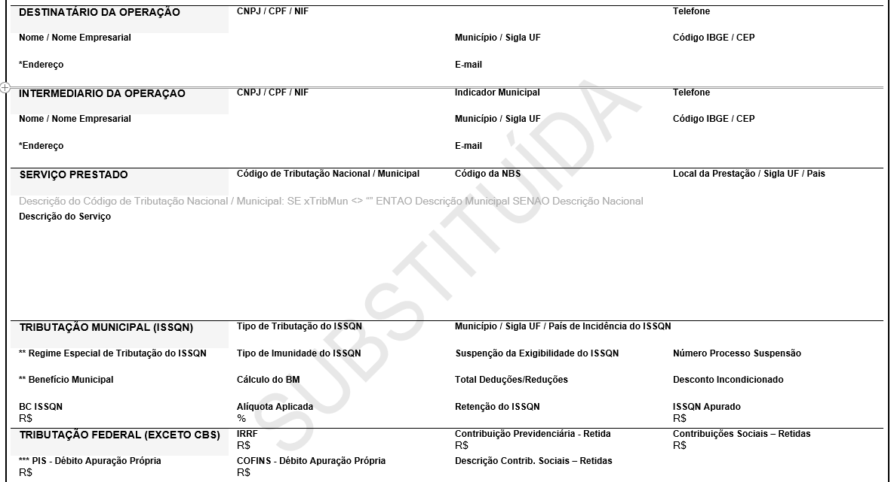

<!-- p.23 -->

# 2.5 Outros

## 2.5.1 Cancelamento da NFS-e

Quando do cancelamento da NFS-e, deverá constar no DANFSe marca d’água com a descrição “CANCELADA”.

A marca d’água será disposta na diagonal, impressa em formato normal, com tamanho mínimo de cinquenta (50) pontos, fonte Arial e em cinza (K35), conforme modelo abaixo:

*Figura: modelo de marca d’água “CANCELADA”.*

## 2.5.2 Substituição da NFS-e

Quando da substituição da NFS-e, deverá constar no DANFSe marca d’água com a descrição “SUBSTITUÍDA”.

A marca d’água será disposta na diagonal, impressa em formato normal, com tamanho mínimo de cinquenta (50) pontos, fonte Arial e em cinza (K35), conforme modelo abaixo:

*Figura: modelo de marca d’água “SUBSTITUÍDA”.*

<!-- p.24 -->
## 2.5.3 Limitações da Impressora

Se for necessária a utilização de uma margem superior ou inferior maior, devido às limitações da impressora, a redução necessária poderá ser feita somente na altura do bloco de “Informações Complementares” deslocando os campos seguintes para baixo pelo valor desta redução.

**CARLOS EDUARDO BURKLE**

Auditor Fiscal de Tributos – Londrina/PR

Secretário-Executivo da Secretaria-Executiva do Comitê Gestor da Nota Fiscal de Serviço Eletrônica de Padrão Nacional (SE/CGNFS-e)
