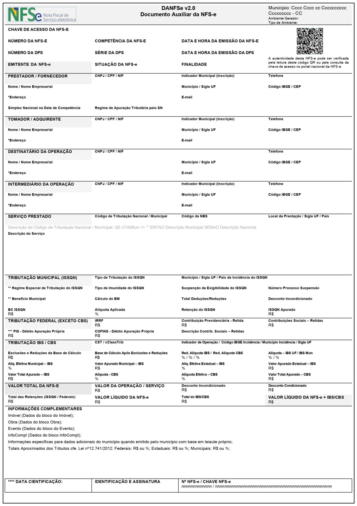

<!-- p.25 -->

# Anexo I – Modelo de DANFSe

*Figura: modelo de DANFSe (Anexo I).*

OBS: Não imprimir os asteriscos. Eles são somente indicadores das notas abaixo.

\* Esta linha poderá ser suprimida, ainda que existam dados dos respectivos campos no arquivo XML.

<!-- p.26 -->
\*\* Esta linha poderá ser suprimida caso não existam dados em todos os campos da mesma linha no arquivo XML.

\*\*\* Esta linha será impressa para as NFS-e emitidas com data de competência até o final do ano-calendário de 2026.

\*\*\*\* Bloco de Canhoto. Opcional.
