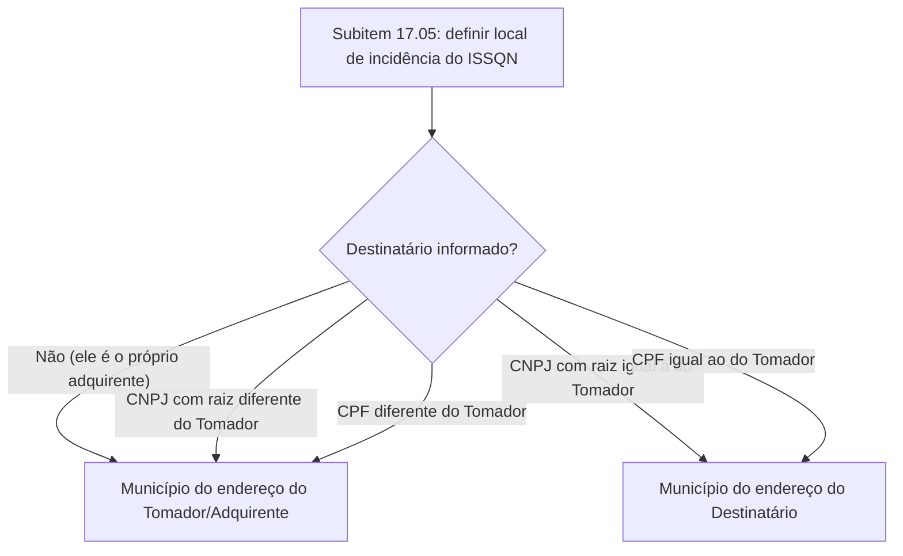

<!-- p.13 -->

# 2.10 Inclusão de regras de validação dos endereços do Tomador/Adquirente e do Destinatário e repercussão na definição do local de incidência do ISSQN em operações com o código de tributação nacional 17.05

Na Sefin Nacional, os endereços do Tomador/Adquirente e do Destinatário deverão ser validados com base nas informações constantes dos cadastros CNPJ/CPF. Essa exigência advém do art. 11 da Lei Complementar nº 214/2025, bem como dos arts. 12 dos regulamentos do IBS e da CBS: Resolução CGIBS nº 6, de 30 de abril de 2026; e Decreto nº 12.955, de 29 de abril de 2026, respectivamente.

Em razão dessa necessidade e com o objetivo de assegurar maior conformidade no tratamento de operações classificadas sob o código 17.05 da Lista de Serviços prevista na Lei Complementar nº 116/2003, referente ao fornecimento de mão de obra, inclusive em caráter temporário, mediante disponibilização de empregados, trabalhadores avulsos ou temporários contratados pelo prestador de serviços, cujo local de incidência do ISSQN corresponde ao local do estabelecimento do tomador do serviço, ficam estabelecidas as regras a seguir.

<!-- p.14 -->

As alterações visam contemplar situações em que, especialmente em operações envolvendo entes governamentais, o documento fiscal seja emitido para um estabelecimento central responsável pela contratação do serviço (Tomador/Adquirente), enquanto o serviço seja efetivamente usufruído por outro estabelecimento da mesma entidade/titularidade (Destinatário), ao qual poderá ser atribuída a incidência do ISSQN, a depender da respectiva legislação municipal.

**1. Validação cadastral para Todas as Operações**

Para todas as operações (todos os subitens), a DPS, ou a NFS-e no caso dos compartilhamentos pelos municípios, deverá ser rejeitada quando o código IBGE do município informado divergir daquele constante no respectivo cadastro do Tomador/Adquirente e/ou do Destinatário.

**2. Definição do local de incidência do ISSQN para os Serviços do Subitem 17.05**

**2.1 Utilização do endereço do Tomador/Adquirente**

O município do endereço do Tomador/Adquirente será definido como local de incidência do ISSQN nas seguintes situações:

- quando o Destinatário não for informado (ele é o próprio adquirente);
- quando o Destinatário for identificado por CNPJ e a raiz do seu CNPJ (primeiros 8 dígitos) for diferente da raiz do CNPJ do Tomador/Adquirente;
- quando o Destinatário for identificado por CPF e o CPF informado for diferente do CPF do Tomador/Adquirente.

**2.2 Utilização do endereço do Destinatário**

O município do endereço do Destinatário será utilizado como local de incidência do ISSQN nas seguintes situações:

- quando o Destinatário for identificado por CNPJ e a raiz do seu CNPJ (primeiros 8 dígitos) for igual à raiz do CNPJ do Tomador/Adquirente;
- quando o Destinatário for identificado por CPF e o CPF informado for o mesmo do Tomador/Adquirente.

Para o subitem 17.05, exclusivamente nas hipóteses previstas nesse item (2.2), acima, será permitida ao emitente a alteração do endereço do Destinatário, constituindo exceção à regra geral de validação cadastral. Nesses casos, não deverá ocorrer rejeição da DPS (ou da NFS-e) em razão de divergência entre o código IBGE informado para o endereço do Destinatário e aquele constante em seu cadastro.

