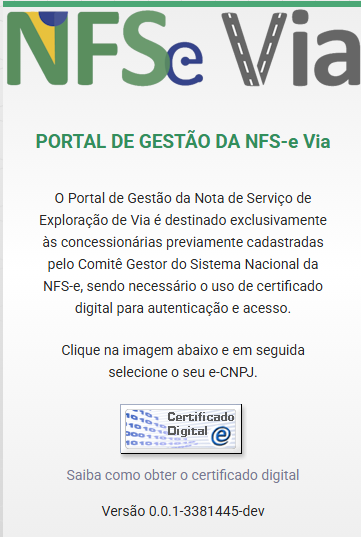

# 1 Acesso ao Portal

<!-- p.03 -->

Para acessar o Portal, é necessário o uso de certificado digital da concessionária. Deve-se usar os seguintes endereços:

a) Ambiente de testes - Produção Restrita
Link https://producaorestrita.via.nfse.gov.br/concessionarias/login

b) Ambiente de Produção
Link https://via.nfse.gov.br/concessionarias/login

> O CNPJ da Concessionária deve ter sido previamente cadastrado no portal nacional pelo Gestor Nacional através da funcionalidade de Cadastro de Concessionárias.
>
> A concessionária que não estiver cadastrada deverá enviar e-mail para concessionarias.nfs-evia@rfb.gov.br o seu cadastramento será providenciado.

<!-- p.04 -->

<!-- REVISAR p.04: texto "Clicar em no certificado" sem o objeto da ação (provavelmente a imagem do botão "Certificado Digital" não foi lida no PDF); transcrito literalmente -->

Clicar em no certificado e inserir a autenticação com certificado digital;

