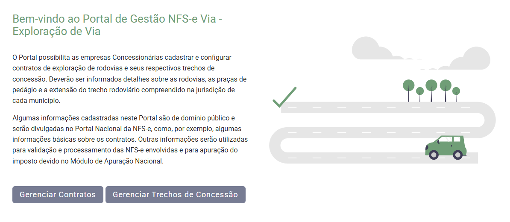
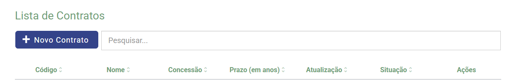
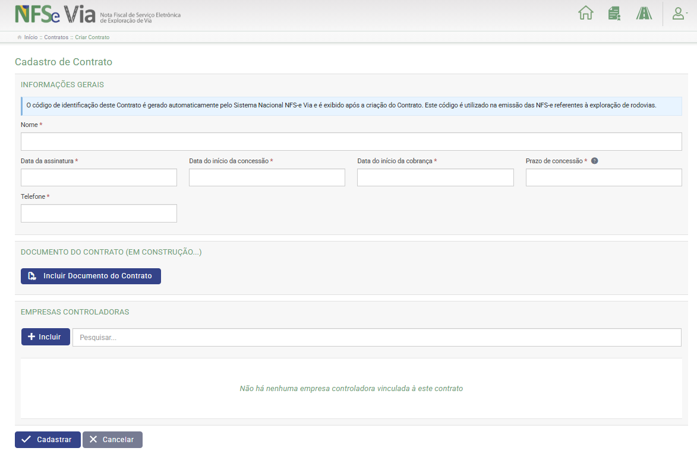
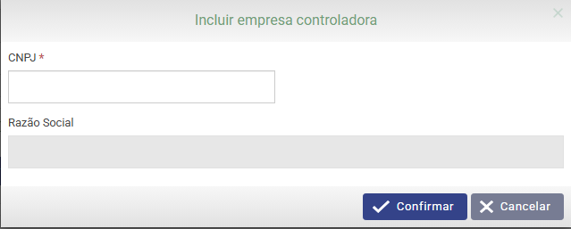
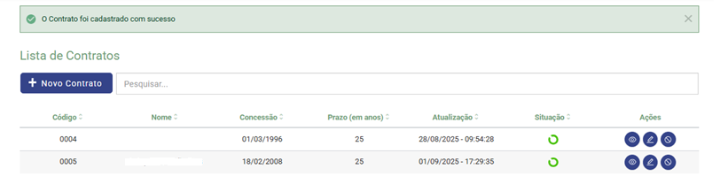

# 2.1 Gerenciar Contratos

<!-- p.05 -->

A Concessionária deve acessa acessa o Portal da NFS-e Via para realizar o cadastro do seu contrato de concessão.

OU

Nesta funcionalidade, a Concessionária realizará o cadastro dos seus contratos de concessão.

Ao clicar em “Novo Contrato”, a concessionária inicia o cadastro de um contrato.

<!-- p.06 -->

Preencher com os dados requeridos:

- Nome: livre, preferencialmente colocar o nome cadastrado na ANTT;
- Documentos do Contrato: Fazer o upload do contrato, seus aditivos e de documento que comprove a extensão da via (em km) para cada um dos municípios abrangidos pela via vinculada ao contrato.
- Empresas Controladoras: obrigatório o cadastrado de ao menos uma empresa.

Ao finalizar o cadastro do contrato, o sistema gerará um código que será usado no leiaute da NFS-e Via.

<!-- p.07 -->

Ao finalizar o preenchimento dos campos e o upload dos documentos, clicar em “Cadastrar”.

O sistema exibirá a tela com a lista de todos os contratos cadastrados, onde é possível “Visualizar”, “Editar” ou “Inativar” qualquer um deles.

