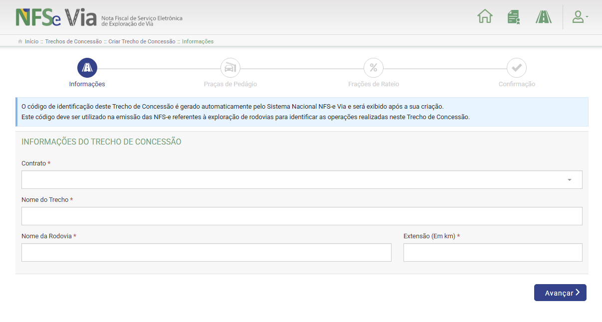
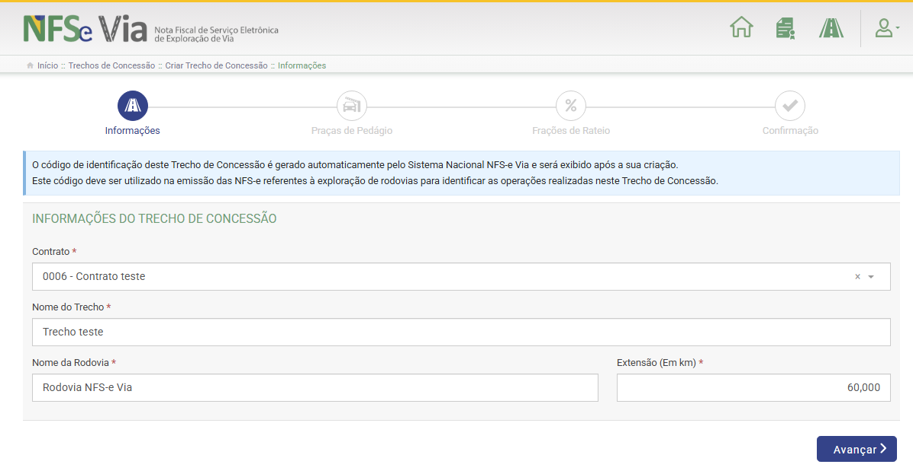

# 2.2.1 Informações

Na tela seguinte, deverá ser preenchido todas as informações referentes ao trecho de concessão:

- Contrato: Ao clicar em contrato, o sistema exibirá a lista de contratos que já estão cadastrados. Deve-se escolher um dos contratos;
- Nome do Trecho: deve-se informar o nome do trecho que se está cadastrando, preferencialmente com o nome descrito no contrato de concessão. Podendo existir variações do tipo: norte-sul, leste-oeste, sul-norte, etc. Quando for necessário o cadastramento de mais de um trecho para um mesmo contrato, por exemplo, nos casos de vias de mão dupla onde as praças de pedágio, municípios e extensão da via for diferente em relação ao sentido da via.
- Nome da Rodovia – Nome descrito no contrato de concessão;

<!-- p.09 -->

- Extensão (em km); extensão total do trecho concedido – pode ser cadastrada com 6 casas decimais;

A figura abaixo mostra um exemplo de trecho de concessão preenchido.

Ao clicar em “Avançar”, o sistema passará para a segunda etapa preenchimento do trecho de concessão: as praças de pedágio.
