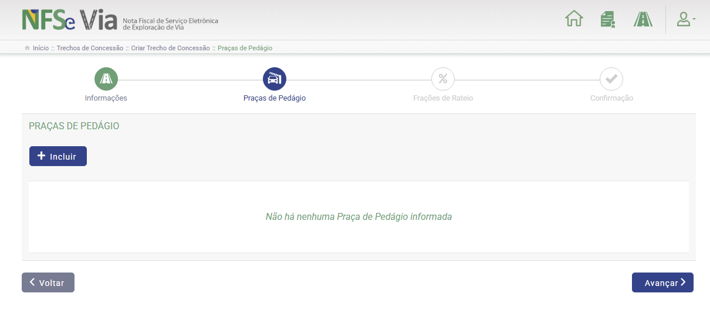
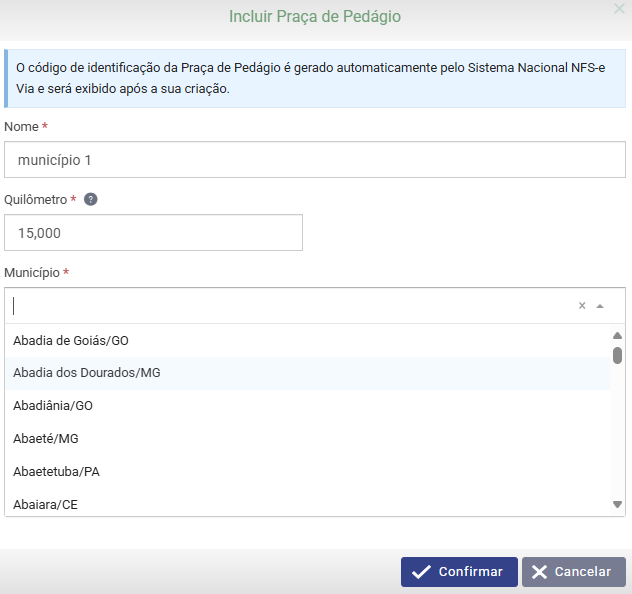
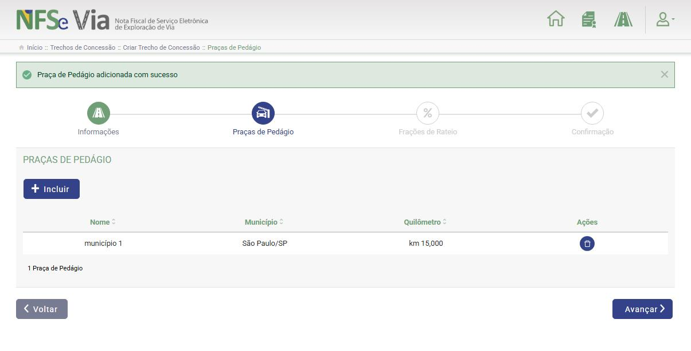
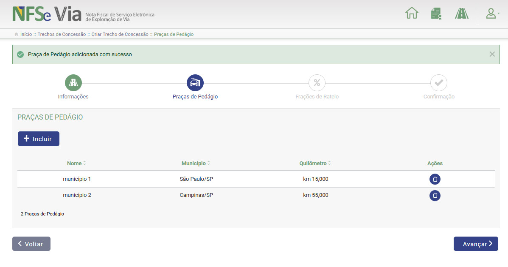

# 2.2.2 Praças de pedágio

O sistema exibirá a tela abaixo onde é possível clicar em “Incluir” para adicionar cada uma das Praças de pedágio do trecho de concessão que se está cadastrando.

<!-- p.10 -->

Na tela seguinte, deverá ser preenchido todas as informações referentes a cada praça de pedágio do trecho.

- Nome: deve-se informar o nome da Praça de Pedágio que se está cadastrando, de forma a facilitar, por parte do usuário do serviço a identificação do local da praça.
- Quilômetro: em qual km da via a praça se localiza ( pode ser cadastrado com 6 casas decimais);
- Município: escolher da lista TOM disponibilizada, o município da via onde a praça se localiza.

<!-- p.11 -->

A figura abaixo mostra um exemplo de trecho de concessão preenchido. Preenchido todos os campos, deve-se clicar em “confirmar”.

Ao confirmar, o sistema listará as praças de pedágio já cadastradas, deve-se clicar em “Incluir”, até cadastrar todas as praças daquele trecho.

<!-- p.12 -->

Nas praças cadastradas neste momento, a data de vigência da praça é a mesma data de início da cobrança do contrato.

Ao finalizar todas as praças, deve-se clicar em avançar. O sistema exibirá a tela “Frações de Rateio”.

Observação: Durante a parametrização de cada trecho de concessão no Portal de Gestão, deve-se providenciar a inclusão de uma praça de pedágio denominada 'PRAÇA ESPECIAL'. Esta praça deve ser selecionada para a emissão da NFS-e Via (campos cPracaEmi e xPracaEmi) sempre que houver a cobrança de valores referentes a cargas especiais (ou excepcionais). Enquadram-se nesta categoria os veículos cujas dimensões (altura, largura e comprimento) ou peso excedam os limites regulamentares fixados pelo Código de Trânsito Brasileiro para o tráfego convencional e que, por serem indivisíveis, exijam cuidados estruturais e operacionais específicos nas vias. Para esses casos, deve-se utilizar no arquivo XML a categoria de veículo '99 – Cobrança Especial' (campo categVeic).
