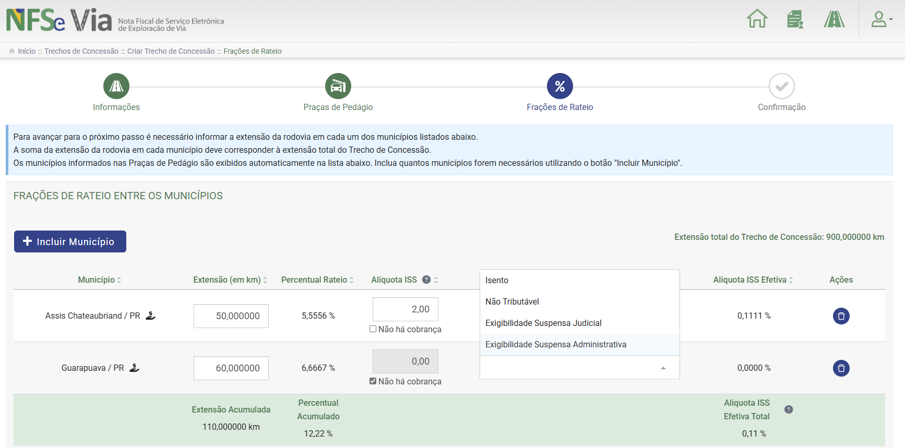
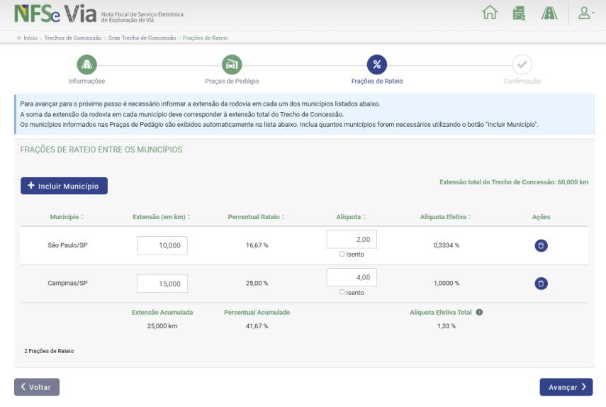
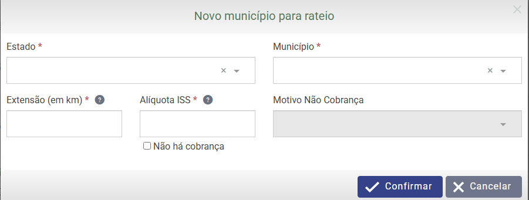
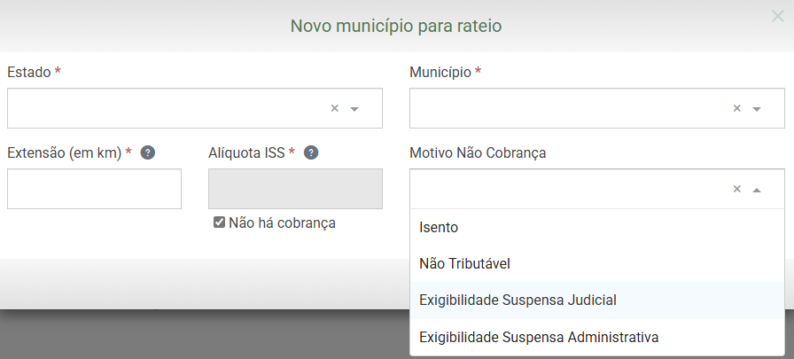
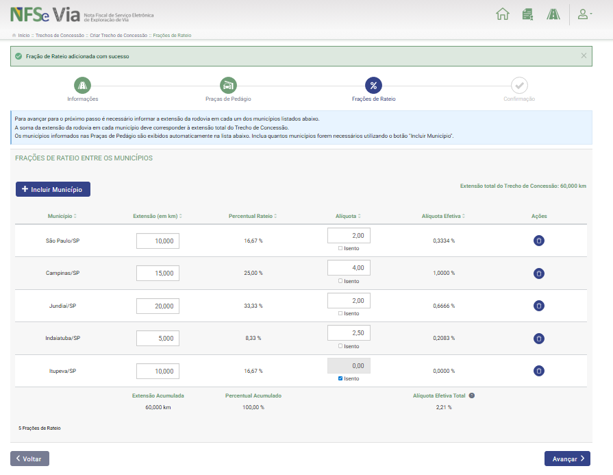
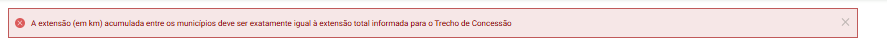

# 2.2.3 Frações de Rateio

Nesta tela, serão exibidos aqueles municípios para os quais foram cadastradas praças de pedágio. Deve-se informar os parâmetros extensão e alíquota para os municípios já cadastrados.

- Extensão (em km): parte da extensão da via que passa pelo município (pode ser cadastrada com 6 casas decimais). Os percentuais de rateio são calculados, pelo sistema, usando-se as frações, porém na tela aparecem com 4 casas decimais, que podem em alguma situação não mostrar o somatório como 100%;
- Alíquota: qual a alíquota do ISS (entre 2 e 5%) para o serviço de exploração de vias (podendo marcar como: Não há cobrança – se for o caso, e o motivo para esta não cobrança: Isento, Não tributável, Exigibilidade Suspensa Judicial ou Exigibilidade Suspensa Administrativa).

<!-- p.13 -->

O sistema exibirá, para cada município cadastrado, o “Percentual Rateio” e “Alíquota Efetiva”.

Deve-se incluir os outros municípios do trecho, clicando em “Incluir Município”. O Sistema abrirá uma tela para a inclusão do município (busca da lista de municípios cadastrados no sistema NFS-e), a extensão (em km) e a alíquota do ISS (podendo marcar como isento – se for o caso).

<!-- p.14 -->

Anotações da figura:

- Informar o Estado da lista.
- O sistema busca da lista de municípios da NFS-e.
- Quantos km do município estende-se a via, para o cálculo da proporção da Taxa Efetiva, pode ser usado 6 casas decimais.
- Alíquota do ISS (entre 2 e 5%). Pode marcar isento, se a concessionária tiver o benefício para aquele município.
- Caso não haja cobrança de tributo naquele município, deve-se marcar este item e, obrigatoriamente, escolher da lista ao lado o motivo da não cobrança.

<!-- REVISAR p.14: os textos de anotação da figura se sobrepõem no PDF (ex.: "6 casas decimais" aparece duas vezes); transcrito o conteúdo legível -->

<!-- p.15 -->

Anotações da figura:

- A extensão acumulada deve ser igual à extensão do trecho da concessão, considera 6 casas decimais.
- Alíquota efetiva do trecho. Este valor será usado no leiaute da NFS-e Via, será considerada somente 2 casas decimais.

Se a extensão acumulada não for igual à extensão do trecho da concessão, o sistema exibirá a mensagem abaixo:

Após preencher as informações de todos os municípios, deve-se clicar em “Avançar”.

Será exibida uma tela com um resumo dos dados cadastrados para o trecho, conferir as informações e clicar em “Salvar Trecho de Concessão”.
