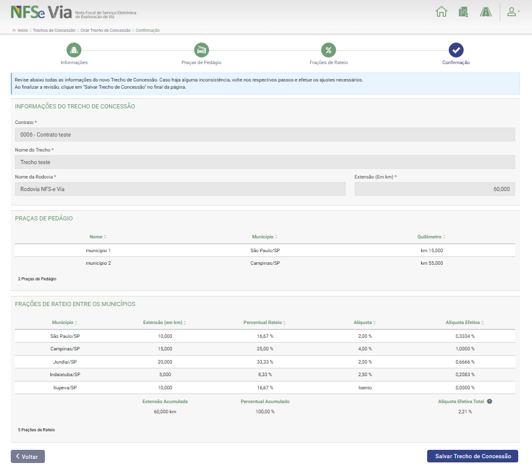
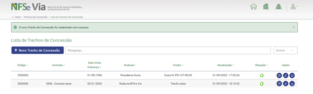

# 2.2.4 Salvar Trecho de Concessão

<!-- p.16 -->

O trecho cadastrado será mostrado na Lista de Trechos de Concessão, com o código do Trecho (gerado pelo sistema), que será usado no leiaute da NFS-e Via.

Anotações da figura:

- Código do Trecho – será usado no leiaute da NFS-e Via.
