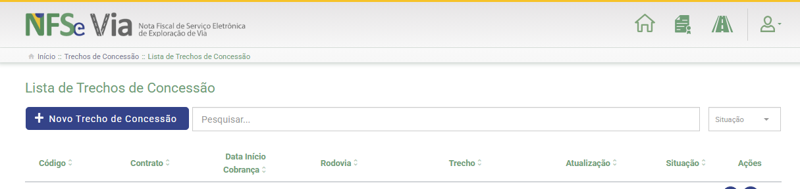

# 2.2 Gerenciar Trechos de Concessão

Após o cadastramento dos contratos, a concessionária deverá iniciar o cadastramento de cada um dos trechos de concessão vinculados àquele contrato.

Para cadastrar os trechos de concessão, é possível fazer isso tanto na página principal do portal, acessando “Gerenciar Trechos de Concessão”, ou no meu da página inicial do Portal.

<!-- p.08 -->

Ao acessar “gerenciar trechos de concessão” o sistema exibirá a tela abaixo onde é possível clicar em “Novo Trecho de Concessão”.

