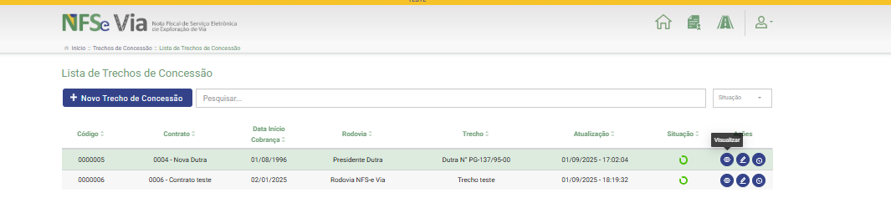
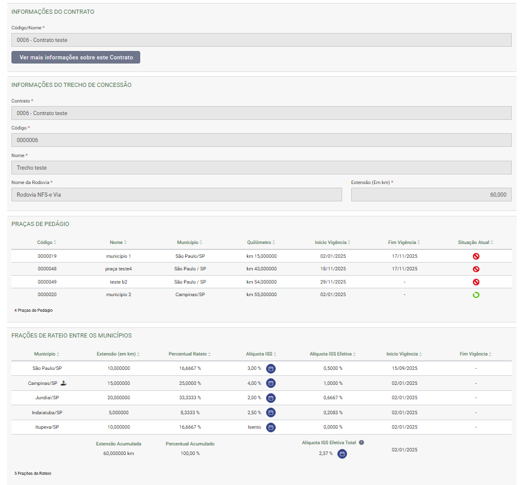

# 2.5 Visualizar trecho

Todos os trechos cadastrados aparecem listados na tela “Visualizar” trechos, onde é possível, visualizar, editar e Inativar os trechos.

Clicando em Visualizar, o sistema exibirá telas com todas as informações cadastradas para o trecho.

<!-- p.17 -->

<!-- REVISAR p.17: a numeração do original pula de 2.2.4 para 2.5 (não há 2.3 nem 2.4); mantida como no original -->

Anotações da figura:

- Código do contrato – será usado no leiaute da NFS-e Via.
- Código do trecho – será usado no leiaute da NFS-e Via.
- Códigos da Praça – será usado no leiaute da NFS-e Via.

Pode também acessar as informações do contrato ao qual o trecho está vinculado, clicando em “Ver mais informações sobre este Contrato”.
