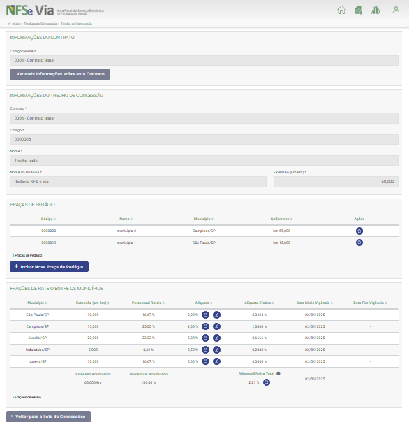
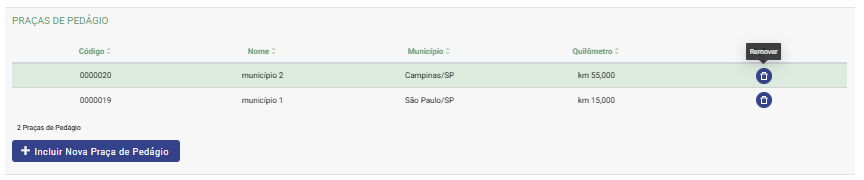
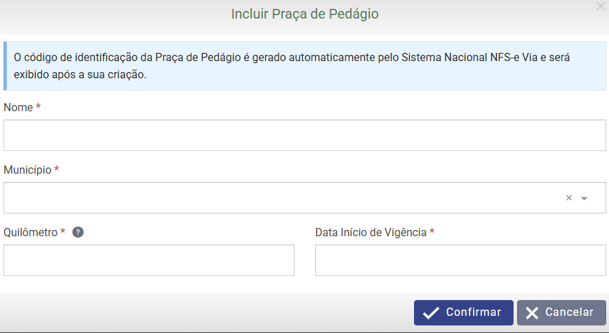

# 2.6.1 Editar praça de pedágio

<!-- p.19 -->

Uma das informações possíveis de serem editadas é “Incluir Nova Praça de Pedágio” ou “Remover” uma praça de pedágio.

Para remover, deve-se clicar no ícone “remover” do lado direito da tela.

Para Incluir, deve-se clicar em “Incluir Nova Praça de Pedágio”, o sistema exibirá a tela do item 2.2.2. Somente é possível incluir uma praça em um município já cadastrado para o trecho.

<!-- p.20 -->

Ao incluir uma praça de pedágio, num trecho cadastrado anteriormente, é necessário incluir a data de vigência para esta praça, que deve ser uma data futura ( no mínimo d+1 em relação ao dia do cadastramento).

