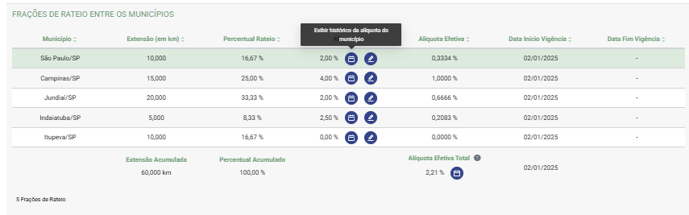
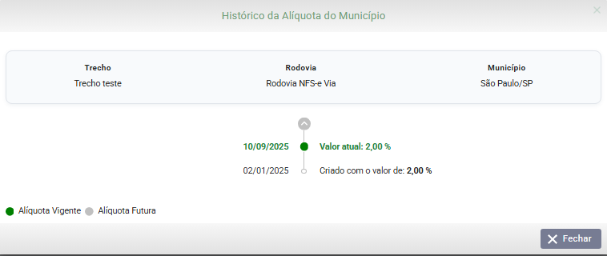
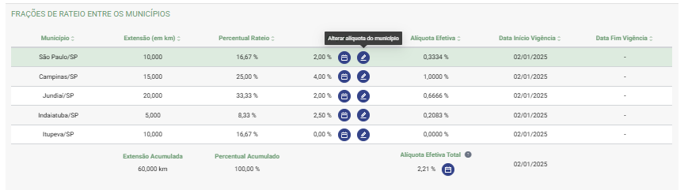
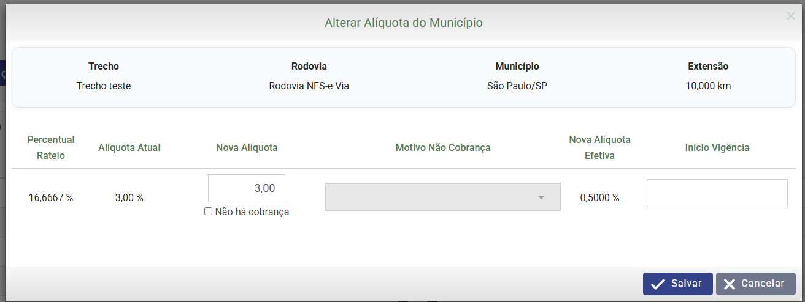
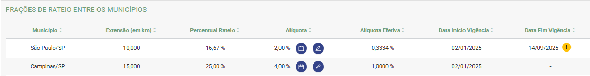
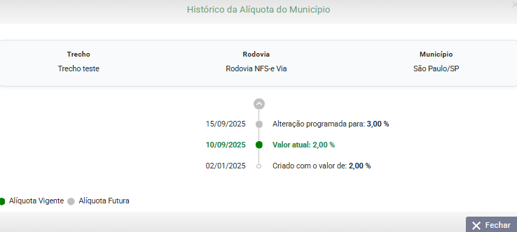
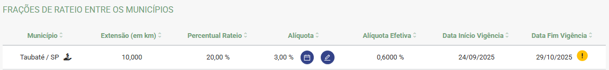
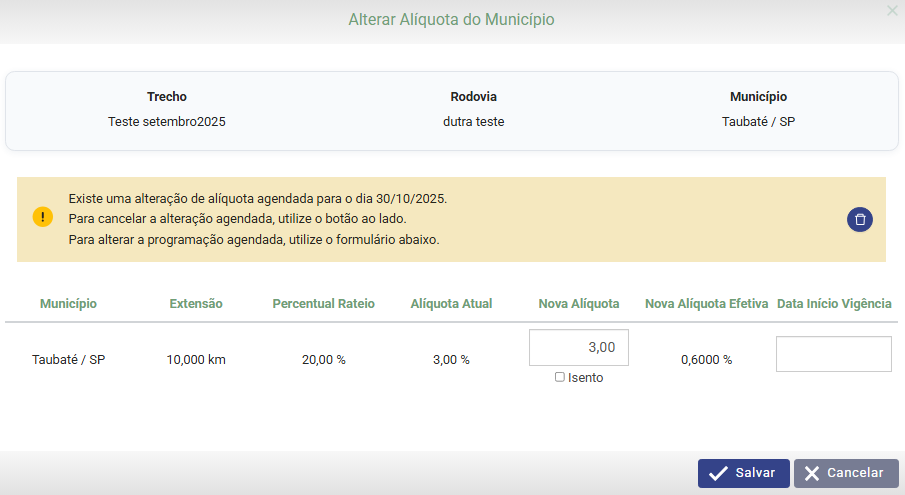

# 2.6.2 Editar alíquotas

É possível visualizar o histórico das alíquotas cadastradas, deve-se acessar o ícone “Exibir histórico da alíquota do município”:

O sistema exibirá uma tela onde mostra as datas em que a alíquota foi cadastrada e as alterações feitas. Exibe ainda a alíquota vigente e uma alíquota futura, caso tenha sido cadastrada.

<!-- p.21 -->

Caso haja uma alteração de alíquota de algum dos municípios abrangidos pelo trecho, é possível fazer a alteração cadastrando uma alíquota futura, para entrada em vigor em qualquer dia a partir do dia seguinte à alteração.

Para isso, clicar em “Alterar alíquota do município”:

O sistema exibirá uma tela onde mostra os dados do município: Extensão, Percentual Rateio, Alíquota Atual. Mas também os campos editáveis “Nova Alíquota” e “Data Início Vigência”.

Os dois campos devem ser informados, em seguida clicar em “Salvar”.

<!-- p.22 -->

Ao retornar à tela, será mostrada a “Data Fim Vigência” para o município que teve uma alíquota futura cadastrada.

Ao exibir o histórico de alíquota para o município cadastrado, será exibida a programação para a alíquota futura.

Somente é permitido o cadastro de uma alíquota futura para cada município.

É possível EXCLUIR uma alíquota futura cadastrada para determinado município. Clicar em “Alterar alíquota do município”, o sistema mostrará o município, com a mensagem de que “Existe uma alteração de alíquota agendada para o dia xx/xx/xxxx”, com duas opções:

- Para cancelar a alteração agendada, utilize o botão ao lado
- Para alterar a programação agendada, utilize o formulário abaixo.

<!-- p.23 -->

Se o ícone da lixeira for utilizado, o sistema desconsidera a alíquota futura anteriormente cadastrada.
