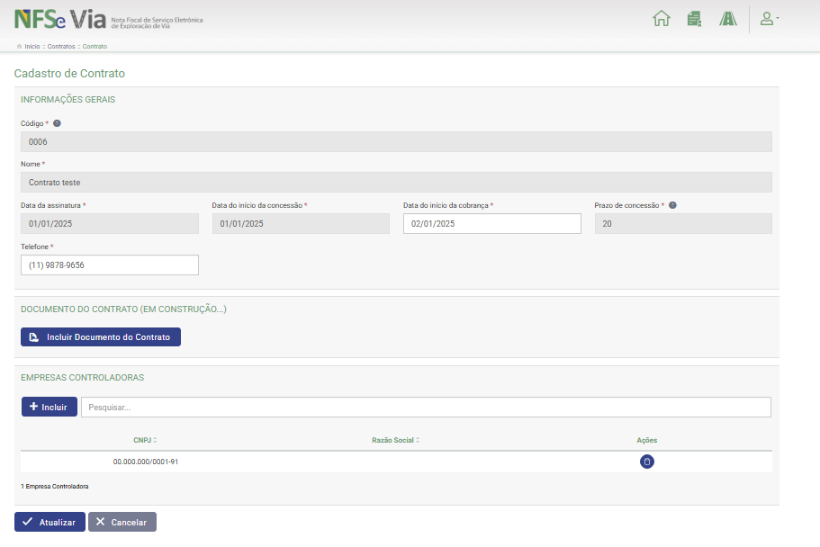

# 2.6 Editar trecho

<!-- p.18 -->

Ao clicar em “Editar”, o sistema exibirá uma tela com todas as informações do trecho cadastrado, com algumas delas podendo ser editadas.

- Incluir e remover praças de pedágio;
- Alíquota municipal;

