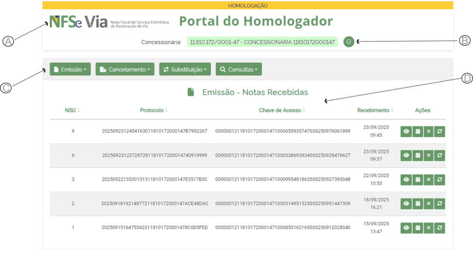
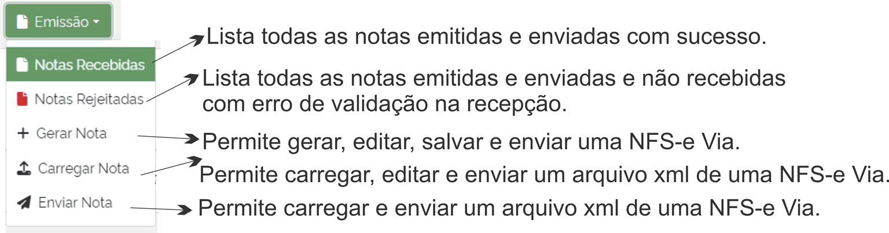
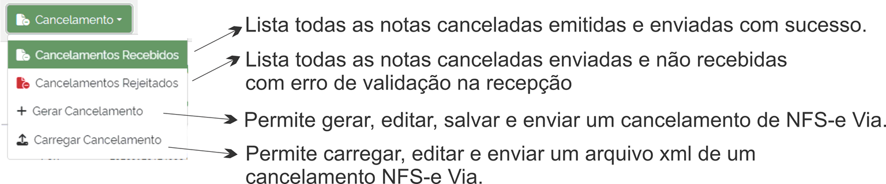
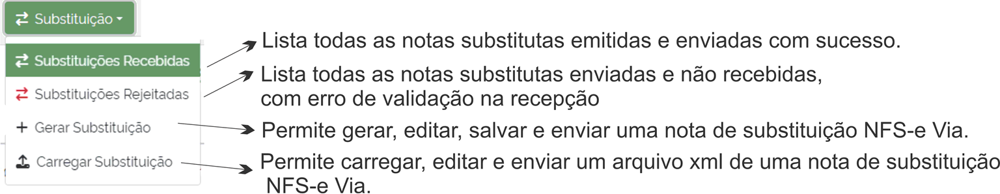
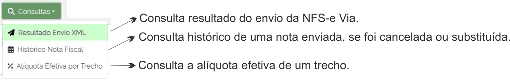

<!-- p.05 -->

# 4.1 Tela Inicial

Após seleciona o CNPJ a tela inicial está organizada nos seguintes elementos:

*Tela inicial do perfil Concessionária, com os elementos A (logo), B (perfil do usuário), C (menu de acesso) e D (área central).*

<!-- p.06 -->

A – Logo da aplicação: Identificação do sistema.

B – Perfil do usuário: Exibe nome do usuário logado e botão que direciona para tela de entrada com as opções de alteração de perfil.

C – Menu de acesso: Agrupado por assuntos com submenus das funcionalidades.

**Emissão**

**Cancelamento**

**Substituição:**

**Consulta:**

D – Área Central (Painel Principal): Lista com todos a notas já enviadas e recebidas com sucesso, com informação do NSU geral, protocolo de retorno da recepção, chave de acesso da nota, data e horário de recepção e menu de atalhos para funcionalidades e Ações (Atalhos) com acesso direto as funcionalidades que permitem detalhar uma nota, verificar o histórico de uma nota, cancelar uma nota e substituir uma nota.
