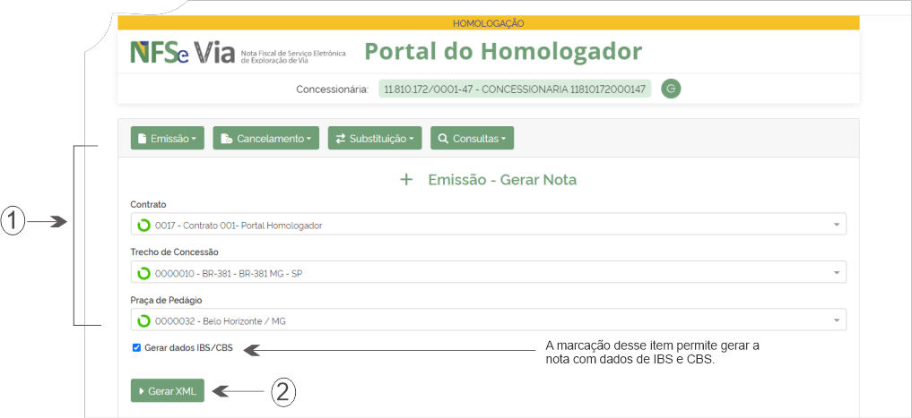
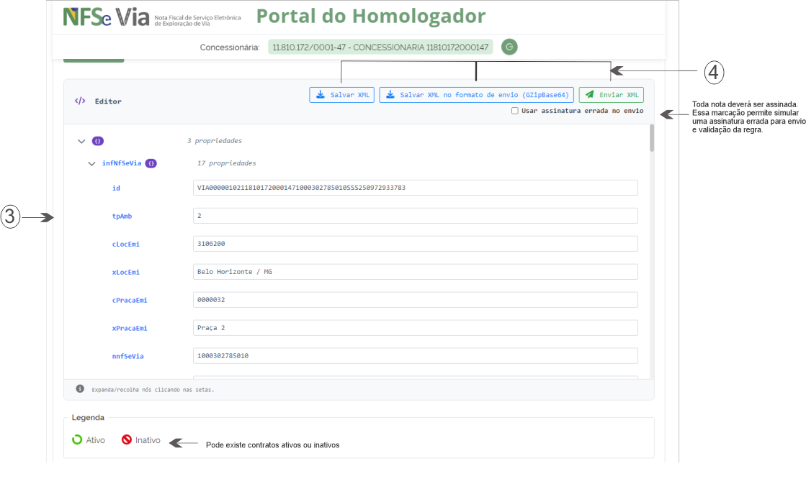
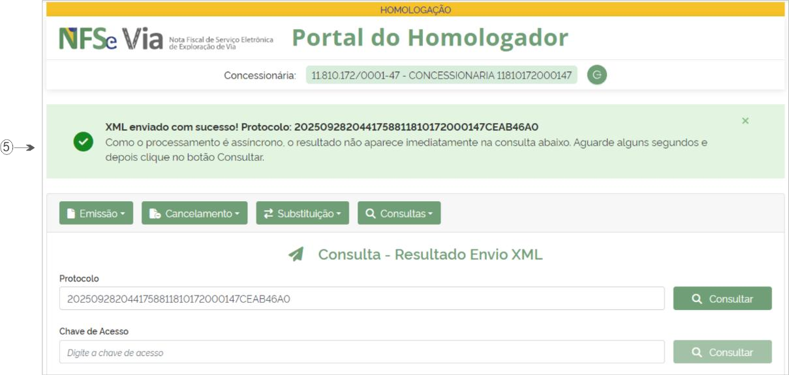

<!-- p.07 -->

# 4.2.1 Emissão – Gerar Nota NFS-e Via

Essa funcionalidade foi desenvolvida para facilitar a homologação do envio de uma NFS-e Via para o ambiente nacional. Permitindo ao usuário gerar, editar e enviar um nota sem necessidade de montar manualmente arquivos XML, possibilitando realizar testes de validação de regras no envio da nota.

Como funciona na prática:

1. Acesse o menu Emissão – Gerar nota, selecione Contrato, Trecho de Concessão e a praça de Pedágio. É necessário que exista um contrato previamente cadastrado no Portal da Concessionária com o mesmo CNPJ utilizado para logar no perfil . Sem esse vínculo, não irá aparece as opções e a nota não poderá ser gerada.
2. Ao clicar em “Gerar Nota”, o sistema reúne os dados do Contrato, Trecho de Concessão e da praça de Pedágio selecionados, e cria a nota no formato exigido pela API.

<!-- p.08 -->

*Tela Emissão – Gerar Nota: seleção de Contrato, Trecho de Concessão e Praça de Pedágio, com a opção de gerar dados IBS/CBS e o botão Gerar XML.*

3. Após a geração, a nota fica disponível para edição. Isso permite alterar os dados para validação de regras. Verifique nos requisitos de validação da NFS-e Via o que é cada campo e quais regras deve ser testadas.

*Editor da NFS-e Via, com as opções Salvar XML, Salvar XML no formato de envio (GZipBase64) e Enviar XML.*

4. Você pode salvar o documento no formato de um XML, no formato padrão de envio (GzipBase64) em arquivo local, ou enviar a nota diretamente para o ambiente nacional da NFS-e Via, conforme o fluxo da concessionária.

<!-- p.09 -->

5. Após o envio para o ambiente nacional a API retorna um protocolo de recebimento, que será usando para consultar o resultado da validação dessa NFS-e Via.

*Mensagem de envio com sucesso e protocolo gerado; o resultado é consultado em Consultas – Resultado Envio XML.*
