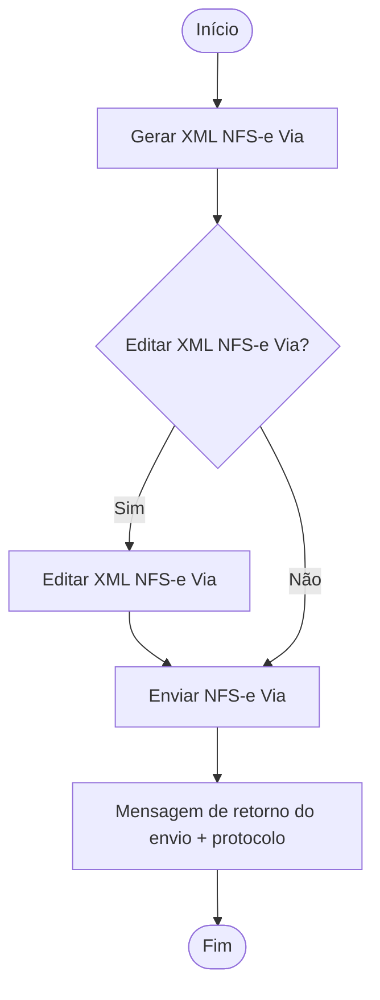

<!-- p.07 -->

# 4.2 Fluxo para homologação – Gerar e Enviar NFS-e Via

*Para iniciar o processo de geração de NFS-e Via é necessário existir o cadastro do contrato / trecho para o CNPJ utilizado no perfil.*

*Esse protocolo poderá ser usado para consultar o resultado da validação da NFS-e Via.*
