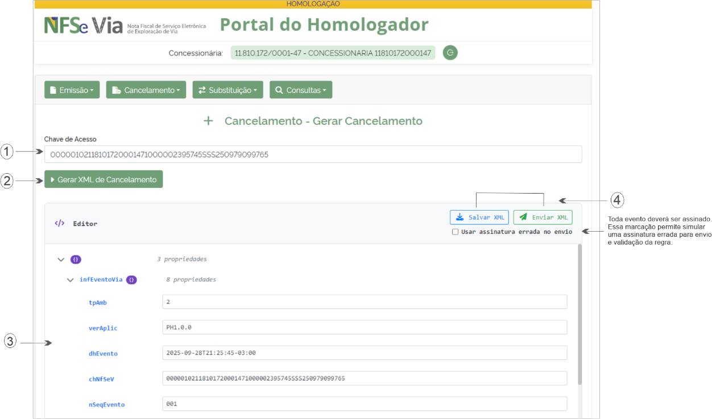
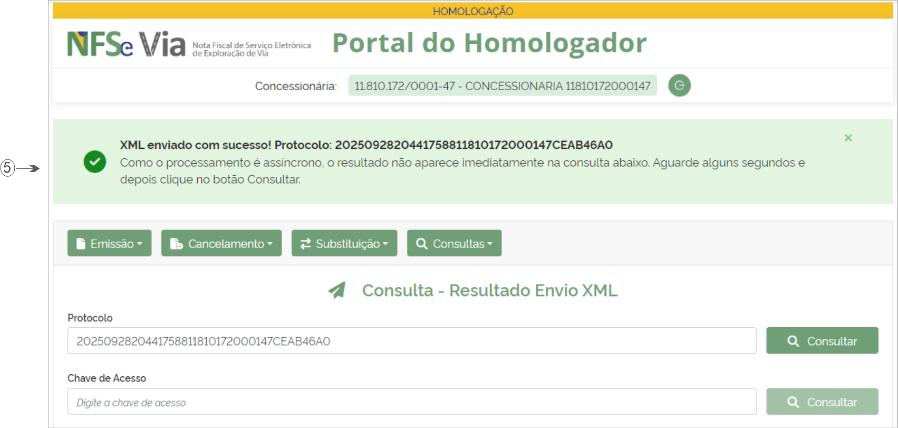

<!-- p.09 -->

# 4.3.1 Cancelamento – Gerar Evento de Cancelamento NFS-e Via

Essa funcionalidade foi desenvolvida para facilitar a homologação do envio de um evento de cancelamento de uma NFS-e para o ambiente nacional. Permitindo ao usuário gerar, editar e enviar um Evento de Cancelamento de uma NFS-e sem necessidade de montar manualmente arquivos XML, possibilitando realizar testes de validação de regras no envio do evento.

<!-- p.10 -->

Como funciona na prática:

1. Acesse o menu Cancelamento – Gerar Cancelamento, informe a chave da nota que deseja gerar o evento de cancelamento.
2. Ao clicar em “Gerar XML de Cancelamento”, o sistema gerará um xml do evento no formato exigido pela API.

*Tela Cancelamento – Gerar Cancelamento: chave de acesso da nota, botão Gerar XML de Cancelamento e editor do evento.*

3. Após a geração, o evento de cancelamento da nota, fica disponível para edição. Isso permite alterar dados para validação de regras. Verifique nos requisitos de validação do evento de cancelamento de uma NFS-e Via, o que é cada campo e quais regras deve ser testadas.
4. Você pode salvar o documento no formato de um XML em arquivo local, ou enviar o evento de cancelamento diretamente para o ambiente nacional da NFS-e Via, conforme o fluxo da concessionária.
5. Após o envio para o ambiente nacional a API retorna um protocolo de recebimento, que será usando para consultar o resultado da validação do envio do evento de cancelamento.

<!-- p.11 -->

*Mensagem de envio com sucesso e protocolo gerado para o evento de cancelamento.*
