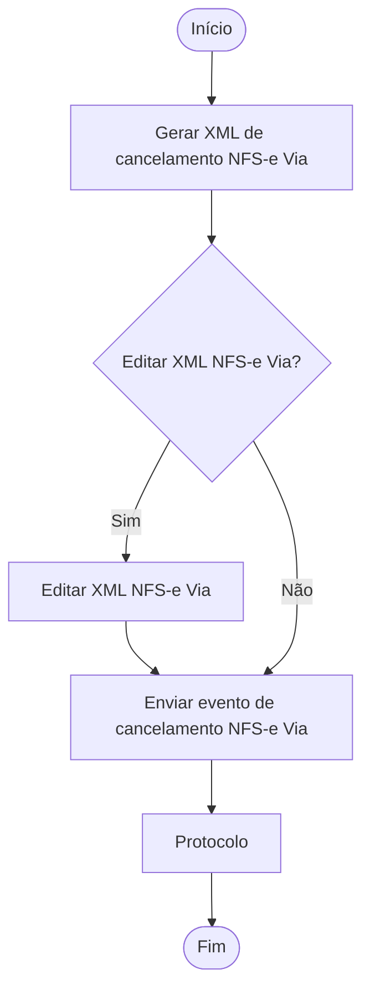

<!-- p.09 -->

# 4.3 Fluxo para homologação – Gerar Evento Cancelamento e Enviar

*Para iniciar o processo de geração de um Evento de cancelamento de uma NFS-e Via é necessário existir uma nota já cadastrada e enviada com sucesso para o ambiente nacional.*

*Esse protocolo poderá ser usado para consultar o resultado da validação do evento de cancelamento da NFS-e Via.*
